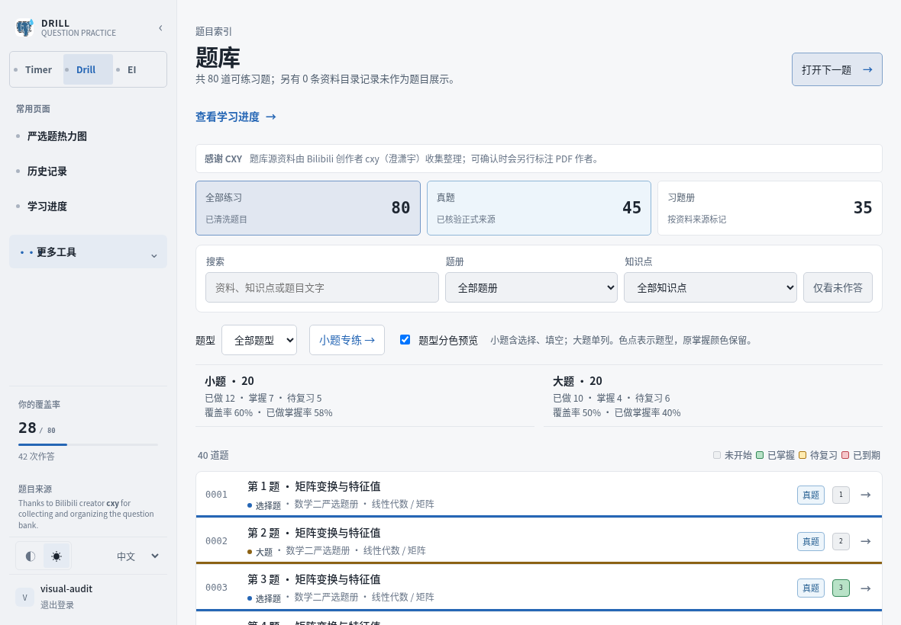
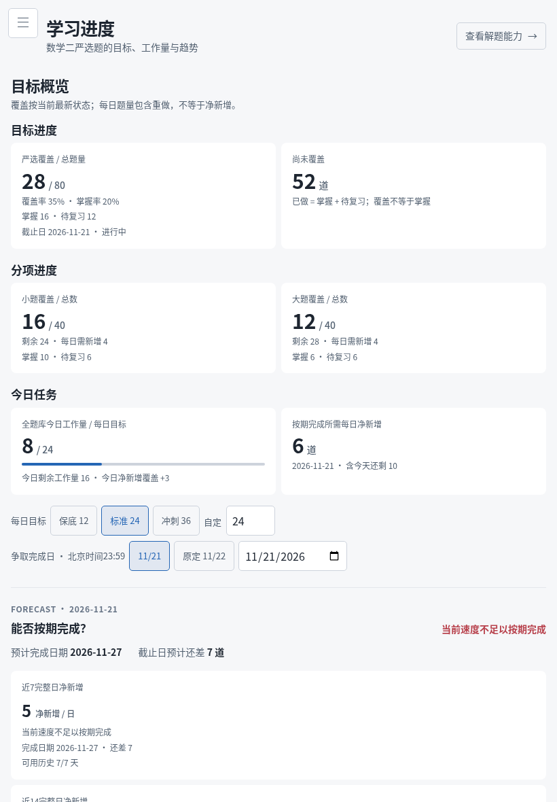
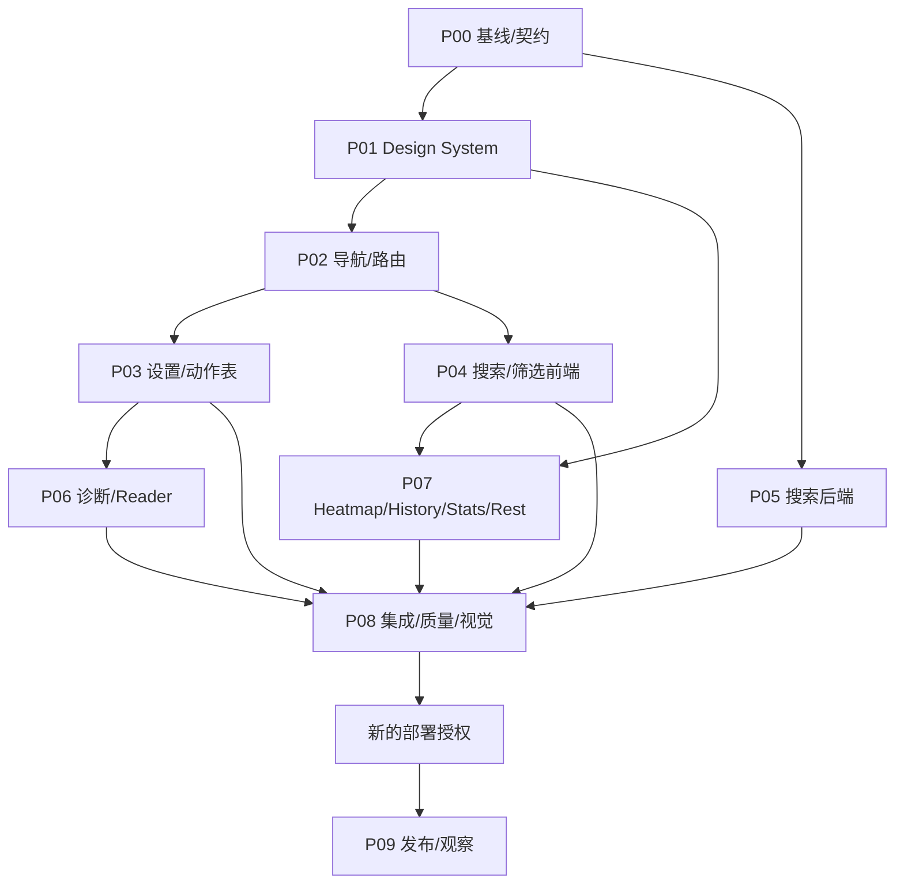

# Drill / EI / Learning OS — Master UI/UX Rebuild Plan

版本：1.0 · 研究基准日：2026-11-12 · 施工目标执行者：Sol Medium + 有明确文件所有权的 Subagents。

**文档性质：施工规范，不是已实施报告。** 本轮只做公开研究、源码审计、只读生产聚合、当前构建的合成数据截图和文档编写。未修改业务代码、未提交 Git、未迁移数据库、未部署。本文所有“新增 / 删除 / 执行”均属于后续施工任务。标注“已验证”的仅指本轮真实取得的证据。

### 施工导航

[需求追踪](#chapter-2) · [真实架构](#chapter-3) · [Design Tokens](#chapter-11) · [外观/强调色](#chapter-12) · [组件契约](#chapter-13) · [侧边栏](#chapter-14) · [设置](#chapter-15) · [搜索筛选](#chapter-16) · [搜索后端](#chapter-17) · [练习保护](#chapter-18) · [响应式](#chapter-20) · [Phase 0–9](#chapter-22) · [并行与续接](#chapter-23) · [测试](#chapter-24) · [视觉验收](#chapter-25) · [部署回滚](#chapter-26) · [文件映射](#chapter-28) · [DoD](#chapter-29) · [Sol执行指令](#chapter-30) · [证据来源](#chapter-31)

<a id="chapter-1"></a>

## 1. Executive Summary

采用一个共享的 Vue 设计基础，继续保留 Timer 和 Drill 两个 Vite 入口；EI 继续复用 Drill 的构建、按 workspace 隔离数据。全局背景改为 RGB 相等的中性灰；Appearance 默认 System，与十种 Accent 完全解耦。导航采用 Linear 的浅层分组、整行中性选中和稳定 Header；设置采用分组行；题库采用 Search + Filters + Sort 工具栏；诊断采用一次点击选择的多选行。禁止引入 React、整套新 UI 框架、品牌复刻及大面积装饰。

搜索推荐 **PostgreSQL 15 内的可重建派生检索表 + 字段化词项倒排 + 中文短词专用策略 + 小词典英文纠错 + 数学规范词项 + 稳定加权排序**。不部署独立搜索服务，不把私人 Note、答案或整卷正文混入共享题目索引。列表、数量、题型统计和做题导航共享搜索候选集合；连续翻题仍遵守原有书序语义。搜索迁移只增加派生结构，不重写题目 UUID、分类或学习记录。

先建立基线、Tokens 和基础控件，再并行施工 UI 与 Search。每阶段交付代码、测试、截图和进度记录；Phase 8 独立验收后，Phase 9 才能发布。**本轮明确禁止生产操作，历史部署授权不适用于本轮；后续执行者须获得新的明确部署授权。**

权威基线：本地 `/home/eh/precision-study-ui-20261111`，分支 `codex/precision-study-ui-20261111`，HEAD `6b83e2924b9042e75e87bc091ea7f24e0948f8ee`；审计开始时工作树干净。生产同 revision，镜像 `time-tracker-ha:20261112-design-6b83e29`，healthy。GitHub `master` 为 `2701ec84730d67f0d4ae37a12f30db7c3138585d`，与已部署功能分支不同；**不能从 master 直接开始并覆盖已上线功能，也不得未经比较强推 master。** 后续 Phase 0 重新核对实际 HEAD，差异需记录到任务台账。

<a id="chapter-2"></a>

## 2. 用户需求逐项核对表（R01–R16）

每个 R 都是必须完成的范围。`Dxx` 为设计决策，`Pxx-*` 为施工任务，`Txx` 为测试组，`E-*` 为验收证据。测试规格在 §24，任务在 §22，证据在 §25。不得只勾“代码完成”就勾 R 完成。

| 需求 | 完整保留的交付范围 | 决策 → 真实代码 | 施工任务 | 测试 → 必须存在的证据 |
|---|---|---|---|---|
| R01 | 去除普通蓝/黄/绿描边，建立 Primary、Secondary、Plain、Icon、Menu Trigger、Segmented、Toggle、Checkbox、Select/Pop-up、Context Menu、Selection Row、Destructive 全套语义 | D01；两套 `styles.css`、`QuestionView.vue`、`ReaderPracticeActions.vue`、`SettingsView.vue` | P01-UI、P03-ACTIONS、P06-DIAG、P07-REST | T01/T04/T08；E-controls、E-border-inventory |
| R02 | 浅色去线框拼接；只保留有结构意义的边界，不以阴影替换每个框 | D02；两套样式、Practice/Progress/Insight/Settings | P01-TOK、P03-SET、P04-FILTER、P07-STATS | T01/T09；所有 Light 基线/改后配对图 |
| R03 | 找出并删除导航圆点生成根因；应用布局去 Markdown block 感；保留题干/Note Markdown | D03；Drill `styles.css:102/107`、Timer `SidebarItem.vue` 与样式 `:207–208` | P02-NAV、P07-REST | T03/T08；E-nav-dom、E-markdown |
| R04 | Linear 结构、密度、分组、图标、active、footer、collapse、响应式；高频入口不增加步骤 | D04；Drill App、Timer navigation/* | P02-NAV、P02-ROUTES | T03/T10；E-sidebar 全设备、点击步数表 |
| R05 | System/Light/Dark、默认System、持久化、启动无闪烁；移除常驻太阳/月亮 | D05；两个 uiPreferences.ts、两个 index.html、SidebarPreferences/App | P01-THEME、P03-SET | T02；E-theme-first-frame、PWA 重启录像 |
| R06 | 所有全局背景纯中性，Accent 不染色背景；禁止渐变和蓝紫大容器 | D06；两套 token 声明、EI局部覆盖 | P01-TOK、P07-REST | T01/T09；20组合computed-style审计 |
| R07 | 独立的至少十色、亮暗可读、Monochrome、持久化、语义色不被覆盖 | D07；Settings theme-options、旧data-theme、chartTheme | P01-TOK、P01-THEME、P03-SET、P07-STATS | T01/T02/T09；E-accent-contrast、10×2控件图 |
| R08 | 完整 Settings 分组行；Account/Appearance/Accent/General/Preferences 对应真实功能；所有既有设置保留权限 | D08；Timer Settings、Drill新增Settings、现有设置API | P03-SET、P02-ROUTES | T04/T07；E-settings-role-matrix |
| R09 | App Store式 Search/Filters/组合/清除/计数/排序/空结果/触控浮层；保留全部筛选 | D09；Practice、ExamTypeControls、workspace.ts | P04-FILTER、P04-STATE | T05/T10；E-filter-parity、E-search-flow |
| R10 | 全链路中文/英文/短词/容错/别名/公式/扫描元数据/相关性/建议/分页/URL/性能/迁移回滚 | D10；Practice、views.py、models.py、drill_sources、独立Timer搜索 | P05-INDEX、P05-RANK、P05-API、P05-BENCH、P04-STATE | T06/T07/T11；E-search-baseline/qrels/metrics/explain/migration |
| R11 | A–D八诊断重构为多选行；保留单击、主因、保存、历史、iPad密度 | D11；QuestionView内嵌诊断与diagnostics.py | P06-DIAG | T08；E-diagnosis-state-trace、触控录像 |
| R12 | 收藏/分享/下次复习/勘误/历史/诊断/题图/全屏/更多/作答/下一题/搜索/筛选/排序/导航/设置全覆盖 | D12；Question、Reader、Practice、导航、公共Button | P03-ACTIONS、P06-READER、P07-REST | T01/T08；E-action-inventory、行为回归 |
| R13 | 全页面清理嵌套卡片/重复半径/阴影/边框/色块/过大空隙，保留密度和数字可读性 | D13；全views目录见§28 | P04-FILTER、P07-STATS、P07-HEAT、P07-HISTORY、P07-REST | T09；E-surface-audit及页面配对图 |
| R14 | 做题/计时/翻题/历史/掌握/待复习/诊断/热力图/统计/数据完整；状态色限面积且一致 | D14；Question/FullscreenReader/foregroundTimer/recovery/models | P06-DIAG、P06-READER、P08-REG | T07/T08/T12；E-invariant-diff、E-reader-baseline |
| R15 | iPhone/iPad双方向/桌面/PWA、safe-area、键盘、浮层、滚动、旋转、裁切全部验收 | D15；shell/Popover/Reader/图表/PWA | P02-NAV、P04-FILTER、P08-VIS | T10/T12；E-device-matrix、实体Safari签收 |
| R16 | Typography/Spacing/Radius/Neutral/Accent/全部基础控件/数据/加载空态焦点/响应式跨应用一致 | D16；frontend/shared 新基础 + 两应用适配 | P01-*、P07-REST、P08-VIS | T01/T09；E-cross-workspace-gallery |

用户最后22项效果有独立映射，见 §29，不以此16行替代。

<a id="chapter-3"></a>

## 3. 当前代码库结构与系统架构

### 3.1 真实技术栈与边界

- `frontend/package.json`：Vue `^3.5.13`、Vue Router `^4.6.4`、TypeScript `^5.7.2`、Vite `^5.4.11`、Vitest `3.2.6`、ECharts `^6.1.0`、Element Plus `^2.8.8`、icons-vue `^2.3.1`。这些是声明范围；Phase 0从lock记录实际版本，禁止顺手升级依赖。
- Timer：`frontend/src/main.ts`、`App.vue`、`routes.ts`、`router.ts`、`styles.css`；Element Plus按已有注册表加载。构建 `frontend/dist`，public base `/static/app/`。
- Drill/EI：`frontend/drill/src/main.ts`、`App.vue`、`styles.css`；共用同一构建 `frontend/drill-dist`，base `/static/drill/`。不需要把Timer Element Plus注册引入Drill。
- 已共享：`frontend/shared/foregroundTimer.ts`、`learningRecovery.ts`。设计基础继续放此共享层；不是新应用。
- `requirements.txt`：Django4.2系列、DRF、psycopg、WhiteNoise、Gunicorn、allauth、PyMuPDF。生产本轮读到 Django **4.2.30**、DRF **3.17.2**、PostgreSQL **15.19**。开发无DATABASE_URL时走SQLite；不能把SQLite通过当PG检索索引验证。
- 主后端：`drill/models.py/views.py/urls.py/serializers.py`；EI由 `QuestionDocument.workspace` 和请求host/site隔离；`tracker/*`管理Timer；`drill_sources/*`保存原卷及题锚。
- PWA：`deploy/pwa/manifest.webmanifest/navigation.js`、两index HTML；**没有Service Worker，没有离线业务响应缓存**。IP origin统一安装，域名是不同origin。

### 3.2 生产拓扑（只读核对，不能把旧README日期当当前版本）

```mermaid
flowchart LR
  U[Safari / Browser / PWA] --> IP[47.95.10.128 HTTPS Nginx]
  U --> EDGE[98.142.241.45 域名TLS与分享代理]
  EDGE --> IP
  IP --> WEB[47 Docker Gunicorn 127.0.0.1:18000]
  WEB --> DB[(47 PostgreSQL 15 唯一业务写入节点)]
  IP --> PWA[/var/www/time-tracker-pwa]
  WEB --> STATIC[WhiteNoise staticfiles + 两套Vite产物]
```

47 Nginx对 `/drill/`、`/ei/`剥前缀并设置对应Host；内部Django `/settings`、`/practice`不是公网前缀路径。生产镜像由 `/etc/systemd/system/time-tracker-ha-web.service.d/20-local-ports.conf`指定；另有`25-native-client.conf`；使用`/usr/local/bin/time-tracker-docker`连接现有Snap daemon。PWA脚本由Nginx独立目录提供，构建镜像不会自动更新它。98只代理到47，分享资产缓存/鉴权链保持原状；不得复制业务数据库到98。NUC不是在线主库。大文件与NUC传输按用户指令用 `scp -P 10000 ... eh@98.142.241.45:...`；该端口指向NUC，98管理SSH仍是root的22端口。

### 3.3 数据与当前搜索覆盖

本轮在显式只读事务、10秒statement timeout下取得汇总，未打印用户文本：

| workspace | 全部Question | 可练习 | prompt_text非空 | latex_text非空 | content_mode |
|---|---:|---:|---:|---:|---|
| Drill | 6,392 | 5,847 | 5,861 | 0 | image 2,880 / mixed 1,817 / text 1,695 |
| EI | 2,889 | 2,830 | 296 | 0 | image 2,593 / markdown 296 |

非空prompt不等于OCR完整或高质量。题目表含索引约15.0MiB，Topic约0.86MiB，Document约0.14MiB；只见B-tree等现有普通索引，无检索GIN/GiST。`pg_trgm`1.6、`unaccent`1.1可用但未安装。迁移：drill到`0035_learning_recovery`，tracker到`0021_alter_knowledgepoint_category_and_more`。这些数量不是目标进度定义，不得硬编码进UI。

### 3.4 必须保护的现有能力

`/progress`已独立，不再迁移一次；热力图快捷状态、下一未做题、异步返回恢复已有；History有Attempt和Note独立分页；更多工具已Teleport避免原侧栏裁切；EI cockpit溢出已有修复；Practice已有400ms防抖、AbortController与sequence；Reader已有native dialog、缩放和safe-area；Note版本冲突、submission key幂等、Timer lease恢复与账号隔离已有。新任务在它们之上施工，任何“重新实现”必须先说明真实缺口。

<a id="chapter-4"></a>

## 4. 当前 UI/UX 问题审计

### 4.1 证据等级

`CODE`=读到实际源码；`PROD-RO`=生产只读聚合/配置摘要；`VIS-FIXTURE`=当前6b83e29构建、真实Vue/CSS、合成只读API截图；`OFFICIAL-DOC/CODE/IMAGE`分别为官方说明、公开源码、官方图像；`DECISION`=本计划工程决定。**当前消息没有附带可读取的ChatGPT/iPad截图；未声称看过用户未附的图片。** 现有命名含`actual-`的旧截图也使用合成API，不视为生产学习数据或真实Safari证据。

本轮新增8张Light/Dark当前构建截图及DOM度量。示例：





### 4.2 可定位的问题

| 审计ID | 实际位置/证据 | 问题与处理方向 | 保留边界 |
|---|---|---|---|
| A01 | Drill styles.css:102/105/107/112；Timer SidebarItem.vue + styles.css:207–208 | nav伪元素和fallback marker画圆点；删除生成路径 | Markdown正文列表不改 |
| A02 | Drill styles.css root/light、`.ei-workspace`；Timer root/theme规则 | 蓝灰中性层与不同Accent来源；统一neutral而非全局replace | 语义状态色不改含义 |
| A03 | PracticeView template + `.taxonomy-grid/.filter-panel` | 来源卡片、筛选容器、题型控件三层；首屏矩阵/结果被挤压 | 所有filter参数保留 |
| A04 | `.question-row.format-*`和ExamTypeBadge/Controls | 题型行宽色边仍占较大面积；改小标签/图标；统计卡彩边已部分修掉 | 真正题型与掌握是独立维度 |
| A05 | QuestionView:1541–1598及global styles末段 | 诊断重复覆盖、黄色描边/内阴影、9–10px字；归入组件 | 多选和主因/历史自动保存不改 |
| A06 | Timer Settings:17/46/347，两个uiPreferences、index HTML | 六品牌配色、仅light/dark；太阳/月亮入口分叉 | 旧明确偏好迁移，默认System |
| A07 | Timer styles.css:776–778 | Element输入普遍内描边；所有panel都描边产生线框感 | 键盘focus仍清晰 |
| A08 | App.vue 两应用、MenuPopover.vue | drawer/inert/focus管理不完整；popover只声明menu却无完整菜单键盘模型 | 保留已成功的边界定位与深链接 |
| A09 | Practice q构造与views.py QuestionListView/navigation_queryset | 一字被截断，查询字段少，相关度缺失，翻题另有重复旧查询 | 不能只改一个endpoint |
| A10 | ChartTheme/PracticeTrend/Timer Trends | palette分叉；主题observer只看scheme；Accent变更未统一通知 | resize/dispose/公式不重写 |
| A11 | FullscreenReader + ReaderPracticeActions | 32px图标命中与描边需评估；dialog顶层与菜单潜在冲突 | 五动作/放大/左右栏/自动翻题完全保护 |
| A12 | Timer Today/History/Issues/SessionDetail + EI selected系列 | 独立页面各有卡片与状态样式；需要逐页归一 | 不是只做三页就宣称全站完成 |

### 4.3 Design Decision Matrix

每项遵循 §11公共状态表、§20响应式和§24测试。以下同时规定行为与视觉；“共享”均指新增的`frontend/shared/ui`，不是导入Timer全局样式。

| 决策 | 当前实现与问题 | 来源与适配理由 | 明确新行为/结构 | Light / Dark / Accent | 组件/数据/兼容/移动 | 完成依据 |
|---|---|---|---|---|---|---|
| D01/R01 | native按钮、Element按钮及彩边散布 | Apple Buttons + Geist Button；学习动作需要层级 | Primary实填；Secondary中性填；Plain无框；其余按§13 | neutral控件；accent只主行为/链接/焦点；错误独立 | UiButton/IconButton；不改handler；coarse44px | T01全状态图、普通彩边清零 |
| D02/R02 | Light多个嵌套rectangle | Apple Lists/Settings；组内关联强 | 页面无卡片壳；自然section；组内分隔一次 | White/灰层；Dark同构；无Accent大面 | SettingsGroup/DataSection；无API | Light截图容器层级≤2 |
| D03/R03 | A01实际造点 | Linear图像，内容UI分层 | 删marker DOM/伪元素，图标有意义或无图标 | currentColor；selected中性 | NavigationItem；Markdown回归；移动相同 | DOM无marker且题干list仍在 |
| D04/R04 | 两种sidebar和footer堆叠 | Linear2026导航分层；适合高频入口 | §14导航矩阵、固定header/footer、中间滚动 | sidebar中性微差、整行active无彩边 | 共享shell+业务adapter；旧route不删 | T03高频点击数不增 |
| D05/R05 | 只亮暗、default dark | ChatGPT官方Appearance；用户System要求 | appearance preference与resolved分开，before-paint bootstrap | System监听媒体，手动覆盖不跟随 | 无新API；本设备cookie/storage；PWA恢复 | T02首帧及故障storage |
| D06/R06 | Drill蓝灰、Timer品牌主题 | Linear去色彩化+Geist灰阶 | 所有全局surface纯灰，删除背景品牌变体 | 20组合背景值完全相等 | tokens唯一owner；不改内容图片 | computed style及图像核验 |
| D07/R07 | 单accent兼任fg/bg | Geist角色分离；已算contrast | solid/ink/on-solid/soft/focus五角色，十色§11 | Yellow/Lime深文字，mono自适应 | AccentColorPicker radio；无状态色变更 | 10×2对比≥4.5文字 |
| D08/R08 | 设置独立按钮与表单块 | Apple grouped rows + ChatGPT分项设置 | 账户、外观、通用、练习偏好、现有安全/数据等分组 | 行中性，局部check accent | §15完整功能/权限表；小屏单栏 | T04所有旧设置仍可达 |
| D09/R09 | 多排来源/类型框 | Apple Search/Menu；高频输入优先 | Search+Filters(n)+Sort；即时条件；不丢现有URL参数 | 搜索一处边界；条件文本中性 | FilterPanel dialog；<768 sheet；native选择 | T05所有组合/空态/IME |
| D10/R10 | 包含匹配、无ranking | PG/Django官方；当前9k题适配 | §17派生索引/多路召回/排名；保留fallback | 命中mark局部、读屏可用 | additive DB/API；不索引私密；T06门禁 | qrels+延迟+一致性数据 |
| D11/R11 | 八个独立描边button | Apple Selection；多选需自然行 | checkbox语义，A/B/C/D分组，selected中性+勾 | code不彩边，主因标文字/小点 | DiagnosisSelector受控；移动2列/1列 | payload/一次点击不变 |
| D12/R12 | 操作视觉同权 | Apple Toolbar/Menu | §18动作表，五Reader动作直达；危险仍在原More | 主动作accent；review小warning标记 | UiActionToolbar；不改record/next函数 | T08动作事件顺序和计数 |
| D13/R13 | Card-in-Card与重复标题 | Linear header + Geist material | 每页一个h1、区域h2、平铺data row | 普通内容无shadow，浮层单shadow | DataSection/StatisticValue，局部样式 | E-surface-audit全页清单 |
| D14/R14 | 成熟状态/统计/计时链 | 真实业务测试与用户约束 | 只替展示层；status token固定 | success/review/danger与accent隔离 | 不改四维数据/lease/Note409 | T07/T08数据不变证据 |
| D15/R15 | drawer/浮动/窄屏多处补丁 | Apple自适应+Web guidelines | §20几何和keyboard策略；无重复底nav | 主题不影响布局；focus可见 | 原生dialog、visualViewport边界 | 旋转/软键盘/实体PWA |
| D16/R16 | 两套基础/多页局部token | Geist role分层；Vue现有shared | 一套token/control契约，业务layout分离 | 所有app同Appearance/Accent | shared TS两build都检查 | T01+全站画廊+无新增框架 |

<a id="chapter-5"></a>

## 5. Linear 研究结果

官方2026-03-12 [设计说明](https://linear.app/now/behind-the-latest-design-refresh)与[发布说明](https://linear.app/changelog/2026-03-12-ui-refresh)确认调整涉及导航、Header和view controls；描述减少图标/分隔干扰、降低背景色彩。已观察[官方侧栏前后图片](https://webassets.linear.app/images/ornj730p/production/b6d6be14c96978b10553cfb9205be1065087e793-3904x2720.png)，可见整行中性选择、细小单色图标和浅层分组。不能从图片断言精确px。

采用：sidebar/main轻微中性色差、Primary导航直接可达、低频More、统一Header、active行背景+字重。拒绝：复制品牌资产、组织项目模型、动态拖拽自定义导航、未证明必要的快捷键。尺寸240/224/288px是本项目决定。

[Workspaces](https://linear.app/docs/workspaces)、[Preferences](https://linear.app/docs/account-preferences)、[Personalized sidebar](https://linear.app/changelog/2024-12-18-personalized-sidebar)提供工作区上下文和偏好分组依据。[linear/linear](https://github.com/linear/linear)是API SDK/开发工具仓库，不是产品前端；未访问私有CSS或Sidebar源码。工程落实见D03/D04、§14。

<a id="chapter-6"></a>

## 6. Apple HIG 研究结果

实际阅读HIG的[Sidebars](https://developer.apple.com/design/human-interface-guidelines/sidebars.md)、[Lists and tables](https://developer.apple.com/design/human-interface-guidelines/lists-and-tables)、[Settings](https://developer.apple.com/design/human-interface-guidelines/settings.md)、[Buttons](https://developer.apple.com/design/human-interface-guidelines/buttons.md)、[Menus](https://developer.apple.com/design/human-interface-guidelines/menus.md)、[Popovers](https://developer.apple.com/design/human-interface-guidelines/popovers.md)、[Search fields](https://developer.apple.com/design/human-interface-guidelines/search-fields.md)、[Segmented controls](https://developer.apple.com/design/human-interface-guidelines/segmented-controls.md)、以及SwiftUI公开接口说明。部分HTML为JS壳，官方提供的Markdown正文可读。

采用的原则是：设置以行表达名称/当前值/动作；相关项共享组容器；菜单负责命令与短选项，表单浮层不是menu；选择反馈用勾选、文字和位置；工具栏突出少量主要任务。它们适合本项目是因为复杂度来自题库条件和状态，而非每一项都需独立卡片。

HIG的iPadOS26材料包含Liquid Glass；本计划**不采用玻璃材料**。Apple关于尽量使用系统外观的建议不覆盖用户明确要求的手动Appearance；这里默认System并允许Light/Dark。原生44pt原则与Web的44CSS px不是单位等价，本计划独立规定触控命中44CSS px。不复制SF Symbols受限品牌资产，复用现有icons-vue。具体施工见§13、§15、§16、§18、§20。

<a id="chapter-7"></a>

## 7. ChatGPT 设计研究结果

本节以OpenAI官方说明为功能证据，当前未收到用户提及的iPad截图，不推测ChatGPT私有实现。将Appearance与Accent分别设置、选择结果留在右侧当前值、展开后勾选当前项，是本项目采用的明确模式。十种颜色是R07要求，不应声称ChatGPT官方也提供同样十色。

推荐本地设备外观偏好，不新增账号配置数据库：现有两套theme均是cookie/localStorage，没有通用服务端用户主题模型；外观跟设备系统模式更一致，也避免登录网络返回后再变色。跨设备同步不是本轮必需功能。IP同源的Timer/Drill/EI同步；`.ehzsy.site`子域可沿用已有域cookie；IP与域名之间不自动跨origin同步，界面标“此设备”。[OpenAI官方外观说明](https://help.openai.com/en/articles/11958281-updating-your-visual-experience-on-chatgpt)及其桌面/iOS配图已实际查看，支持Appearance和Accent独立设置的观察；配图不是用户iPad截图。ChatGPT自身Accent同步策略不等于本项目必须复制其后端。本项目确定实现见§12、§15。

<a id="chapter-8"></a>

## 8. Vercel Geist 研究结果

已读取[Geist Introduction](https://vercel.com/geist/introduction)、[Colors](https://vercel.com/geist/colors)、[Typography](https://vercel.com/geist/typography)、[Button](https://vercel.com/geist/button)、[Input](https://vercel.com/geist/input)、[Select](https://vercel.com/geist/select)、[Menu](https://vercel.com/geist/menu)、[Materials](https://vercel.com/geist/materials)、[Empty State](https://vercel.com/geist/empty-state)、[Skeleton](https://vercel.com/geist/skeleton)、[Web Interface Guidelines](https://vercel.com/design/guidelines)。采用角色化色阶、少量elevation、文字和数字规格、完整键盘反馈；不采用React组件代码。

真实公开实现：`vercel/next.js` MIT，固定提交`1430e15cd572b2e6a468af11792cfd3127a29d5b`的`packages/next/src/next-devtools/dev-overlay/styles/{colors,dark-theme,default-theme}.css`、`menu/dev-overlay-menu.tsx`、`components/dialog/dialog.tsx`。这些是**Next DevTools**，不是Vercel Dashboard；说明了灰阶、主题和菜单状态管理的工程方式。部分键盘实现不适合直接复制，需按§13自行满足Tab/焦点要求。

`vercel-labs/agent-skills`的`skills/web-design-guidelines/SKILL.md`是规则入口，不是Geist组件源码；读取commit `1a2c79d4e6c4a2283dc2c614b6538cbe1ed5ca62`时未发现许可证，只引用不复制。其指向的`vercel-labs/web-interface-guidelines` `command.md`（`434b7f91364665f2f733b310ec54809bf8f37937`）为MIT。固定链接见§31。

<a id="chapter-9"></a>

## 9. 搜索架构技术研究

当前QuestionList与navigation_queryset各自拼接icontains；缺题册标题/公式、中文单字被前端挡住、没有ranking。Insight是个人Attempt/Note检索；Timer GlobalSearch又是独立授权和加密内容路径，不可统一成一个无权限共享索引。Production仅约9千题，优先利用现有PG。

| 方案 | 短中文/扫描题 | 容错与排名 | 运维/适配 | 决定 |
|---|---|---|---|---|
| 当前icontains/LIKE | 需全扫描；缺字段；没有图像正文 | 无词项权重/拼写 | 简单但已不足 | 保留关闭v2时的兼容回退，非最终方案 |
| 整篇pg_trgm | 1–2字和符号不可靠；长串相似度稀释术语 | 可拼写相近，不等于教育语义 | PG扩展轻量 | 不做主召回；只用于小型英文词典 |
| PG默认FTS | 英文好；simple不自动中文分词 | ts_rank可用，但需另建中文token | 现有PG能部署 | 评估后不作为本轮唯一方案 |
| 中文分词插件 | 中文召回较好；仍无OCR | 依赖词典/扩展维护 | 需服务器二进制、测试跨平台 | 本轮不引入 |
| 字段化词项派生表+GIN | 可显式索引1/2gram/词项/编号/别名/精选metadata | 控制召回、加权、纠错、稳定排序 | 无新服务，索引可重建 | **采用，§17给完整契约** |
| 独立Meilisearch/Elastic | 有内建功能但中文/公式仍需配置 | 扩展能力强 | 新进程、双写、备份、权限和内存负担 | 当前规模不采用；非必要依赖 |

官方PG说明GIN/FTS、pg_trgm、并发建索引的能力边界，Django提供SearchVector/Rank和并发索引migration工具；这些是实现工具，不是“加一个trigram就完成搜索”的依据。中文、英文、公式独立规范化；不做自动OCR，也不以无OCR内容缺失掩盖可索引元数据遗漏。技术与评估依据见§17和§31。

<a id="chapter-10"></a>

## 10. 统一设计语言与设计原则

1. **内容布局先于表面**：每页一个h1；区域h2不叠“英文eyebrow + 中文标题 + 重复解释”；题目来源/真实状态可用短辅助行。
2. **中性永恒、Accent局部、语义独立**：全局surface不引用任何accent/status变量；Mastered/Review/Overdue只在小状态标记/热力格内表达。
3. **操作按语义**：一个作用域通常最多一个Primary；做题两个高频结果都可见，不能把Review藏进More。收藏与“下次复习”不等于掌握状态。
4. **一层容器足够**：页面本身无外卡壳；设置组/表格/真实浮层可以有一层边界；图表不嵌卡再套卡。普通内容不投影。
5. **密度通过对齐**：正文14–16px，辅助12–13px；除热力格编号/原生小图标签的明确例外，不小于12px。业务Markdown独立排版，不拿导航/数据行模拟Markdown列表。
6. **异步不抢控制**：旧请求不可覆盖新输入；骨架保持布局；失败不是零结果；不抢用户已经开始滚动的恢复位置。
7. **产品技术栈不变**：共享Vue primitives + native HTML +现有icons；复杂Timer表单保留Element实现，用明确adapter，后续逐个迁出，不一次重写。
8. **原有有效交互优先**：reader/提交/计时/预测代码不因为风格改变而重写。每个迁移有旧动作到新控件一一映射。

<a id="chapter-11"></a>

## 11. 设计 Token 完整规范

### 11.1 层级与文件

新增 `frontend/shared/design/tokens.css`（primitives+semantic）、`controls.css`（仅ui-*组件类）、`element-adapter.css`（Timer专用）。新增`frontend/shared/appearance/palette.ts`作为Accent单一数据源，生成CSS/预启动片段；生成器见§12。两个入口在各自styles前导入tokens/controls，**同一Phase同步移除旧styles中的重复root/light/.ei-workspace/theme值**，只留兼容别名；否则后加载的旧规则会覆盖shared。Element adapter在Element原样式之后、业务布局之前加载。不得在全局末尾追加一组覆盖“修补”。

原始Token `--n-*`定义颜色材料；语义Token `--surface-* / --text-* / --accent-* / --status-*`定义用途；组件Token `--button-* / --nav-* / --field-*`引用语义。业务组件不得引用`--n-*`或硬编码十色。下述全为本项目选值。

```css
:root {
  --font-ui: -apple-system, BlinkMacSystemFont, "Segoe UI", "PingFang SC",
    "Hiragino Sans GB", "Microsoft YaHei", "Noto Sans CJK SC", sans-serif;
  --font-mono: ui-monospace, SFMono-Regular, Menlo, Consolas, monospace;
  --space-1: 4px; --space-2: 8px; --space-3: 12px;
  --space-4: 16px; --space-5: 24px; --space-6: 32px; --space-7: 48px;
  --radius-control: 6px; --radius-group: 8px; --radius-popover: 10px;
  --radius-dialog: 12px; --radius-pill: 999px;
  --duration-feedback: 120ms; --duration-overlay: 160ms;
  --ease-standard: cubic-bezier(.2, 0, 0, 1);
  --z-header: 20; --z-popover: 40; --z-feedback: 60;
  --control-height: 36px; --icon-size: 16px;
}
:root, [data-color-scheme="light"] {
  color-scheme: light;
  --surface-page: #ffffff; --surface-sidebar: #f7f7f7;
  --surface-subtle: #f5f5f5; --surface-hover: #ebebeb;
  --surface-selected: #e5e5e5; --surface-elevated: #ffffff;
  --text-primary: #202020; --text-secondary: #525252;
  --text-tertiary: #666666; --text-disabled: #929292;
  --border-subtle: #e8e8e8; --border-default: #d4d4d4;
  --border-control: #808080;
  --status-success: #166534; --status-review: #805900;
  --status-danger: #b42332; --status-info: #1d4ed8;
  --shadow-popover: 0 8px 24px rgb(0 0 0 / .12);
  --overlay-dim: rgb(0 0 0 / .28);
}
[data-color-scheme="dark"] {
  color-scheme: dark;
  --surface-page: #141414; --surface-sidebar: #101010;
  --surface-subtle: #1b1b1b; --surface-hover: #2b2b2b;
  --surface-selected: #333333; --surface-elevated: #242424;
  --text-primary: #ededed; --text-secondary: #b0b0b0;
  --text-tertiary: #999999; --text-disabled: #757575;
  --border-subtle: #2a2a2a; --border-default: #3b3b3b;
  --border-control: #777777;
  --status-success: #74c99a; --status-review: #dfbd6b;
  --status-danger: #f19a9f; --status-info: #8ab4ff;
  --shadow-popover: 0 8px 24px rgb(0 0 0 / .32);
  --overlay-dim: rgb(0 0 0 / .48);
}
@media (pointer: coarse) { :root { --control-height: 44px; } }
@media (prefers-reduced-motion: reduce) {
  :root { --duration-feedback: 0ms; --duration-overlay: 0ms; }
}
```

`--border-control`只用于需要边界识别的输入/checkbox，不套每一行。普通group separator是装饰，不承担唯一可识别状态。disabled也必须有disabled属性，不能仅靠灰色。

原始中性色primitive固定命名为十六进制灰阶分量（`--n-14`即#141414），避免误把灰阶号当语义：

```css
:root {
  --n-00:#000000; --n-10:#101010; --n-14:#141414; --n-1b:#1b1b1b;
  --n-20:#202020; --n-24:#242424; --n-2a:#2a2a2a; --n-2b:#2b2b2b;
  --n-33:#333333; --n-3b:#3b3b3b; --n-52:#525252; --n-66:#666666;
  --n-75:#757575; --n-77:#777777; --n-80:#808080; --n-92:#929292;
  --n-99:#999999; --n-b0:#b0b0b0; --n-d4:#d4d4d4; --n-e5:#e5e5e5;
  --n-e8:#e8e8e8; --n-eb:#ebebeb; --n-ed:#ededed; --n-f5:#f5f5f5;
  --n-f7:#f7f7f7; --n-ff:#ffffff;
  --font-size-title:24px; --line-title:32px; --font-size-section:17px; --line-section:24px;
  --font-size-body:14px; --line-body:21px; --font-size-reading:16px; --line-reading:26px;
  --font-size-caption:12px; --line-caption:18px; --font-size-metric:32px; --line-metric:38px;
  --weight-normal:400; --weight-control:500; --weight-strong:600; --weight-title:650;
  --button-primary-bg:var(--accent-solid); --button-primary-fg:var(--accent-on-solid);
  --button-secondary-bg:var(--surface-subtle); --button-secondary-fg:var(--text-primary);
  --button-plain-bg:transparent; --button-plain-hover:var(--surface-hover);
  --field-bg:var(--surface-page); --field-border:var(--border-control); --field-text:var(--text-primary);
  --nav-active-bg:var(--surface-selected); --nav-active-text:var(--text-primary);
  --menu-bg:var(--surface-elevated); --menu-border:var(--border-subtle);
  --settings-group-bg:var(--surface-subtle); --settings-separator:var(--border-subtle);
  --status-success-soft:color-mix(in srgb,var(--status-success) 10%,var(--surface-page));
  --status-review-soft:color-mix(in srgb,var(--status-review) 10%,var(--surface-page));
  --status-danger-soft:color-mix(in srgb,var(--status-danger) 8%,var(--surface-page));
}
```

实施时上方semantic表的中性hex逐个改为对应primitive引用，例如dark page=`var(--n-14)`，只在primitive出现材料值；语义表的可读hex是规范数值，不是让两个源各自维护。status-soft仅小状态标签/热力格/错误提示，不用于页面/整组背景。组件通过component→semantic→primitive使用；例如`.ui-button--primary {background:var(--button-primary-bg);color:var(--button-primary-fg);border:0}`。focus规则直接outline，不用彩框代替。CSS media fallback的dark semantic映射由同一生成器生成在`:root:not([data-color-scheme])`下，仅`prefers-color-scheme:dark`生效，不能与显式light竞争。

### 11.2 十色映射（唯一来源，禁止复制到每页）

| id/显示名 | Light solid | Light ink/link/focus | Light on-solid | Dark solid=ink | Dark on-solid |
|---|---|---|---|---|---|
| blue / Blue | #2563EB | #1D4ED8 | #FFFFFF | #8AB4FF | #141414 |
| cyan / Cyan | #0E7490 | #155E75 | #FFFFFF | #67D5E8 | #141414 |
| green / Green | #15803D | #166534 | #FFFFFF | #72D59B | #141414 |
| lime / Lime | #B5D96A | #3F6212 | #141414 | #B5D96A | #141414 |
| yellow / Yellow | #F4D06F | #855700 | #141414 | #F4D06F | #141414 |
| orange / Orange | #B54708 | #9A3412 | #FFFFFF | #FFB375 | #141414 |
| pink / Pink | #BE185D | #9D174D | #FFFFFF | #F6A4C7 | #141414 |
| magenta / Magenta | #A21CAF | #86198F | #FFFFFF | #E9A0EF | #141414 |
| purple / Purple | #7E22CE | #6B21A8 | #FFFFFF | #C2A6FF | #141414 |
| monochrome / Black · Monochrome | #262626 | #262626 | #FFFFFF | #EDEDED | #141414 |

运行时只设置`--accent-solid`、`--accent-ink`、`--accent-on-solid`；派生`--accent-soft: color-mix(in srgb,var(--accent-solid) 10%,var(--surface-page))`仅用于小型checkbox/segment check/文本selection，禁止surface-page/sidebar引用；`--accent-focus:var(--accent-ink)`。默认Blue。Primary hover用实色overlay：Light白字按钮叠黑8%，Light深字和Dark按钮叠当前on-solid 6%；执行T01验证hover最小对比，不凭肉眼。按压用同色12%，不scale改变布局。

本轮用WCAG相对亮度公式技术验证：上述10组的Light按钮、Light ink对白/selected、Dark按钮及Dark ink对selected，最低 **4.96:1**。这不是完整UI可访问性合格声明；透明叠色、hover、状态、图表仍须Phase1测试。证据`accent-contrast.json`。

### 11.3 字体/数字/布局

| 用途 | font-size / line-height / weight | 约束 |
|---|---|---|
| h1页面 | 24/32/650；手机22/30 | 无装饰eyebrow |
| h2区域 | 17/24/600 | 不重复页面标题 |
| 正文/题目行 | 14/21/400；长阅读16/26 | 题干Markdown保留数学布局 |
| 控件/nav | 14/20/500；active600 | 不以8–10px压密度 |
| 辅助/日期 | 12/18/400或13/20 | 不能以tertiary显示关键错误 |
| 主统计 | 32/38/600；窄屏28/34 | `font-variant-numeric:tabular-nums` |
| 次统计 | 24/30/600 | 单位14px，不等权 |
| 表格/计时 | 14/20，tabular-nums | 数值右对齐；日期nowrap需独立列 |

标题到toolbar16px；toolbar到结果16px；section间24px；同组行8–12px内padding。Settings行最小52px。半径不混用旧5/7/11px；只有头像、开关、色样用pill。普通panel无阴影；popover/dialog一层subtle边界+单shadow。focus-visible是2px实线accent-focus、offset2px；深浅均保留，不用低透明box-shadow作为唯一焦点。滚动定位只短暂中性outline/焦点反馈，不闪烁颜色；reduced-motion时立即定位。

### 11.4 兼容迁移规则

兼容adapter按下表执行，迁移期只允许引用新语义值，不允许留旧hex。生成器同时提供逗号分隔的`--accent-ink-rgb`、`--accent-solid-rgb`、`--status-success-rgb`供现有rgba(var(...),alpha)使用；不是空格格式。

| 现存变量/规则 | 固定去向与处置 |
|---|---|
| --bg-app/sidebar/surface/elevated | --surface-page/sidebar/subtle/elevated |
| --bg-surface-hover / --bg-surface-active | --surface-hover / --surface-selected |
| --text-primary/secondary/tertiary/disabled | 新同名语义值；删旧声明，不建自引用别名 |
| --border-subtle/default | 新同名语义值；--border-strong映射border-control |
| --accent / --accent-hover | accent-ink / accent-ink（文字hover用underline或neutral底，不另造色） |
| --accent-rgb / --accent-muted / --accent-contrast | accent-ink-rgb / accent-soft / accent-on-solid；每个rgb tint使用点审查并移除大面染色 |
| --success/mastered / --warning/review / --danger | status-success / status-review / status-danger |
| --green / --green-rgb | Timer过渡映射accent-ink/ink-rgb；Drill映射status-success/success-rgb；按使用点语义迁完删除 |
| --muted | Timer映射text-secondary、Drill映射text-tertiary；迁完删除 |
| --ink / --panel / --line | text-primary / surface-subtle / border-subtle |
| --radius-sm/md/lg | radius-control/group/dialog |
| --shadow-elevated | shadow-popover；只浮层保留使用，普通panel调用删除 |
| --focus-ring | 过渡值`0 0 0 2px var(--accent-focus)`，原outline:none规则删，最终全部迁outline标准并删别名 |
| --chart-secondary | 固定neutral text-secondary；真实另一语义series由shared chartTheme显式选status/独立category，不意外跟accent |

**Phase1必须同时迁移填色消费者**：Timer `.el-button--primary`目前把--accent当背景，改solid/on-solid；Drill `LearningSharePanel.vue`实填button目前用bg-app作文字，也改on-solid。所有`background:var(--accent)`及类似声明逐个定位，Primary→solid，普通nav/row→neutral，不能等Phase3再修。否则Yellow/Lime会出现深ink底+深on-solid文字，违反对比表。

删除EI workspace accent覆盖；业务科目/题型色独立`--category-*`，只用于图例/小标签/热力图信息；existing类型分色偏好保留。Element adapter桥接el变量/组件类，不泛加!important；原重复覆盖随调用迁移删除。每个过渡别名记录owner/最后消费者/删除任务；P08若仍需少量兼容必须明示业务理由和测试，不留三套root值。不要只给新tokens套cascade layer却保留旧unlayered高优先级规则。

<a id="chapter-12"></a>

## 12. Theme / Appearance / Accent Color 架构

### 12.1 数据与优先级

新增`frontend/shared/appearance/{preferences.ts,resolve.ts,palette.ts,bootstrap.ts}`，类型：

```ts
type Appearance = 'system' | 'light' | 'dark'
type Accent = 'blue' | 'cyan' | 'green' | 'lime' | 'yellow' |
  'orange' | 'pink' | 'magenta' | 'purple' | 'monochrome'
type UiVisualPreferences = { version: 1; appearance: Appearance; accent: Accent }
```

持久化key `learning.ui.visual.v1`；cookie `learning_ui_visual_v1`，仅含枚举JSON、Path=/、一年、SameSite=Lax、HTTPS时Secure，沿用现有`.ehzsy.site`域范围；IP不设置Domain。cookie优先于localStorage使子域同步；同origin通过storage event同步，返回页面通过pageshow/focus重读；写失败仅降为当前页内存状态，不能阻断应用。它是设备级外观，无用户题目/标识/令牌。语言保留现有独立key与翻译体系，不把翻译字典搬进appearance模块。

迁移顺序：有效v1 cookie → 有效v1 localStorage → 旧显式scheme cookie/storage与旧theme → defaults。旧显式light/dark保留；无旧值则System。旧theme：violet→purple、coolapk→green、bilibili→pink、meituan→yellow、apple→monochrome、youtube→pink；youtube映射是本次取消品牌主题的明确取舍，不伪称色值完全相同。缺旧theme→Blue。旧key本阶段保留只读回滚，不反复重迁；v1一旦有效不再读取旧key。

`data-appearance`存选择，`data-color-scheme`存解析后的light/dark，`data-accent`存色名。切System后监听`matchMedia('(prefers-color-scheme: dark)')`；仅System响应变化；手动模式不受OS改变。切换不重载路由，不清Note草稿，不改学习恢复数据。

### 12.2 首帧策略

**推荐构建生成、同源外部、同步head bootstrap**。Timer匿名分享的 `tracker/web_views.py` 现有 CSP 为 `script-src 'self'`，因此不能以新增inline或`unsafe-inline`解决主题；这是已确认的安全边界。新增`frontend/scripts/generate-appearance-bootstrap.mjs`从palette/同一纯函数生成不依赖Vue的小IIFE；共享Vite插件在两套输出各发出同内容、带内容hash的JS，并通过`transformIndexHtml`在入口CSS/模块script之前插入普通`<script src="/static/app/...hash.js">`或Drill对应路径（不加async/defer）。删除两份手写主题脚本。DOM开始呈现前执行枚举校验、设置三个data属性、`color-scheme`和meta主题色；CSS本身提供系统偏好fallback。不隐藏body。

生成器实现固定用已安装Vite API：`build({configFile:false, publicDir:false, build:{write:false, minify:"esbuild", lib:{entry:ABS_BOOTSTRAP_TS,formats:["iife"],name:"LearningAppearanceBootstrap"}}})`。`frontend/build/appearancePlugin.ts`调用一次产物并emitAsset/transformIndexHtml；Node18/22不能直接import TS，因此不以原生import palette.ts代替打包。纯`resolve.ts`含枚举校验、旧值迁移、色彩解析，preferences.ts与bootstrap.ts共同依赖；bootstrap不得import Vue store，防止首屏同步加载Vue。两Vite入口、package scripts和tsconfigs只由M修改。

同一生成器为Django服务端页面输出`tracker/static/tracker/ui/appearance-bootstrap.js`及中性token CSS；模板用``解析collectstatic哈希。`templates/{allauth/layouts,public}/base.html`与`templates/admin/base_site.html`删除旧品牌bootstrap，按其已有CSP合法方式加载同源脚本；admin仅统一主题adapter，不重写Django管理行为。同步删除`tracker/static/tracker/auth.css/public.css/admin.css`中的旧root/品牌色、径向渐变和固定深色背景，不能让它们在tokens之后重新染色。匿名Drill无script分享模板仅采用中性CSS与系统媒体查询，保持原禁脚本CSP。两个前端和这些页面都从同一规范生成；CI校验生成文件无漂移，不能另写第三套主题算法。PWA导航脚本不承担theme初始化。

`frontend/index.html`补`viewport-fit=cover`；Drill已存在。meta theme-color只随resolved主题变#fff/#141414，绝不随Accent染色。无JS/存储异常时CSS使用`prefers-color-scheme` fallback（生成中性light/dark变量），Vue启动复用同一解析。bootstrap不设置全局transition:none长时间遮挡，不用隐藏body掩盖闪烁。

### 12.3 图表与组件响应

提供`useAppearance()`只读resolved和setter，变更派发`learning:appearance-changed`；图表订阅scheme/accent并用ResizeObserver已有实例更新option，不重新请求统计数据。`chartTheme.ts`从shared语义变量读取，Timer charts共用视觉配置；保持原ECharts注册、resize、dispose、数据和预测计算。主题设置UI用radio rows；出现Focus/selection要同时文字/勾选，不能只颜色。

### 12.4 必测

首次无缓存System；已有旧light/dark；旧六theme迁移；损坏JSON/非法accent；localStorage抛错/cookie禁用；同origin两tab；domain子域切换；IP/domain隔离；OS变化仅System响应；PWA冷启动/后台恢复；路由与全屏内变色；颜色切换前后surface computed值恒定；Slow CPU/网络首帧录像。部署时继续保留旧bootstrap对应的旧image以便回滚。

<a id="chapter-13"></a>

## 13. 组件架构与旧组件替换表

所有NEW路径均明确标为未来新增；已存在的文件在§28登记。本表无目录前缀的组件全部位于`frontend/shared/ui/`；`navigation/`与`layout/`也是其子目录；标Drill的组件位于`frontend/drill/src/components/`。新增composable固定`frontend/drill/src/composables/usePracticeQuery.ts`；navigation数据固定两应用各自`src/lib/navigation.ts`。共享层只依赖Vue、类型及已安装icons-vue，不import Timer App、业务API或全局Element注册。props承载状态，业务容器保留副作用。

| NEW共享/业务组件 | 精确契约（省略项不自动推断） | 旧实现处置 |
|---|---|---|
| `shared/ui/UiButton.vue` | variant:`primary/secondary/plain/destructive`; size:`sm/md`; disabled,busy:boolean; type默认button；click保留DOM Event；busy保留原宽，aria-busy，禁重复触发；slot label/icon | 替代普通native按钮外观与简单el-button；不改变函数调用 |
| `UiIconButton.vue` | UiButton plain；label必填，pressed?:boolean，tooltip可选；44触控；aria-pressed仅toggle动作 | Unicode操作符替为真实图标；保留Reader专用SVG含义 |
| `UiPopover.vue` | open、anchor HTMLElement或{x,y}、placement bottom-start/end、width、label、role:`dialog/none`；emit update:open/close(reason)；内容决定语义 | 吸收Drill more边界算法；Timer MenuPopover逐处迁移后删 |
| `UiMenu.vue` | items `{id,label,icon?,disabled?,checked?,tone?,run}`；actions才用menu/menuitem；方向/Home/End/typeahead；Tab关闭并走下一个focus；Escape返回trigger | account/actions/Sort；导航More用UiPopover + nav普通链接，表单筛选不能用menu role |
| `UiContextMenu.vue` | 与UiMenu同items，anchor=pointer或trigger rect；Shift+F10；有可见More等价入口 | 只复用现有操作清单；不拦题图/正文浏览器contextmenu |
| `UiSelect.vue` | label/id/options/value/disabled；short options native select；长题册/知识点由combobox增强 | 不重写一个不可访问的div select |
| `UiCheckbox.vue` / `UiSwitch.vue` | label、checked、disabled、update:checked；真实input checkbox；switch仅二元即时偏好；无保存API内置 | checkbox用于多选；单选禁止伪装checkbox |
| `UiSegmentedControl.vue` | options≤4，value，label；单选radio group，箭头切换；不使用一圈圈独立outline | 热力快捷状态可4/5文字tabs（5项不用强塞segmented）；日期ranges用select |
| `UiSelectionRow.vue` | label、description?、checked、mode:`checkbox/radio`、disabled、meta；一个整行label对应一个input | 设置/诊断行；禁止行内嵌可点击button制造双触发 |
| `SettingsGroup.vue` / `SettingsRow.vue` | group title/description；row kind:`value/link/select/switch/action`、label、description、value、href?、disabled?；row单一交互宿主；slot仅为真实控件 | 重构setting-section，不删表单/安全说明 |
| `AppearanceSelector.vue` | appearance枚举，update:modelValue；单选三行，当前打勾 | 两套scheme-switcher与emoji DOM删除 |
| `AccentColorPicker.vue` | accent枚举，update:modelValue；radio选项label+圆样+check，色样不能是唯一label | 删除品牌theme-options；10色本文件不硬编码色值 |
| `navigation/AppSidebar.vue` | slots workspace/primary/secondary/footer；collapsed/mobileOpen；emit；不发API | Drill App内联与Timer AppSidebar变业务adapter |
| `navigation/NavigationItem.vue` | label、to XOR href、icon?、active、disabled、depth0/1、badge?；active aria-current=page；无icon只文本对齐 | 删Timer fallback marker；保留旧route和query |
| `navigation/NavigationGroup.vue` | label、collapsible、expanded、storageKey?；toggle aria-controls | SidebarSection迁移；默认不新增用户自定义分组 |
| `layout/AppHeader.vue` | title、subtitle?、navToggle、actions slot；普通流/可sticky；移动header显示菜单 | 删除各page手工给浮按钮让出的52px补丁 |
| `SearchInput.vue` | value、busy、suggestions、error、label；update/commit/clear/select；IME、Abort由composable协调；combobox仅有建议时 | Practice与Timer GlobalSearch复用输入语义，不混API |
| `FilterTrigger.vue` / Drill `PracticeFilterPanel.vue` | count与active摘要；open；受控已应用值，emit patch一次更新；Done仅关闭；clear全部/单组 | 删除taxonomy-card筛选与旧大filter-panel DOM |
| `DataSection.vue` / `StatisticValue.vue` | heading、description?、actions；value/label/unit/state?；无固有外卡壳；tabular digits | Progress/Diagnostics/Timer趋势共用布局语汇 |
| Drill `DiagnosisSelector.vue` | modelValue:只读ErrorCode[]、primary:ErrorCode或null、disabled:boolean、compact:boolean；仅emit toggle(code)；primary手动select仍归父Question | 抽内嵌视图；不搬record/auto-save到组件 |
| Drill `PracticeActionToolbar.vue` | busy:boolean、label:string、slots primary/secondary/utilities；布局容器不emit业务事件，各slot原button直接调用原handler | unified-answer-actions与保存工具栏只改呈现 |
| `EmptyState.vue` / `LoadingState.vue` | kind:`empty/no-results/error/forbidden`、title、detail、action?；status或alert合理 | 不以插画大卡片填空；错误不当0结果 |

所有基础控件状态：default、hover、pressed、focus-visible、selected/toggled、disabled、busy、error；Theme × Accent不改变控件几何。Outline仅用于focus、字段输入边界、错误和独立浮层，不是通用按钮variant。

Popover实现：fixed坐标在visualViewport范围clamp，边缘≥8px；先向下，空间不足向上；宽度≤viewport-16px；更新监听resize/visualViewport resize+scroll及anchor ResizeObserver，unmount全部清理。popover若由native dialog内触发，Teleport目标是该dialog内专用overlay容器，不能到body被top layer遮住。Escape只关闭最上层。模态sheet/drawer用`<dialog>.showModal()`获得inert和焦点框架，另做focus返回与滚动锁；非模态popup允许Tab退出。点击外部不吞底层下一次正常点击。

<a id="chapter-14"></a>

## 14. Linear 风格侧边栏详细施工方案

### 14.1 信息架构与真实路由

| 空间 | 默认可见、单击入口（固定顺序） | More小弹窗内分组 |
|---|---|---|
| Drill | 严选热力图 `/selected-heatmap`；历史 `/insight`；学习进度 `/progress` | 练习：`/practice`,`/diagnostics`,`/favorites`,`/review-later`；记录：`/activity`,`/book-activity`,`/heatmap`,`/feel`；工具：`/papers`,`/errata` |
| EI | 五科核心 `/core-heatmap`；历史 `/insight`；进度 `/progress`；892总览 `/cockpit` | 同通用组；五科：`/circuit-selected`,`/signal-selected`,`/analog-selected`,`/digital-selected`,`/communication-selected`；公式/页码：`/signal-formulas`,`/selected-pdf-pages` |
| Timer | 今日 `/today`；学习趋势 `/trends`；学习记录 `/sessions`；问题 `/issues` | 科目组保留`/sessions?subject=math/english/major/training`；设置在footer菜单 |

保留`/ → /practice`、`/paper → /papers/new`、全部Question/Paper子路由、Timer `/`alias及public share。不新增虚假的Knowledge/MathLab导航，后者实际是受feature flag控制的dialog。移动抽屉中相同顺序，首屏高频不收进二级。

顶部是一行workspace名称+collapse（44px），下一行Timer/Drill/EI **无描边直接链接**，保留一次点击切换。名称处的下拉只放当前workspace相关说明/设置，不再重复三个链接；这项明确偏离纯Linear workspace picker，以保护现有跨空间一步访问。保持现有canonical IP href，不能拿route relative path跨两个SPA。账号footer整行打开Menu：用户名只读、设置、退出。移除常驻覆盖率卡、长致谢和太阳月亮；覆盖率已经在Progress，来源原文迁至设置“题库来源”，不是删除。

### 14.2 精确布局

≥1200px宽240；900–1199px宽224；<900px modal drawer宽`min(288px,100vw - 48px)`。桌面完全折叠为0，无悬浮窄轨遮题。Question无用户偏好时继续默认折叠；已有显式折叠值优先。保留旧key读取，若迁新key必须一次迁移。

Sidebar高度100dvh，fallback100vh；padding-top/bottom取max(12px,safe-area)。只导航中区`flex:1;min-height:0;overflow-y:auto`滚动，顶/底固定在自身flex内。行36px fine/44px coarse，14px文字，16px单色icon，8px间距、6px半径，组间16px。仅主/侧背景差异，无组组分隔线。Active中性surface-selected、主文字600；hover中性hover；focus标准2px。去掉Drill四条圆点规则和Timer两处fallback DOM及marker CSS，不加display:none补丁。More触发用已有图标库的More单色图标，禁止字面`•••`产生新“圆点列表”错觉。

More保持用户指定的**小弹窗**，272px宽、最大520px/viewport-16px高、可滚；通过共享Popover传nav插槽，内部正常链接Tab，不滥用role=menu。窄屏anchor旁空间不足时贴drawer内边，仍有自己的完整视口边界；不回退成被overflow裁掉的一行。

### 14.3 高亮与返回

构造每应用独立`navigation.ts`数据/active resolver：Question `from=heatmap/selected-heatmap/core-heatmap/insight/diagnostics/cockpit/collection/circuit-selected/signal-selected/analog-selected/digital-selected/communication-selected`及现有`collection=circuit_selected/signal_selected/analog_selected/digital_selected/communication_selected`别名映射原入口；DiagnosticQueue归Diagnostics；默认Question归Practice；Paper子路由归Papers；Timer session-detail归Sessions。不得只看URL前缀把EI高亮数学二。每次路由成功后关drawer；旋转到desktop清modal/inert/scroll lock；drawer关闭不能留下可聚焦隐藏链接。全屏dialog开启时不让sidebar抢Escape或焦点。

### 14.4 新设置路由完整链

新增Drill `SettingsView.vue`及`main.ts /settings`；Timer现有`/settings`保留。`time_server/urls.py`的现有settings path保持name，改指向新增`tracker/web_views.py: workspace_settings_spa_view`，函数仅按`is_practice_host(request)`调用`drill_spa_view`否则`spa_view`，复用各自认证/缓存策略；**不直接复用带operations dashboard分支的root_spa_view**。仅注册一次路径，不加吞API的catch-all。

同时补`drill/web_views.py::_safe_drill_target`、`frontend/shared/learningRecovery.ts::safeResumePath`、`drill/recovery.py::valid_location`允许settings；新增section枚举校验（§15列出的值），并保留现有敏感query-key拦截及安全next路径规则；不存在一个可直接复用的_settings query白名单，不放行open redirect。补已注册但恢复白名单缺少的`selected-pdf-pages`，测试不触发提交。IP前缀通过现有nginx剥离；无需改Nginx。验收`/settings`、`/drill/settings`、`/ei/settings`、两个业务域名`/settings`，已登录刷新以及登录后回原路径；陌生`/api/...`仍真实404。

<a id="chapter-15"></a>

## 15. Apple 风格设置页面详细施工方案

### 15.1 真实功能映射

Timer `/settings`保留全部管理能力；Drill/EI `/settings`显示共享的账户/外观/通用/练习偏好/来源分组，低频账号/实例管理通过明确的“管理…”行链接到Timer对应section。避免把全套Element表单依赖装入Drill，不能链接到不存在的页面。Timer使用query `?section=appearance|general|security|data|organization|invitations|shortcuts`选组；旧#id链接保留解析兼容，但学习恢复仍不存hash。

| 组/行 | 实际数据/行为 | 呈现与权限 |
|---|---|---|
| Account 用户名 | `/api/auth/session/`已有identity | 只读value行；不新增编辑用户名/头像虚假功能 |
| Account 登录安全 | `/accounts/2fa/`、`/accounts/2fa/webauthn/add/` | 整行link；原Passkey认证流程不改 |
| Account 退出 | 现有logout POST | menu/行Destructive文本，原动作不加无谓确认 |
| Appearance 外观 | shared appearance enum | 右值System/Light/Dark，点击单选popover；手机sheet |
| Accent 强调色 | shared accent enum | 独立行，色样+名称；展开10项radio grid，44命中 |
| General 语言 | 原en/zh-CN/ja key/t() | 单选select；不重写翻译体系 |
| Preferences 练习 | Question已有next-mode/mastered-auto-next/review-auto-next/page-turn-copy | 抽同一store供设置和Question使用；就地入口保留；不创建副本状态 |
| 题库来源 | 原Sidebar致谢/来源文字 | 只读小组，署名原文保持，不新增虚构作者 |
| Privacy 存储加密 | `/api/settings/data-encryption/` GET/PUT | 保留现有说明、确认流程、isSaving和错误；不能简化成无风险普通色彩开关 |
| Instance 学习室/开始日期/考试日期等 | `/api/settings/runtime/`和runtimeForm既有字段 | superuser限制；组内value行打开现有编辑表单；禁止借此保存个人theme |
| Organization 任务预设/标签 | 现有preset/tag API及4层规则 | 原tree/编辑/删除行为；改Toolbar和row外观 |
| Access 邀请码 | 既有每天次数、admin/普通用户权限 | 保留一次明文展示及visitor限制；不在截图证据含raw code |
| Data 导出 | `/api/export/csv/`、json、markdown | 一个分组内三个plain action；保留导出范围 |
| Administration | Django admin及invite dashboard/auth recovery | 仅既有isAdmin；不是新权限入口 |
| Integrations 启动/扰动能力URI | 原token创建、暂停、更新、重新生成、删除 | 原设置表单/时间窗口/一次secret展示不变；危险行为不被普通toggle替代 |

### 15.2 几何与行为

内容可用宽≥960px：左index192px、间距32px、右内容max720px；小于960px：单栏，顶部分组select/水平文字tabs最多一行，组名不堆成十张卡。页面container最大1120px，手机padding16px。Group是一个subtle背景、radius8，外边框默认无；组内separator1px且左右缩进16px。行min52px，label14/21，右值13/20 secondary；description12/18。长说明自然wrap，不把本体压成200px窄栏。

整行link渲染a，select行的点击宿主是对应button/select，switch整行label控制真实checkbox，不允许button内嵌switch。回车/空格合理，focus return至启动行。Desktop外观popover240px，Accent grid2列（每项≥112×44），小屏sheet两列，不只用色圆；名字与勾必须可见。选择立即保存并关闭单选popover；Escape保持已保存值，不模糊“Apply”。Appearance与Accent是两行，修改一个不修改另一个。

练习偏好store初版保持既有key和默认值：`drill.next-mode.v1`默认sequential，`drill.mastered-auto-next.v1`缺省true、review缺省false；`${runtimeWorkspace}.page-turn-copy.v1`原有效模式；diagnosis-open仍工作区key。不要为了命名一致改变共享/分空间含义。所有localStorage异常被捕获。Question原快速调节区继续存在。

<a id="chapter-16"></a>

## 16. 题库搜索与筛选交互方案

### 16.1 页面结构与控件规则

Header：题库h1、简短结果上下文、右侧“打开下一题”Primary；学习进度保留plain link。下方一行`SearchInput`（flex1，min-width0）+`Filters(n)`Secondary +`Sort`Plain菜单。结果计数左、已选条件摘要下方最多两行，超过后“另N项”打开同一个Filter，不造第二套状态。题库来源致谢迁Settings，题型统计移入可折叠“题型概览”data row，默认收起；不删除数据/入口。结果为紧凑列表，未开筛选时手机375px首屏至少看见2条结果（以固定测试数据、100%字号、软键盘关闭测量）。

保留唯一高频快捷条件“仅未做”checkbox，位于Search工具栏旁/下一行；因为日常刷题高频且当前已有一次点击。其余状态在Filter；热力图自身状态条仍全部可见。普通筛选不以彩边表达。结果行标题14px主字、来源12px、真实状态小标签+文本，整行有真实router-link且不嵌套交互。

### 16.2 Filter分组与完整参数表

| Filter组 | 参数/已有能力 | 明确语义 |
|---|---|---|
| 来源 | source_category、旧past_exam=1 | 单选已有分类值；past_exam兼容映射到past_exam分类 |
| 题册/知识点 | document、topic | 单选；换册后仅当topic不属于新册才清topic；标题可检索 |
| 题型 | type_group、exam_type | 使用现有分类/unknown语义；不改Question类型数据 |
| 学习状态 | 新可选status=all/unattempted/mastered/review/overdue；旧unattempted=1兼容 | 复用最新Attempt/reset及review_overdue逻辑；显式status优先，冲突参数400；不要用颜色名代替状态 |
| 收藏/下次复习 | 新favorite=1、review_later=1 | `QuestionUserState`的对应布尔字段，owner-scoped Exists；与作答review不同；两项AND可组合 |
| 学习标记 | marker | 原QuestionMarker四code，保留单选语义，不把它当favorite |
| 结构条目 | include_structure | 只有原可用场景显示；默认不含非练习条目 |
| 严选/五科上下文 | collection/bucket/tier/kind/combined/state/material/course/scope/from | 原有收藏/严选上下文透传，不随clear误清；在Filter顶部只读说明范围；“离开此范围”单独导航至普通题库 |
| 排序 | 新sort=relevance/source | q非空默认relevance，空默认source；source严格书序；结果质量排序不改变下一题书序 |

Filter count按非默认语义组计数，不按checked总项；q与sort不计。兼容unattempted和status=unattempted只算一组。收藏+下次复习各为一组。`clearAll`清用户可编辑filter，保留workspace/collection固定范围和q；另有搜索clear只清q。总result count来自服务端，不能用当前24条length伪造。

### 16.3 即时生效是本计划定案

与现有Practice一致：每次选项更改立即提交新query；一次相关联变更（换册+清topic）batch成一次请求，页码归1。Popover/Sheet footer只有“完成”和“清除筛选”，**没有草稿Apply/Cancel模型**；完成/Escape/点击外部只关闭，不撤销已选条件。研究稿中的draft Apply方案不采用，以免增加高频操作步骤。对于复合输入范围未来如无现有字段则本轮不造。

≥768px anchored Filter dialog宽360px，最大高度min(640px,visualViewport.height-24px)；<768px用底部modal sheet，最大可视高度calc(100dvh-safeTop-16px)，标题/完成固定在sheet内、正文滚动，软键盘出现后底部操作仍在visualViewport内。Filters显示计数及`aria-expanded`，关闭返回触发器。当前字段标签、筛选范围、结果计数全能被读屏说明。

### 16.4 搜索状态与URL

新增`drill/src/composables/usePracticeQuery.ts`拥有applied状态，draft输入独立。URL是已应用查询真值：typing后250ms `router.replace`；点击suggestion/filter使用`router.push`但一次batch只写一条history；page变化push；输入IME期间不请求，compositionend只发一次。新输入立即递增sequence并abort旧请求，不能在防抖窗口让旧结果回写。Enter立即提交（`isComposing`或keyCode229时不处理）；Esc先关闭建议，不清输入。建议选择同时兼容pointer/touch/keyboard，移除只支持mousedown+blur150ms的路径。

统一序列化allowlist，page1/默认值省略，未知业务上下文只能从明确清单保留；无效数字/enum返回明确错误或前端清理，不能越scope。Note/secret/token不进入搜索URL或log。列表缓存继续使用workspace+user，追加normalized applied params、search_version/index_version。原全局`drill.practice.state.v1`只迁入当前workspace且校验题册ID有效；不能覆盖显式URL。选择UUID、scroll按`user/workspace/queryKey`保存；返回数据就绪+nextTick+rAF恢复一次，用户交互后停止恢复，复用PWA learningRecovery，不建立另一个跨应用恢复引擎。

### 16.5 加载/无结果/错误

已显示结果可在重新查询时保留并标aria-busy，但清楚显示“正在更新”；首加载8行等高静态skeleton，无光带动画。成功count0：显示原query、当前筛选摘要、“清除筛选”和合法纠错/术语建议；不能声称扫描图片全文已搜。错误：保留输入，展示重试，不用0结果覆盖；Abort不toast。meta-only命中给“匹配题册/知识点”等短标签，不生成虚假题干摘录。搜索建议最多8项，book/topic建议是“应用筛选”，query建议是“搜索术语”，图标/文字区分。

<a id="chapter-17"></a>

## 17. 搜索后端详细施工方案

本节是确定方案；研究中的其他候选不构成授权引入新服务。所有NEW模型/模块/索引由唯一Search Backend owner维护，主Agent集成views/urls边界。

### 17.1 真实链路、基线与受保护的统计

`PracticeView.vue` → `lib/api.ts/withWorkspacePrefix` → `drill/urls.py` `/api/drill/questions/` → `DrillQuestionListView` (`drill/views.py:646`)。旧q在`:675`拼OR icontains。`navigation_queryset` (`:214`)又复制q条件；两处必须使用同一membership服务。`drill/exam_types.py::queryset_type_statistics`在题型过滤之前统计，现有`test_final_exam_types.py`要求此顺序；必须保留。

本轮只读3次低负载SQL采样（count+最多24题进度数据；无HTTP/serializer/type_statistics；不是稳健p95、不是相关性评估）：

| workspace / q | count | 3次中位ms | 最大ms |
|---|---:|---:|---:|
| Drill 导数 | 455 | 1445.51 | 1471.19 |
| Drill 隐函数 | 95 | 432.69 | 524.26 |
| Drill 多元微分 | 134 | 498.21 | 619.80 |
| EI 傅里叶变换 | 58 | 942.43 | 1089.56 |
| EI Fourier | 0 | 675.20 | 784.16 |
| EI RS 触发器 | 0 | 729.31 | 775.46 |

这些证明零结果和延迟问题存在，不能证明所有瓶颈原因。代码确认旧跨表OR被count/slice重复执行、无检索索引；`question_progress`在分页前连接Attempt聚合并选完整Question；type_statistics还读取所有候选后Python累计。是否出现大文本sort/hash、磁盘瓶颈，要用Phase0/5 EXPLAIN证明。**禁止把零结果慢归因serializer，因为该采样没有serializer。**

### 17.2 模块/模型的确定结构

NEW：`drill/search/{__init__,normalize,query,index,postgres,sqlite,service,suggestions}.py`；`drill/data/search_aliases_v1.json`。模型在现有`drill/models.py`，迁移号从最新head递增，不预占0036以覆盖其他任务。

| NEW模型/字段 | 类型和不变量 |
|---|---|
| QuestionSearchDocument.question | OneToOne Question，primary_key，CASCADE；只作为可重建派生视图 |
| workspace/schema_version/source_hash | Char16 indexed / PositiveSmallInteger=1 / SHA256 Char64；workspace查询时仍与live Document复核 |
| labels_norm/book_norm/topics_norm/body_norm/formula_norm | Text；字段边界U+001F，phrase不得跨边界；保留公式大小写规则 |
| identifiers | JSON list：UUID、source_label/anchor key规范编号；不是把question_order假当印刷题号 |
| lexeme_refs | JSON list，每题去重的{workspace,kind,term,target_key}，用于词典计数反向diff；不能仅靠source_hash推导旧refs |
| terms | JSON object `term → bitmask`；label1/book2/topic或已审metadata4/body8/formula16/identifier32，同term OR |
| coverage/indexed_at | JSON `{has_prompt,has_latex,has_anchor,has_reviewed_metadata}` + datetime；has_prompt不叫OCR完成 |
| QuestionSearchLexeme | workspace、term Char120、kind latin/concept/book/topic、display、document_frequency、target JSON、target_key、schema_version；unique(workspace,kind,term,target_key) |
| QuestionSearchDirty | question OneToOne PK、revision bigint、enqueued_at、attempts int=0、next_retry_at nullable、last_error_code Char64；仅标识与错误码，不存正文 |
| QuestionSearchState | workspace unique、schema_version、generation bigint、aliases_hash、manifest_hash、last_completed_at nullable、rebuilding bool、ready bool默认false、rebuild_last_pk bigint默认0、build_source_version Char64 |

索引内容来源只允许：Question原label/prompt/latex、Document title/display_title/filename、Topic及similarity_topic层级名称、SourceQuestionAnchor的本题label/key、五科严选manifest中**included且UUID+fingerprint核验一致**条目的label/bucket title/tags。不得索引excluded reason、生成答案、用户Note、Attempt、复习状态、整卷内容给每个小题。要记录manifest不一致数量并阻止错误metadata进入，不重分类。

不静默截断源字段。backfill preflight记录最大长度/词项量；源字段总长>100,000 codepoints则明确报对应UUID与长度、阻止hybrid发布；当前规模需Phase0确认这个门禁可通过。出现异常长记录时执行者必须补派生chunk支持并重新评审，不允许以skip绕过。日志不含正文。

### 17.3 文本规范化和QueryPlan

纯函数同时用于document/query，`NORMALIZER_VERSION=1`，不回写业务字段。

0. **标识符优先解析**：在标点清理/中文分组之前识别完整UUID（标准36字符或32hex，规范为小写标准UUID），编译`id:<uuid>` exact分支，先按已授权workspace/collection查候选；不能因exact命中绕过scope。`题册 + 原始source_label/anchor_key`按真实目录identifier映射查，保留题号中的连字符、小数点与附问标记，不把“1-2”“1.2”“12”混同；只允许NFKC、边缘空白和已证实的排印空白等价。裸数字可能在多册出现，返回所有scope内精确原编号并按source稳定排；不能用question_order猜印刷编号。identifiers同步生成`terms`中的`id:`词项/identifier bit32；S-Q24–28覆盖字母册名、编号、UUID、其他workspace负例。
1. **先识别公式**：提取Markdown数学段、LaTeX宏、Unicode上下标；在NFKC之前把²/₂写成`^{2}`/`_{2}`，U+2212数学负号统一为`-`。直接NFKC会把两者折成x2，本轮Python探针已确认。公式大小写保留，`\Pi`与`\pi`不合并。
2. **散文**：HTML实体decode一次；去Markdown语法保内容词（非执行HTML），NFKC+casefold；NBSP/连续空白折叠；去零宽format控制。中文另建Han compact表示消除PDF字间换行；英文保留词界；原查询文本展示不改。
3. **中文**：每字段全部unigram/bigram，无跨字段gram。1字用`zh1:导`精确；2字用`zh2:导数`；未知≥3字连续词用全部bigram AND召回，再在一个字段内compact substring验证，防乱序gram假命中。已知知识点/词典最长匹配拆概念组；组间AND，组内别名OR。`隐函数 偏导数`与反序成员相同。
4. **英文/混合**：完整词`en:fourier`；≥2前缀`enpre:fo`；≥3包含词用en3交集+实际token包含验证。索引所有普通词前缀至48字符，超长词保留exact和trigrams，查询>48用trigram+prefix复核，不先截词典32项造成漏召回。单Z/R/C仅精确符号/词，不模糊。无英文停用词把Z丢掉。
5. **词项级别名**（必须显式seed）：Fourier ↔ 傅里叶/傅立叶；Laplace ↔ 拉普拉斯；Karnaugh ↔ 卡诺；Bode ↔ 波特。**完整概念**另有Fourier transform ↔ 傅里叶变换、Fourier series ↔ 傅里叶级数、Laplace transform、Z-transform/Z 变换、K-map/卡诺图、RS flip-flop/RS触发器、negative feedback/负反馈。裸Fourier允许匹配其相关概念，`Fourier transform`必须包含transform概念，不能等价series。alias JSON包含canonical/equivalents/common_typos/workspace/notes/test_ids，版本进入source_hash。
6. **英文拼写**：原精确/前缀结果<5才启用扩展，原命中始终优先。pg_trgm只查Latin词典，SET LOCAL阈值0.25，取≤32个词候选；Damerau–Levenshtein校验：3–6字母距离≤1，≥7距离≤2且距离/长度≤0.25；≤2不纠错。每组≤3个替代词，按距离/词频/字典序稳定排序；匹配这些词的题目不设候选上限。UI显示“也匹配…”，URL仍原文。中文≥3字仅使用人工typo表/词典距离1给可点击建议，不静默改写1–2字。
7. **数学**：frac/dfrac/tfrac→同math:frac；partial/∂、int/∫、sum/∑、infty/∞、Greek宏/Unicode对等；left/right/spacing仅布局忽略；mathrm/operatorname等wrapper保留内部内容。未知宏`macro:原名`精确；x^2/x²归同一规范，x2不同；x_1与x1不同。不承诺代数等价、不执行TeX、不把a/b与frac自动视同一表达式。
8. **边界**：q最多120 Unicode codepoints/12 semantic groups；超过返回400及错误码，不静默截断。空白q走原浏览；非空纯标点返回count0/reason=no_terms，不转通配全库；识别到数学符号则允许精确搜索。SQL参数化、禁止用户regex/SQL标识符。

### 17.4 索引和同步

PG使用`jsonb_ops`，它支持key存在/any/all；**不能换为不支持这些谓词的jsonb_path_ops**。

```sql
CREATE INDEX CONCURRENTLY drill_search_terms_gin
  ON drill_questionsearchdocument USING gin (terms jsonb_ops);
CREATE INDEX CONCURRENTLY drill_search_ws_schema
  ON drill_questionsearchdocument (workspace, schema_version, question_id);
CREATE INDEX CONCURRENTLY drill_lexeme_term_trgm
  ON drill_questionsearchlexeme USING gin (term gin_trgm_ops) WHERE kind = 'latin';
CREATE INDEX CONCURRENTLY drill_lexeme_prefix
  ON drill_questionsearchlexeme (workspace, kind, term varchar_pattern_ops);
```

追加最新Attempt查询覆盖索引候选`(user_id,question_id,created_at DESC,id DESC) INCLUDE(result)`：**先读现有pg_indexes**，若已有等价不新建；若计划证明受益才建。它只改变索引、不改Attempt内容；名称≤63字符、Django state可追踪。

`QuestionSearchLexeme`拼写词典来自出现≥2题的3–48字符Latin词；单次专业术语仅通过已审alias允许，避免OCR噪声主导纠错；book/topic suggestion单独kind。建议≤8项，题目候选无任意top500上限。

导入器使用bulk_update/queryset.update，不能只依赖signals。PG触发器的**真实列清单**如下；只比较`IS DISTINCT FROM`，不在trigger执行文本分词/排名。所有变更先在源事务推进受影响workspace generation（跨workspace按固定字典序锁State防死锁），需重建的再入Dirty；学习Attempt/Note/UserState不触发共享题目索引重建。

| 源表/事件 | 真正依赖的列 | 动作 |
|---|---|---|
| Question INSERT/UPDATE/DELETE | uuid,document_id,topic_id,similarity_topic_id,question_order,source_label,display_label,prompt_text,latex_text,content_mode,fingerprint,is_past_exam,source_category,record_kind,is_practiceable,subject,exam_year,exam_variant,answer_source,question_type,syllabus_scope | INSERT/变化入Dirty+generation；DELETE先取得old workspace推进generation，CASCADE清派生，不给已删PK入Dirty |
| QuestionDocument UPDATE/DELETE | source_id,workspace,filename,title,display_title,relation_type | 相关题入Dirty，old/new workspace均推进；DELETE在BEFORE阶段取得旧workspace和词典delta，不等cascade后才查 |
| QuestionTopic INSERT/UPDATE/DELETE | document_id,parent_id,title,display_title,normalized_title,level,sort_order | 入相关document所有题，保证父路径变化的后代受影响；跨document处理旧/新 |
| QuestionExamType INSERT/UPDATE/DELETE | question_id,question_type；source_system可保守失效 | 旧/新question均入Dirty+generation；review_required不gate读取，不能擅自排除题 |
| SourceQuestionAnchor INSERT/UPDATE/DELETE | question_id,source_question_id,asset_id,key,label,position,y（`drill_sources/models.py:9–15`；只新增trigger，不改源模型定义） | 相关题Dirty；旧/新关联均处理 |
| Question.answer_markdown空/非空变化 | 仅布尔存在性变化 | material=ready成员变化，推进generation；**绝不索引答案内容** |
| QuestionAsset INSERT/DELETE/UPDATE | question_id,asset_type | 影响question_crop/answer_crop存在性，推进old/new workspace generation；无正文重建 |
| QuestionErratum INSERT/DELETE/UPDATE | question_id,status（open/reviewing等） | 影响material=ready成员，推进old/new workspace generation；不把勘误文本加入共享搜索 |

material=ready实际依赖`drill/circuit_selected.py`的答案存在/asset/开放勘误，五科共享此逻辑；不能漏掉它导致旧版本第2页合法但集合已变。源generation前进而Dirty未处理时search.stale=true；引导信息仅显示待同步，不把source变更当用户学习状态修改。触发器/索引只新增派生同步机制，不修改以上源表值。Question/Document删除涉及词典清理见下方lexeme同步规范。

词典同步：Latin lexeme保留document_frequency=1的行，只有查询纠错时应用df≥2或受审alias准入，不能在第一次出现时不存导致永远达不到2。worker同事务比较旧/新lexeme_refs：removed减1、added用唯一键ON CONFLICT加1、same频数不变且刷新display/target；0删除。派生QuestionSearchDocument增加BEFORE DELETE触发器扣OLD.lexeme_refs并推进old workspace generation，覆盖主Question级联、派生批删除；普通更新只执行delta，不双扣。禁止TRUNCATE绕过逐行清理；重建按batch upsert或有控DELETE。每日verify从refs重算词频对账。book/topic的term是最多120codepoints的查询键（完整normalized标题前缀及各词项可各一ref），display/target保留完整名称；完整题目搜索仍使用未截断book/topics_norm，不因suggestion key长度丢题。词典计数单位是题目对唯一ref的一次引用，不是词出现次数。

队列重试：一次失败只回滚该题的派生事务，其他有效题可继续；attempts+1、仅记录错误码，next_retry_at按30/60/120/300/900秒退避，连续5次后隔离为失败项并告警，不每30秒毒化整批。新的源revision重置attempts/next_retry_at；manual verify可显式重排。失败项存在时新版本ready不得true；已有完整索引保持可读但stale。rebuild --resume检查失败清单，不把“跳过坏题”计为verify通过。所有delete/move/retry/重复处理测试保证词典频数无漂移。

新增commands：`rebuild_question_search --workspace drill|ei|all --batch-size 500 --resume --verify --dry-run`、`process_question_search_queue --batch-size 100 --max-seconds 20`、`verify_question_search --enqueue-mismatch`。dry-run不写；worker用advisory lock单worker；捕获dirty revision，重建并transaction upsert，仅delete捕获revision；并发更改保留新revision。跨workspace迁移时同时提升旧/新generation并清旧派生归属。manifest/alias hash变化触发明确整workspace重建。

新增systemd oneshot+timer每30秒（见§26），队列命令max-seconds20、TimeoutStartSec25；每批开始前检查剩余预算，每条处理超时可重试且transaction rollback；重建batch500与后台queue batch100是有意区分，每日低峰完整source_hash对账，缺失/错hash/孤儿入队，正常内容更新≤60秒。worker失败不清活跃完整索引，返回stale=true并轻提示；持续>5分钟需要运维可见告警，不静默永久陈旧。

**完整重建定案**：本版不引入shadow tables/双写搜索服务。首次索引未完成时保持legacy，ready=false。每个workspace State在安装触发器前建立；rebuild记录build_source_version=normalizer/alias/manifest组合hash，每批成功后原子推进rebuild_last_pk。--resume只接受同build_source_version，不一致明确拒绝并要求从头重建，不跳过旧hash记录。verify只有数量/源hash/版本匹配、没有未处理dirty且未重建时才能事务内设ready=true；hybrid入口强制检查ready。更换normalizer/alias大版本时主动切`DRILL_SEARCH_BACKEND=legacy`，记录rebuilding，在派生表批量可恢复重建、drain queue/verify/质量门禁通过后再切hybrid；期间学习正常写入，触发器继续入队。若重建失败保留legacy、旧镜像和旧alias工件；不将半成品索引当hybrid读。必须在发布记录告知临时搜索能力回退窗口。

### 17.5 SQL/ORM与性能执行管线

`search_questions(base_queryset, QueryPlan)`只返回Question成员/score，不拥有用户认证。调用前由`workspace_questions`/`filter_collection`确定scope；必要的user-state用owner-scoped Exists/Subquery；所有后续仍复核live workspace。

```sql
SELECT q.id
FROM drill_question q
JOIN drill_questiondocument d ON d.id=q.document_id
JOIN drill_questionsearchdocument s ON s.question_id=q.id
WHERE d.workspace=%s AND s.workspace=%s AND s.schema_version=%s
  AND (s.terms ?& %s::text[])
  AND (s.terms ?| %s::text[])
  AND (position(%s in s.topics_norm)>0 OR position(%s in s.body_norm)>0);
```

此是参数化模板，不把所有query固定成两个条件；编译白名单QueryPlan AST生成组间AND/组内OR及必要phrase复核。ORM可用JSONField has_key/has_keys/has_any_keys与受测Expression；SQLite实现仅供小规模开发/功能fixture，明确不承诺生产性能。

固定管线：

1. 薄候选只取id/document_order/final_type/score及确实要用的状态，不select大文本，不调用question_progress、不重复分类表连接。非题型筛选含q在这里应用。
2. 从同一候选按最终题型SQL聚合type_statistics，latest result只在需要时subquery；null/reset=unattempted；历史done与correct都算mastered，done/correct/review都算attempted；review=review严格复用既有定义（`drill/exam_types.py:48`、`serializers.py:46–51`、`views.py:62–66`）。输出原全部key/unknown，不改变统计口径。不得把此优化延伸为进度预测重写。
3. 应用type_group/exam_type后精确count；由前步可安全推导时复用，不能重复paginator.count。排序后只取24个ID（empty count0直接结束）。
4. 仅对24个ID调用原`question_progress`+所需select_related完整hydrate并序列化；按ID排序回填。不要在defer/only时制造每行fingerprint/字段N+1。不在Python对全库排序。
5. PG这段读服务在最外层显式read transaction内于**第一次SQL前**设置REPEATABLE READ（只本服务，不改全局连接隔离，注意Django嵌套atomic需先保证外层无查询）；count、index generation、页数据一致。若嵌套入口无法保证，使用专用读事务函数，测试事务顺序；不在普通DRF流程中途SET隔离。

高频单字允许PG选择seq scan，不能关闭enable_seqscan强迫GIN。需要数据库/序列化/网络分别计时，完整响应达标才算优化。T06包含state统计与原实现逐值对照、零结果不hydrate、查询数不随页大小增长。

### 17.6 Rank v1（固定、可解释、可评估）

每个必须概念组选匹配的最佳字段：identifier8、label6、topic/approved metadata5、book4、formula3、body2；乘100，再乘match质量系数：literal100%、alias90%、prefix75%、contains65%、typo60%（整数计算）。组分数相加；额外全query exact identifier +10000、exact readable label +4000、topic phrase +1200、book phrase +800、label phrase +600、body phrase +200。重复OCR词出现次数不加分。

新增内部match_tier：literal=0、alias=1、prefix=2、contains=3、typo=4；每个必须组取实际命中中最低tier，再在该tier内按字段权重求分；复合query的tier取最差必需组。relevance排序：exact_identifier DESC、match_tier ASC、score DESC、document_id ASC、question_order ASC、pk ASC。因此literal正文始终先于typo标题，不能只靠0.6系数实现“原命中优先”；T06必须有该反例。source排序最后三个字段。学习状态/用户掌握不加相关度。score仅内部排序，不显示伪造置信度。常量改变要以训练集调整、holdout验证并提升rank版本；不得用最终验收集反复调参后声称客观提升。

### 17.7 API输入输出兼容

旧`/api/drill/questions/`及所有旧参数、24/page、count/next/previous/results/QuestionSummary字段保留。新增可选：`search_version=2`、`sort=relevance|source`、`index_version=<opaque>`、§16新status/favorite/review_later。selected集合原`state`不是新status，不重释。

```json
{
  "count": 42, "next": "existing-next-page-url", "previous": null, "results": [],
  "type_statistics": {},
  "search": {
    "version": 2, "query": "Fourer", "normalized_query": "fourer",
    "index_version": "1:aliasHash:generation", "mode": "expanded",
    "reason": null, "corrected_terms": ["Fourier"], "suggestions": [],
    "stale": false, "coverage": {"metadata_only_count": 12}
  }
}
```

新增result `search_match={fields,kind,excerpt,highlights,coverage}`可选；excerpt≤160 codepoints；highlights为**相对excerpt的Unicode codepoint半开区间[start,end)**，前端`Array.from(excerpt)`切片后text节点+mark，不能用JS UTF-16 slice误切emoji/数学非BMP，也不得v-html。coverage=text|metadata；不可打印被查询到的用户私密内容进log。

新增同auth `/api/drill/search/suggestions/?q=...&limit=8`，返回`query,index_version,results[{kind:query|document|topic,label,query?,filters?,reason}]`；limit clamp1..8；空q=[]；本地catalog建议立即显示，远程仅input focused且本地少于3条或需要纠错才请求；不要每键击重复两次完整检索。

错误：400 `SEARCH_QUERY_TOO_COMPLEX/INVALID_FILTER`；409 `SEARCH_INDEX_CHANGED`含新version；请求v2但无完整索引且未允许legacy模式返回503可重试（UI不清输入）；auth/权限沿用。flag关闭时仍以mode=legacy明确返回兼容结果，不能报hybrid。旧客户端仍得到旧字段，不要求新增参数。

### 17.8 翻页、缓存、导航一致性

version由schema+alias hash+catalog generation组成。影响源文本、成员、分类或题序的source mutation在**同一个源事务**即推进相关workspace generation；worker成功提交派生更新再推进一次。不能只等30–60秒后的worker推进，否则live排序已变而第2页旧version仍合法；T11覆盖改题序后worker尚未跑时旧page2立即409。第2页起带version；不匹配409，前端保留q/filter、回第1页并提示结果已更新，不静默把第3页换成另一页。固定index且无用户状态变化时无重复/遗漏；掌握/收藏变化本来会改变对应筛选，复用现有状态事件失效缓存并合理归1。无跨HTTP长期数据库snapshot。

缓存key含user/workspace/applied params/search version/index version；沿用5min上限+状态失效，不新增共享查询结果缓存或私密搜索日志。词典允许workspace+generation下128项/60秒有界内存。搜索URL中不得新增含token/key等被恢复安全规则禁止的参数名。

Question `navigationQuery()`增加sort/search_version/index_version及必要return query，**列表与navigation_queryset使用同一成员服务，但下一题顺序仍书序**；在结果旁短说明“排序影响列表，练习按题册顺序”。如源集合已变，后端返回refresh上下文，不放宽集合。旧source-indexed直达、unattempted/overdue/review fallback策略保持，重测`test_navigation_queries`、`test_unattempted_navigation`等。

### 17.9 Insight与Timer私人搜索边界

Insight metadata可复用Question候选；Note匹配必须owner scoped，Attempt列表保留每个attempt_id和时间，不按题UUID去重。其排序仍recent/oldest，不被Question相关性替代。Timer `/api/search/`与History `search`参数保持现有kind、分页与时间语义，输入共享但scope不混。

Timer非加密字段只能先用无损owner/date/status/kind等SQL范围再Unicode/token-AND复核，禁止先用旧q icontains过滤再声称支持全角/别名；没有可证明的superset时流式扫描该owner全范围。GlobalSearch按原时间序倒序流式匹配，达到原limit可停止；History精确count必须遍历全部有效范围再分页，不只扫最新N条。加密账号继续在owner范围调用现有解密路径，加入同一纯normalizer/术语匹配，不建立持久明文派生索引/日志/长缓存，也不得仅取最新N条假装全搜。新增10k本用户+10k另一用户隔离/延迟fixture；p95≤500ms目标。达不到时该子任务仍未完成，需要隐私保留的增量方案经独立审查，不能借题库已优化把Timer漏掉。用户Notes的准确性测试只能合成或私有审计工件，不提交真实文本。

### 17.10 评估集与量化门禁

新增`tests/search/queries.v1.jsonl`、`qrels.v1.jsonl`（仓库只放合成/已许可metadata，真实题集UUID判断放私有release证据）。至少60项：

- S-Q01–05：多元微分、偏导数、导数、隐函数、单字导。
- S-Q06–09：傅里叶变换、傅立叶变换、Fourier、fourier transform；另负例Fourier series不可混同。
- S-Q10–18：Z 变换/Z变换/z-transform/Z、拉普拉斯/Laplace、卡诺图/Karnaugh map/K-map。
- S-Q19–23：RS 触发器/RS触发器、负反馈、Bode、波特图。
- S-Q24–28：真实题册raw/display标题、source/anchor key、印刷题号+册、UUID；不能用猜测题号。
- S-Q29–37：隐函数 偏导数/反序、Fourier 变换、RS 触发器 逻辑、Fourer/Foureir/Lapalce/Karnaughh/傅里页变换。
- S-Q38–48：partial/∂、frac/dfrac、x^2/x²、x ( t )/x(t)、left/right、未知宏、x_1/x1；上下标非BMP高亮。
- S-Q49–60：空/空白/%_引号反斜杠/emoji/SQL或HTML外形、多个filters、两用户marker、selected范围、分页、generation409、metadata-only/fullwidth/NBSP。

每个有答案query汇集旧/新top20和独立目录找到的阳性，至少20个judgment；0无关/1旁支/2直接/3精确。20%双人盲判，分歧记录；不可检索的图片内隐文本标unanswerable，不伪造正确结果。报告是pooled Recall，不冒称全库真实召回；1字广泛词主要用合成全集严格等价测试。至少20%查询作为不调参holdout。

发布门槛：exact ID top1=100%；合成别名top3=100%；跨user/workspace漏出=0；count/page不一致=0；真实可判断集nDCG@10≥0.85，基线<0.85时增益≥0.15，否则不得下降；pooled Recall@20≥0.90；技术多词P@10≥0.80；导航类MRR@10≥0.90；英语错字top5≥90%、错误自动扩展≤5%；单/双汉字静默纠错=0；metadata可判断扫描题Recall@20≥0.90。

性能：相同资源/数据，5warmup+每query30次，concurrency1和5；完整认证API warm p95≤250ms、p99≤750ms；suggestions p95≤150ms；重启后首请求≤1s；100ms RTT最后一次输入到结果≤650ms（含250ms防抖）。10倍约93k合成题、concurrency5：p95≤500ms/p99≤1.5s/最大≤2s；正常索引新鲜度≤60s。阈值是目标，未实现，不可把本轮少量SQL采样冒充已达标。

新增`benchmark_question_search --backend legacy|hybrid_v1 --user-id FIXTURE_USER_ID --queries PATH --qrels PATH --repeats 30 --concurrency 1 --output PRIVATE_PATH`；输出SHA/PG版本/数据集hash/资源/词典版本/query IDs/count/top20 UUID/分段时延/错误/指标，无正文。该command仅是service benchmark，不能冒充完整HTTP。新增`tests/search/benchmark_http.py --base-url URL --queries PATH --cookie-file PRIVATE_SESSION_FILE --repeats 30 --concurrency 5 --output PRIVATE_PATH`固定作为HTTP基准runner；staging setup创建fixture会话，runner只GET，cookie只从0600私有文件读取、不进入命令行值/日志。HTTP测试由隔离fixture账号走真实认证，不在生产造账号绕auth；生产只少量经授权的只读验证。EXPLAIN ANALYZE BUFFERS JSON覆盖单字、双字、多概念、错拼、复杂filter、深页；生产timeout1s，staging2s；只在staging跑负载。失败要继续优化或记录未完成，不偷偷降低门槛。

<a id="chapter-18"></a>

## 18. 结构化诊断与做题页面施工方案

### 18.1 唯一业务状态源

`frontend/drill/src/views/QuestionView.vue`内的`toggleError`、诊断payload构造、`record`、历史PATCH和自动翻题仍是唯一行为实现。新`DiagnosisSelector.vue`是受控展示组件：`modelValue: ErrorCode[]`、`primary: ErrorCode|null`、`disabled:boolean`、`compact:boolean`，仅emit `toggle(code)`，不自行排序、保存、清空或计时。不得误以为存在可直接替换的StructuredDiagnosisEditor。

八项原文与代码保持：A知识断层、B1想不起来、B2不会启动、B3不会组合、C1计算错误、C2符号/方向/单位、C3边界/条件错误、D看解析仍不懂。规则为多选；第一次选中的错误为primary；去掉primary后取剩余第一项或null。原`主要原因`select允许在已选codes中手动改primary，必须继续显示并保持原v-model保存链；不能以“首次选中自动主因”为由删除手动选择。`K/M/E`、`used_hint`、`viewed_answer`、`is_independent`等字段原样保存。历史诊断550ms自动保存和当前作答草稿随submit保存的区别不得消失。历史Attempt不能被合并成题目的唯一诊断。

结构采用A/B/C/D文本分组下的无外框选择行，code为固定28px辅助列、正文14px、尾部check；中性selected背景，primary有“主要原因”文字而非另一种色框。触控行≥44px。可用内容宽度≥600px时两列，低于600px一列；iPad横屏现有窄侧栏按其实际容器宽度判定，不按整个屏幕强行两列。不要每个组再套卡片，不把八项藏入Menu。按钮采用`aria-pressed`或checkbox语义二选一，推荐checkbox整行label；一击即改，Space一致；读屏宣告选中和主因。诊断折叠仅收起内容，不清除草稿。

### 18.2 全站练习动作优先级表

| 原动作/真实位置 | 新控件与始终可见性 | 必须保持的调用/状态 | 特殊检查 |
|---|---|---|---|
| 掌握并下一题，Question `record('correct')` | 主操作Primary；文字随原自动翻题偏好变化 | submission key、计时、诊断、现有自动下一题规则 | 重复点只记一次；请求失败不提前翻题 |
| 待复习并下一题，`record('review')` | Secondary中性填，局部review标记 | review结果与独立自动翻题偏好 | 不能误改为`review_later`收藏标志 |
| 打开下一题/上一题 | Plain或IconButton，现有位置直达 | 原next-mode、集合/书序/边界fallback | 未提交也不得被UI自动提交 |
| 收藏 | IconButton+pressed，现有工具栏直达 | `QuestionUserState.is_favorite` | 弱网恢复/失败回退沿用 |
| 分享 | Plain/IconButton，保持直达 | 原分享范围、匿名token与撤销协议 | 不修改私密Note/答案可见范围 |
| 加入下次复习 | Menu或原直达位置的Plain；首轮保持直达 | `QuestionUserState.review_later` | 与作答review结果分开 |
| 提交勘误 | Plain，保留原入口位置 | 原表单、题图锚、文本与附件 | 不藏进新增二层菜单 |
| 历史记录/展开收起诊断 | Plain Disclosure | 原展开、分页、筛选及历史时间 | aria-expanded/controls准确 |
| 复制题图 | IconButton，保留原触发 | 原clipboard权限/降级路径 | iOS拒绝时原反馈存在 |
| 全屏/退出全屏 | IconButton直达 | native dialog、原scroll/focus恢复 | Esc和系统返回，不新增确认 |
| 更多操作 | Menu Trigger，neutral | 原undo/reset动作及确认逻辑 | danger只用于危险菜单项，不染整菜单 |
| Reader前/后/掌握/复习/答案 | 五个直接IconButton | 原`previous/next/mastered/review/answer`五事件 | 不收进More，不多一次点击 |
| 搜索/筛选/排序/导航/设置 | 按§13–16；每页最多一个同级高强调行为 | 原route/API状态 | 不因为“统一按钮”改业务handler |

`PracticeActionToolbar.vue`仅负责排列、响应式和slot；不复制`record`。每个事件的原始函数签名、参数和先后顺序在重构前写T08 characterization测试。空闲、loading、success、error、disabled时均保持按钮宽度；loading只阻止同一提交，不能冻结无关只读浏览。

### 18.3 FullscreenReader保护线

保留`FullscreenReader.vue`原生`dialog.showModal()`、题图渲染、50–250%/25步进缩放、拖动/触控、横屏左右分栏、翻题、答案、Note、计时与恢复。`ReaderPracticeActions.vue`只换视觉/命中区域。桌面细指针按钮32px可保留；coarse pointer提升44px。保留现有≤640px隐藏标题与缩放±的规则、仍可点击的缩放比例/fit和close；五练习动作全部保留。375px布局预算：五动作220 + 内间隙16 + fit44 + close44 + 外间隙8 + 左右padding20 =352px，剩23px；页码在独立紧凑区域，不能挤掉动作。测200%文本、长页码，必要时工具栏两行，不能横向裁切。大屏缩放±仍存在。

Reader自身scroll区域保留`touch-action: pan-x pan-y pinch-zoom`，不得被公共button/global manipulation覆盖。浮层若在native dialog内触发，Teleport到**该dialog内的overlay host**，否则body浮层会落在top layer后；这是共享Popover的必测契约。关闭弹窗返回触发元素；退出Reader返回原题图/入口，不滚到页顶。背景遮罩用中性遮罩替代多余blur时只动CSS，不能替换dialog机制。

全局Question landscape相关规则集中在Drill `styles.css`约742–820，已有9px等压缩覆盖；移入对应组件所有权下逐项替换并删旧规则。不要在文件末尾再追加第三套覆盖。**任何截图更漂亮但五动作或Note多一次操作，都判定失败。**

<a id="chapter-19"></a>

## 19. 统计、热力图和历史记录施工方案

### 19.1 学习进度、解题能力和Timer统计

保留`ProgressView.vue → PracticeTrendPanel.vue`和独立`DiagnosticDashboardView.vue`职责。第一层目标覆盖/目标量/覆盖率/剩余/截止日/完成状态；第二层Drill小题大题总/已做/未做/掌握，EI自身权威目标；第三层今日去重工作量/每日工作量目标/按期需要的每日净新增/今日剩余；第四层原7/14日速度和预测日期/缺口；第五层原趋势及7日平均。数据已有则复用字段，不重算、不硬编码963、不修改预测公式。详细数据可默认折叠，目标概览和今日任务不可折叠到不可见。描述明确“工作量”和“净新增覆盖”不同，tooltip不能是唯一解释。

一个section一层surface；关键数字28–32px tabular，标签13px、标题17px；子指标用对齐data rows和轻分隔，不每个数字独立描边卡。主网格`repeat(auto-fit,minmax(min(100%,240px),1fr))`，所有grid/flex child `min-width:0`，长日期与标签可换行；值单位不整体nowrap撑宽。892 cockpit建议与掌握区域保留已修复的minmax/换行约束；验收加入长建议、所有五科和最大数字fixture。

将`frontend/drill/src/lib/chartTheme.ts`中的视觉角色抽到`frontend/shared/design/chartTheme.ts`（新增），Drill保留兼容export；Timer `src/lib/charts.ts`调用同一配置。grid线用`border-subtle`、轴/legend12–13px、tooltip正文14px中性elevated、仅tooltip允许浮层shadow、图表line宽2、无大面积渐变area。工作量/总趋势用accent，掌握success/复习review/错误danger；其他多series用固定可区分色+线型/label，不能把每条都accent。图表颜色表显式按metric语义，不按series数组位置。提供DOM摘要/table切换，不依赖canvas读屏。

保留现有ResizeObserver/window事件、`echarts.resize()`、dispose及异步request cleanup；Appearance和Accent变化发布一个版本事件重新应用视觉option，不重拉统计数据、不丢日期范围。切回可见tab/旋转后nextTick+rAF resize；0宽容器延后直到非0。减少动效模式关闭chart animation，普通更新≤180ms；图表无数据显示明确文本，loading保留容器高度不闪空白。

### 19.2 HeatmapView

不重新实现已存在快捷状态和下一未做题。顶部只有h1、一行简洁覆盖数、题型/来源Filters与compact定位按钮；矩阵为主体；题册标题16–18px、册内进度辅助文本/细线。未做neutral、掌握success、待复习review、逾期文字/符号标识；选中用内侧中性outline+清晰标记，focus才accent ring，避免与状态混淆。每格有题号、accessible name包含册/号/状态/选中；不只颜色。矩阵细指针28–32px、触控44px，每列间隙4px；375px内7列仍是密集矩阵，不能改大卡片列表。当前连续编号顺序不变。

快捷状态默认高亮+弱化，其他格保留布局与点击语义；低opacity不能使题号不可读，弱化用neutral背景和文本≥4.5对比。来源/题型限定有效集合，再按现有顺序查找下一未做；命中scrollIntoView block:center、短暂3秒定位label，不写题目状态；无候选aria-live提示。reduced-motion用instantscroll。保留source-indexed直达/原preview，不增加预览确认。

离开前复用现有recovery存filter、册anchor、selectedQuestion、scroll，key含用户/workspace/route。返回时按`data ready → Vue nextTick → fonts/images/layout ready → rAF`恢复；优先册anchor+格offset，fallback clamped scrollY；只应用一次，用户已主动滚动立即取消迟到恢复。连续做题返回保留原browse context并标识当前题；状态刷新不把原位置清零。相关函数沿用已有测试，不新建另一套LocalStorage状态系统。

### 19.3 InsightView

常驻工具栏：搜索、最近作答排序、常用状态、日期范围、Advanced。科目/题册/章节/诊断/Note等进入高级区，显示已选数量和一键清除；原服务器参数与两类分页独立。结果行顺序：题名/来源、状态、时间、关键诊断、Note摘要两行；按attempt_id作为key，多次作答逐条保留。Note默认两行+“展开”Plain，用户换页/回来恢复展开集合可限最近100项，不污染学习数据。

内容容器≥960px双栏Attempt/Note，比例3:2、各自分页与标题；低于960px用“作答 / 笔记”tabs，不把两个巨长列表顺排。tab切换不重置另一栏筛选/页码；页码越界在服务器count后只回最后有效页，不清其他条件。搜索250ms/IME/Abort序列保护与Practice共用输入基础，但API/分页状态分别管理；不把两类结果混成一个全局相关性列表。返回时URL条件→对应列表load→nextTick→restore scroll；restore完成后才标已恢复，Race测试快进快退/请求逆序。

### 19.4 全站其余页面必须收尾

Timer Today/Trends/History/Issues/SessionDetail/Settings/PublicShare；Drill Activity/Favorites/Review/Errata/DiagnosticQueue/Papers/PaperNew/PaperExam/PaperReview/PdfPageStatus；EI Cockpit/SignalFormulaReview和五科Selected均在P07-REST清单。逐页保留原API/路由与操作，将普通彩边、重复外壳、标题和数字替换为共享基础。五科Selected抽`SelectedCollectionLayout.vue`展示适配器，五份业务lib、集合定义、tier/bucket/kind/state/combined/type_group及原顺序保持；先迁一个再四个，保留矩阵/带标签两模式。

MathLab是可选lazy dialog，不创造新route；KnowledgeView无活跃route，记录为非运行入口，不擅自加入导航；旧PaperView不在live import，`/paper→/papers/new`兼容跳转保留。登录/allauth/admin/public模板统一neutral字体和主题adapter，不能删除Django表单错误/CSRF，也不能把匿名分享变成私有shell。真实Markdown/KaTeX、表格和列表保持语义渲染。全站收尾不是允许无限重构各页业务，而是每个live route都要有视觉审计签收。

<a id="chapter-20"></a>

## 20. 响应式与 PWA 施工规范

| 可用视口/容器 | 全局壳 | 内容与控件 | 禁止行为 |
|---|---|---|---|
| ≥1200px桌面 | 240px sidebar，可折叠到0，header48 | 页面padding24/最大1440，统计按240min网格；常规列表最大1120 | 折叠后留下空240px |
| 900–1199px（含iPad横屏1180） | 224px sidebar，用户可折叠；触控header52 | padding16；Question用原横屏分栏；设置按容器960判双栏 | 按设备名硬编码布局/压缩全部字号 |
| 768–899px（iPad竖屏820） | overlay drawer默认关闭，宽288或viewport−48 | padding16；search单主行+必要secondary；统计2列仅足宽 | 固定sidebar挤主内容或双nav |
| <768px手机 | header52+单一menu入口；drawer同上 | padding12；search占整行，filters/sort/result第二行；setting单栏；filter sheet | 整个桌面工具栏硬塞一行/所有卡片顺排 |
| native Reader | 保留自己的fullscreen shell | 不显示App header/sidebar；按§18预算 | 共享导航浮到题图上 |

断点是CSS px和可用容器，不按user-agent；iPhone375/390/430全部测，iPad820×1180和1180×820，desktop1440×1000。动态viewport用`100dvh`并提供`100vh` fallback；safe-area只在最外固定壳和Reader相应边界各应用一次：header top `env(safe-area-inset-top)`、drawer top/bottom、sheet bottom、fixed action bottom。不要层层padding累计。

文档纵向滚动优先body；sidebar中段独立滚动、header/footer固定；Popover/Sheet只有内容区滚动并`overscroll-behavior:contain`。禁止用`body{overflow-x:hidden}`掩盖超宽；通过子项min-width0、图表resize、表格容器local overflow修复根因。公式/代码/大表局部横滚有标识，不让整个应用横滚。非浮层表单不设固定height裁正文。

Popover以trigger rect和visualViewport offset/width/height计算位置，margin8，先bottom再top翻转，宽clamp；resize/scroll/open重新计算，每frame最多一次；close清监听。手机Sheet native modal dialog + focus trap，height不超过visualViewport.height−topSafe−8，标题/关闭固定、内容滚动。软键盘弹起时不使用body硬平移；focused input scrollIntoView nearest，footer随可见viewport且不遮输入；输入不小于16px以避免iOS自动zoom。旋转/键盘隐藏恢复原可视范围，不留下旧inlineheight。

PWA不新增Service Worker或离线缓存。保持`deploy/pwa/navigation.js`既有入口/return行为及Drill/EI隐藏重复launcher逻辑；Timer如有浮动launcher，确保底部保留实际height+safearea，不能再叠一个新nav。新增Settings和已有selected-pdf-pages纳入恢复白名单；papers/new、papers/:uuid等现有恢复缺口必须明确逐条处理：新建页只恢复路径不自动提交；paper UUID恢复先验证owner、mount启动行为仍需用户既有语义；没有可靠安全恢复时展示“继续原试卷”入口，不能自动跳错 workspace。unknown/API/auth/static/share不放开通配。

完整测试链：iPad横屏→打开图表/筛选→竖屏→键盘搜索→收键盘→横屏；PWA background/resume、System theme变化、账户退出再登录；`learningRecovery`不能恢复另一账号、含token的URL或丢掉workspace前缀。Playwright模拟standalone只是自动化证据；iOS实体Safari/PWA safearea、软键盘与安装重启需人工签收，不能用Chromium截图冒充。

<a id="chapter-21"></a>

## 21. 数据兼容、性能与可访问性方案

### 21.1 不变量与认证

建立E-invariant-diff：部署前后Question UUID/Document workspace/分类数、Attempt主键和created_at/result/duration、Note版本/内容hash、QuestionUserState、计时round/lease、统计固定fixture响应。真实用户数据只存受控本地hash/aggregate，文档/Git不放正文。UI重构不触发记录迁移；搜索只新增派生表、dirty/state/lexeme，不能UPDATE已有学习表。

保持CSRF、same-origin credentials、`X-Learning-User-ID`、workspace prefix、GET coalescing隔离。Drill现有api wrapper已经仅在GET且没有options.signal时合并请求；保留此分支，所有可取消搜索始终传独立AbortSignal，测试两个consumer不会互相误取消，不新增无必要的coalesce参数。公共share继续`credentials:omit`，不导入认证偏好API。所有cache key含user/workspace，退出清缓存与pending请求；服务器owner过滤在搜索/统计/Note JOIN之前，禁止前端拿全库再过滤。未知字段400、无权限404/403保持现有约定。

### 21.2 可访问性门禁

按[WCAG 2.2](https://www.w3.org/TR/WCAG22/)与[WAI-ARIA APG](https://www.w3.org/WAI/ARIA/apg/)：正文/辅助文字4.5:1，大文字3:1，必要控件轮廓/状态3:1；装饰分隔线不要求3:1，但不能用不可辨识线作为唯一输入框边界。焦点ring2px+offset2，焦点不能被sticky遮住；focus-visible不在鼠标每次点击后闪光。disabled以行为+aria表达，不能仅opacity。

coarse目标≥44×44；fine图标可32，但hit target不能互相重叠。checkbox/radio整行可点；输入label始终可得，placeholder不替代label。Popover dialog和Menu角色不能混：筛选有输入是dialog，动作菜单才menu/roving focus。Escape关闭最内层、Tab正确循环/退出、返回焦点；箭头/Home/End用于menu/segmented按实际ARIA模式；不劫持文本输入箭头。

状态同时用文字/图标；颜色弱视模拟检查掌握/复习/逾期。200%文字及320CSSpx reflow，长中文/英文标题、1000%百分比、空值/NaN（展示—而非NaN）都有fixture。live region仅报告结果数量/保存失败/定位，不每敲一键读全页。reduced-motion无smooth scroll和非必要动画。触控/键盘都能完成过滤、诊断、主题选择与Reader五动作。

### 21.3 性能与维护边界

共享CSS/小Vue组件不引入新大型UI框架；沿用现有图标依赖或本地统一stroke图标，禁止多套iconfont。基线记录两build gzip资源、首屏请求数/阻塞、LCP/INP/CLS（staging一致条件），新增公共首屏JS gzip增量≤15KiB、CSS≤10KiB；LCP相对基线不退化>10%、CLS≤0.1、交互INP目标≤200ms。异常需拆分lazy组件，不能删业务减包。重搜索不在输入事件同步阻塞，图表不因Accent变化重fetch。

错误/加载/空态统一：首次列表skeleton保留3–6行与真实行高，旧结果refresh保留并aria-busy；离线/超时明确重试，错误不能显示成0结果。搜索索引不可用feature flag降legacy并记录监控，UI可以提示有限检索，不静默宽泛出错。慢查询日志只记录query hash/长度/类型/count/duration，不记录私人原文。Django等依赖生命周期升级另列维护工单，不混入本轮视觉变更或未经验证迁移版本。

<a id="chapter-22"></a>

## 22. Phase 0–9 施工步骤

所有阶段采用同一完成规则：实现、局部测试、两构建受影响检查、截图Review、修正、独立review、阶段commit、台账。**以下是未来执行指令，本轮没有执行这些代码/迁移/发布动作。** 每个阶段的“记录”必须填写真实命令、退出码、Git SHA、证据相对路径、未覆盖点和下一任务；失败不写done。阶段commit格式`ui-rebuild(Pxx): <范围>`，不能夹入数据或无关依赖升级。

### Phase 0 — 现状基线

1. **目标/任务**：`P00-BASE`锁定代码/环境/不变量；`P00-VIS`建立截图；`P00-SEARCH`建立搜索qrels和真实基线；覆盖全部R的现状。
2. **前置**：读取本文、工作树和AGENTS；重新`git status --short`、HEAD/log、remote refs；生产只读授权范围内核对当前镜像，不能假设仍6b83e29。已有未提交修改登记owner，不reset。
3. **文件**：全部§28真实路径；新增`docs/UI_UX_REBUILD_PROGRESS.md`、`docs/uiux-rebuild/requirements.json`、`docs/uiux-rebuild/tasks.json`、基线证据目录；private qrels不入Git。
4. **步骤**：记录依赖lock/两构建；inventory live routes/控件/旧CSS变量/全部filter/API；记录题目/计时/恢复路径；按§25截图；收集60query判例和SQL/HTTP分段时延；备份恢复在隔离环境演练，不此时生产变更。
5. **接口/组件**：冻结§13 Props、§16 query、§17 search响应；记录版本v1；不写业务实现。
6. **删除旧代码**：无；若已有需求完成标reuse而非删除，不能把旧截图错当新改版。
7. **测试**：现有Vitest、两vue-tsc/build、Django选定套件与当前PG功能；失败按pre-existing/new分类，不静默跳过。
8. **截图**：9类核心页面Light/Dark的全部设备基线；主动作/Reader/diagnosis操作录像；现有8张仅参考，不能替未来HEAD基线。
9. **验收**：每个R有实际文件/现状/风险；关键动作原始事件trace可复现；每条route深链接归属正确；搜索基线未混SQL和HTTP指标。
10. **回滚**：只增加文档/fixture；单独移除本阶段新增工件可回退，不影响业务。
11. **进度记录**：基准SHA、branch/worktree、owners、commands、baseline hashes、数据集版本、真实设备是否可用；填写所有P任务为pending/blocked/ready。
12. **依赖**：P01依赖本阶段；P05研究契约从这里冻结；缺生产数据不阻止合成fixture施工，但质量判定/发布门禁不能伪造。

### Phase 1 — Design System / Appearance / Accent

1. **目标/任务**：`P01-TOK`、`P01-THEME`、`P01-UI`；交付R01/R02/R05/R06/R07/R16可用基础。
2. **前置**：P00完成，单一shared owner获得所有全局文件锁；tokens/Props表固定。
3. **文件**：新增shared/design、appearance、ui基础；两main/styles/index、两tsconfig/Vite config、package scripts、三套服务器CSS/template；精确表§28。
4. **步骤**：创建tokens和纯palette/resolve；生成同步外部bootstrap；迁移旧偏好；接Vue store；创建buttons/popover/rows；删除原同名root/light/EI/theme值防覆盖；Element primary和LearningSharePanel实填按钮**此阶段**改solid/on-solid；接服务器neutral adapter。
5. **接口/组件**：§13全部基础Props冻结；`useAppearance`、appearance changed事件；Vite共用generator。不能暂留一个入口只支持light/dark。
6. **删除旧代码**：两份手写theme bootstrap/重复uiPreferences外观算法/品牌背景和渐变/旧theme CSS值；语言逻辑仍在adapter；旧持久化key只读兼容保留。
7. **测试**：T01/T02；20主题组合所有控件状态、v1迁移/存储错误/OS变化/跨tab/CSP；两TS配置必须检查shared，不能只构建Timer。
8. **截图**：控件gallery10accent×2appearance，特别Yellow/Lime/Mono；两app+登录+公开页首帧slow-network；Question基线差异先审再继续。
9. **验收**：背景RGB中性且十色不变；contrast过门禁；无CSP error或theme flash；两构建可用且未改变Question事件；shared旧别名全部有处置表。
10. **回滚**：回退本阶段commit与生成工件；旧cookie/key仍在；不反向写旧偏好或清学习storage。
11. **记录**：palette/version、compat剩余清单及归属、bootstrap字节hash、contrast结果、两构建SHA和截图。
12. **依赖**：P02/P03/P04/P06/P07必须基于此基线；后续不得自行发明新色/阴影/button variant。P05后端可并行，不写shared UI。

### Phase 2 — 全局布局与侧边栏

1. **目标/任务**：`P02-NAV`、`P02-ROUTES`；R03/R04/R15，新增settings路径完整可用。
2. **前置**：P01基础通过，nav数据和active映射冻结；全局owner独占App/router/recovery。
3. **文件**：两App、Timer navigation组件、两navigation.ts（新增）、shared navigation/header、drill main、Timer routes、time_server/urls.py、tracker/web_views.py、drill/web_views.py/recovery.py、shared learningRecovery、PWA navigation。
4. **步骤**：先抽nav adapter并保留href；逐项删除marker DOM/伪元素；落实三个primary和EI专属；More小popup；drawer/dialog focus；固定宽度/折叠；设置host dispatcher及双白名单；补安全恢复缺口；禁止泛化catchall。
5. **接口/组件**：AppSidebar/NavigationItem/Group/Header，route active resolver纯函数，workspace_settings_spa_view。
6. **删除旧代码**：nav dots生成器、重复分隔/常驻theme toggle/品牌logo变体/多余drawer层/旧header补丁；来源文本转Settings，不删除内容。
7. **测试**：T03/T12；所有route与Question from组合；登录next/直接刷新/401；模态close后inert清除；More列表可键盘全达；drawer不遮状态栏。
8. **截图**：每workspace桌面/平板横竖/手机、展开/折叠/More/当前Question；主题两种；PWA入口。
9. **验收**：主要入口一击不退化；所有旧route仍解析；无nav圆点；所有可见nav在目标页面高亮正确；settings refresh加载正确bundle。
10. **回滚**：同批回退路由+frontend+recovery commit，不只回一半；数据库不变。
11. **记录**：导航表、点击数、deep link响应/资源bundle验证、DOM根因删除证据、人工PWA缺口。
12. **依赖**：P03 Settings和P07布局接此shell；P04页面可用固定contract并行，但App编辑仍独占。

### Phase 3 — 按钮体系和设置

1. **目标/任务**：`P03-ACTIONS`动作清单与按钮归类；`P03-SET`Settings完整重构；R01/R05/R07/R08/R12。
2. **前置**：P01控件和P02 settings路径可用；取得Timer Settings/Drill Settings独占锁。
3. **文件**：Timer SettingsView、Drill新增SettingsView、shared setting/appearance组件、旧SidebarPreferences、题库来源内容、现有Question偏好读取helper（提取视图偏好，不移动提交）。
4. **步骤**：建立§15权限/能力表；按组迁移真实设置；General/Appearance/Accent分开；短选项popover/手机sheet；低频管理链接Timer section；现有runtime/密钥/导出表单逐项保持；建立全站按钮库存并分配后续页面owner。
5. **接口/组件**：SettingsGroup/Row、AppearanceSelector、AccentColorPicker、共享练习偏好store；不新增用户profile API。
6. **删除旧代码**：每设置一按钮的包装DOM、太阳/月亮emoji、六品牌theme options、重复外观状态；保留所有原安全提示/权限检查/单次secret显示。
7. **测试**：T04/T07；普通/staff/superuser；主题/练习偏好双向同步；退出POST/CSRF；Passkey链接；加密/导出/邀请/快捷方式功能回归，合成账号不在生产操作。
8. **截图**：设置desktop双栏/iPad/手机单栏，appearance menu和十色picker，两主题，长用户名/权限差异。
9. **验收**：§15每一行有可到达功能和角色证据；一组自然容器且组内分隔；无假设置项；旧偏好在Question仍一致。
10. **回滚**：回退Settings和相关偏好adapter一组commit；保留v1兼容读取；既有服务端设置API/schema没改。
11. **记录**：功能×角色矩阵、按钮归类总表、API请求差异（应无业务变化）、截图路径。
12. **依赖**：P06按P03-ACTIONS表改练习；P07按同表清其余页面。设置owner不自行修改QuestionView。

### Phase 4 — 题库索引、过滤、查询状态

1. **目标/任务**：`P04-FILTER`、`P04-STATE`；R09/R10前端/R13/R15。
2. **前置**：P01基础、P02 shell；§16/17 API契约冻结。后端未完成时用 typed fixture，仅legacy支持的参数发线上，不能假称新搜索已上线。
3. **文件**：PracticeView、ExamTypeControls/Badge、new PracticeFilterPanel、SearchInput、new usePracticeQuery、shared/search/queryState.ts、Drill api/types、Timer GlobalSearch；selected adapters在P07。
4. **步骤**：将来源/题册/知识点/题型/状态/收藏等迁到FilterPanel；保留唯一高频未做快捷；规范即时apply/清除/计数/空态；250ms+IME+abort+seq；URL canonical/返回恢复；长列表建议keyboard；加入结果相关性sort和search metadata展示；缓存按owner/workspace/query/version。
5. **接口/组件**：query schema和parse/serialize纯函数；前端search_mode legacy/hybrid能力判定；filter计数按非默认**维度**，多选一个维度只计1；search q与sort不计filters数量。
6. **删除旧代码**：taxonomy彩色卡片筛选、重复大表单外壳、旧仅mousedown建议实现、只读不写URL分支、global无账号隔离的状态缓存；保留既有API参数兼容parser。
7. **测试**：T05/T06前端/T10；组合filter、counts、分页、输入逆序、IMEs、clear期间慢响应、Back/Forward、one-character、keyboard、浏览scope、搜索+类型统计语义。
8. **截图**：题库空/有结果/无结果/loading/error、Filter desktop/popover与phone sheet、10个长已选条件、Suggestion高亮、两workspace。
9. **验收**：顶部无彩色分类框；原filter逐项对照完整；筛选不需要额外Apply；滚动/URL一致；无结果可清单项/全部；无旧请求覆盖新query。
10. **回滚**：frontend commit回退；API保持旧输入/输出；任何新参数必须有legacy降级，不破坏既有deep link。
11. **记录**：参数parity表/屏幕点击数/abort trace、fixture与真实API差异、截图。
12. **依赖**：P05-API完成后对接真实混合检索，P08必须取消fixture再走真实PG/staging；P07复用Filter基础而不混API。

### Phase 5 — 搜索后端与质量

1. **目标/任务**：`P05-INDEX`派生schema/归一化/队列；`P05-RANK`召回排序；`P05-API`契约与旧链统一；`P05-BENCH`质量/性能；R10与R14数据保护。
2. **前置**：P00真实schema、baseline、60queries、API冻结；PG15隔离环境；UI可并行，Search owner独占models/views搜索段/migrations及search模块。
3. **文件**：§17新增drill/search、models、新编号migrations、commands、tests/search；drill/views.py/serializers.py/exam_types.py/urls.py；tracker/api_views.py私人搜索适配；settings feature flags。
4. **步骤**：先normalizer/aliases golden tests；再tables+vendor migrations+triggers；legacy flag默认；回填/完整性计数；候选→pretype SQL统计→filtered count→page IDs→hydrate；ranking/建议/409；navigation复用候选；Timer私有搜索独立；worker freshness；跑quality和load、EXPLAIN分段改进，审查计数/顺序。
5. **接口/组件**：QuestionSearchDocument/Lexeme/Dirty/State；SearchService；新suggestions契约；benchmark/rebuild/drain/verify commands；flags `DRILL_SEARCH_BACKEND`、建议开关。
6. **删除旧代码**：只有在parity/rollback测试通过后删除重复Question查询构造，旧算法保留在legacy backend；不删当前题库字段、不回填prompt、不改Note/Attempt。
7. **测试**：T06/T07/T11；SQLite退化、PG真实索引、bulk update dirty、并发worker/rollback/中断恢复、Count/filter/page/navigation一致、generation race、ID授权、恶意字符、10倍数据、Timer加密隔离。
8. **截图**：用真实测试API展示必选中文/英文/公式/错拼/短词/扫描元数据结果，键盘建议/排序/无结果；截图只是UX证据，相关性必须有qrels指标。
9. **验收**：§17.10全部门槛达标，migration rehearsal和回滚通过，索引无invalid、无学习数据变化；metadata未覆盖的图片内容明确标限制；失败不得宣布搜索完成。
10. **回滚**：flag legacy→停止索引worker→回退应用；新增表可留，legacy不读取；并发索引失败只清invalid后重跑；不回滚已有学习记录，不在生产reverse destructive migration。
11. **记录**：migration IDs/DDL/表行数与source hash/lexeme词典版本/qrels版本/metrics/EXPLAIN/执行资源/flag/worker freshness；所有真实数据工件私有。
12. **依赖**：完成后解除P04真实对接和P08质量门禁；P09必须迁移/回填后再启hybrid，不能只部署前端。

### Phase 6 — 诊断与练习页面

1. **目标/任务**：`P06-DIAG`、`P06-READER`；R11/R12/R14。
2. **前置**：P01控件、P03动作清单、P00行为trace；QuestionView单owner；全屏baseline已人工观察。
3. **文件**：QuestionView、new DiagnosisSelector/PracticeActionToolbar、ReaderPracticeActions、FullscreenReader、styles中Question专属旧覆盖、QuestionRecord/Reader测试。
4. **步骤**：先受控抽诊断视图；逐按钮替呈现保留handlers；删除旧彩色诊断边框；接小屏布局；Reader只改chrome/target；native dialog内overlay；依次跑history PATCH/currentsubmit/autoNext/recovery。
5. **接口/组件**：§18受控toggle契约；PracticeActionToolbar slot，事件一一保持；不创造第二个timer/record store。
6. **删除旧代码**：原诊断按钮DOM/其局部样式与global重复覆盖、普通彩边、重复wrapper；不删计时、Note、图片算法或保存函数。
7. **测试**：T08/T07/T12；8诊断多选主因序列、550ms历史保存、Note409、重复提交、离线失败、autoNext组合、五Reader动作、dialog焦点/zoom/pinch、clipboard失败、从Heatmap/Insight返回。
8. **截图**：Question普通/全屏iPad横屏重点、iPhone375、诊断开/收/多选/保存错误、Reader菜单；Light/Dark+Yellow/Mono。
9. **验收**：任何核心动作点击数不增；API payload/时间/attempt数完全符合baseline；导航/Note/五动作可达；无9px压缩文案与彩框海。
10. **回滚**：Question+新展示组件+相关global删除作为一个commit回退；无数据迁移；不能只回CSS留下缺类。
11. **记录**：E-diagnosis-state-trace/E-reader-baseline前后、事件diff/固定fixture数据hash、未测实体设备项目。
12. **依赖**：P08全链；P07不得同时编辑Question或Reader。若发现业务bug单独工单/独立修复，不混视觉提交。

### Phase 7 — 统计、热力图、历史与全站收尾

1. **目标/任务**：`P07-STATS`、`P07-HEAT`、`P07-HISTORY`、`P07-REST`；R02/R03/R13/R14/R16。
2. **前置**：P01–P04相关基础冻结；统计字段/公式fixture已锁；可按文件owner并行。
3. **文件**：§19/28完整views与chartTheme/charts；五科Selected展示adapter；模板auth/public/admin；Markdown组件只审不随意改。
4. **步骤**：统计平面化/关键数字/共享chart视觉；Heatmap保矩阵和恢复；Insight搜索层级和两分页；依全live-route checklist清其余页面；五科先一后四；补error/loading/empty；逐页移除旧样式而非追加覆盖。
5. **接口/组件**：shared DataSection/StatisticValue/chartTheme；SelectedCollectionLayout受控；History tabs与Note展开只存view state。
6. **删除旧代码**：重复card壳、彩色类别描边、品牌背景、旧重复chart皮肤、无运行引用的style规则（需rg确认）；不删除低频功能/路由/表单权限。
7. **测试**：T09/T10与每页原业务套件；PracticeTrend数值snapshot不变、resize/dispose监听清理、两分页、Heatmap异步恢复、五科集合完全相同；Timer Markdown/math测试保留。
8. **截图**：全部live页面Light/Dark；9关键页面代表accent；长label/大数字/数据为空/错误状态；892建议不遮掌握。
9. **验收**：全route都有owner签收；统计响应与公式无业务diff；外壳≤2surface且无无义彩框；所有页面遵循同字体/控件/token。
10. **回滚**：每模块独立commit可revert，shared chart版本保持兼容export；不合并不可拆的大杂烩commit。
11. **记录**：route×theme画廊、旧class移除清单、数据fixture对照、保留差异及业务理由。
12. **依赖**：全部模块齐备后进入P08，不允许以“低频”为由永久跳过R16。

### Phase 8 — 集成测试、视觉验收、独立审查

1. **目标/任务**：`P08-REG`、`P08-VIS`；完成全部R与UAC01–22的发布前证据。
2. **前置**：P01–P07集成到一个候选SHA；新schema/数据在staging；所有任务非pending；独立reviewer未主写这些模块。
3. **文件**：所有tests、screenshots/manifest、requirements/task ledger、release notes；必要bug修复仍回原owner，不抢共享文件。
4. **步骤**：两build+types+Vitest+PG/SQLite后端；真实API E2E；§25设备/主题/交互矩阵；搜索qrels/perf；数据不变量diff；独立AI-dashboard审查；修正→重测具体风险→冻结RC。
5. **接口/组件**：无新增范围；测试fixture/测试auth单独环境，不能添加生产绕auth开关。
6. **删除旧代码**：确认无调用后清compat别名/临时fixture切换；不能为测试通过删失败用例或减断言；review已记录例外需有明确原因。
7. **测试**：T01–T12全部；无配置ESLint则写not configured，不写passed；真实Safari/PWA人工项单列。
8. **截图**：Before→Change→Screenshot→Review→Refine配对；失败样本保留，最终对比同数据/视口/主题/状态。
9. **验收**：§29所有项有证据、未解决P0/P1=0；无“暂时通过”核心功能；实体设备未验只能标RC待签收，不能full done。
10. **回滚**：候选未部署可revert具体模块commit；不要reset其他Agent工作；DB派生表保持向后兼容。
11. **记录**：RC SHA、CI logs、metrics、browser/device versions、人工签名、独立review issues/resolutions、可发布/阻塞结论。
12. **依赖**：只有全门禁通过且用户重新明确授权部署，P09才可启动。

### Phase 9 — 生产部署与回滚准备

1. **目标/任务**：`P09-RELEASE`；将已验收RC安全发布；本轮仅规划，禁止执行。
2. **前置**：P08 passed、独立review通过、新的部署授权、受保护备份及隔离恢复成功、当前生产拓扑重新核对。
3. **文件/环境**：§26具体runbook、`deploy/ha/Dockerfile.standby`、有效systemd drop-ins、PWA目录、新migrations/workerunit；47唯一writer，98代理配置原则不变。
4. **步骤**：备份→restore rehearsal→build immutable image→显式entrypoint migration plan→additive migrate→legacy启动→backfill/verify→read-only smoke→hybrid切换→observe；详§26。配置更新原子rename，保留旧镜像/静态产物。
5. **接口/组件**：新增索引worker systemd unit/env仅搜索队列；flags；不激活历史HA脚本、不新启副写库。
6. **删除旧代码/资产**：当日不删旧image/PWA备份或旧key，不清媒体/题图缓存；至少保留两个已知健康release。
7. **测试**：T11迁移/回滚与T12公网route；health/login/static/CSP/PWA/share；授权测试账号只读API；真实用户attempt/Note计时无变化。
8. **截图**：公共页面与获授权账号只读目标页面；stateful流程依staging证据，生产不能为了截图触发paper start/session review。
9. **验收**：镜像revision/资源hash一致、healthy、API搜索达标抽样、错误率无异常、indexfreshness≤60s、全部deep links可刷新；30分钟观察和下一日只读复核安排明确。
10. **回滚**：先legacyflag/停worker，再旧image+PWA/配置；保留派生schema；完整DB恢复仅实际数据损坏且停写后经独立授权，绝不覆盖上线后的学习记录。
11. **记录**：发布操作者/授权引用、时间、旧新SHA/image digest/backup checksum/restore log、迁移/回填/监控/回滚步骤、公开健康证据；不记录secret。
12. **依赖**：发布后发现回归回到对应P任务；不能把服务healthy当UI/搜索质量全部通过。后续清旧schema需单独维护窗口。

<a id="chapter-23"></a>

## 23. Subagent 分工与任务依赖图

### 23.1 文件所有权与并行边界

主Agent负责设计决策、公共契约和集成；Design System owner可以由其授权一个子Agent，但全程只允许一个写者。最多可用槽位按环境调整，优先3个执行+1主控；不为保持并行而制造共享冲突。

| Owner | 输入 | 允许写 | 输出/禁止项 |
|---|---|---|---|
| M / 主控+DS | 本文、P00基线 | shared/design/appearance/ui；两App/main/styles/index/Vite/tsconfig；routes/recovery；PWA；server主题模板 | frozen tokens/Props、P01/P02/集成；其他Agent只提交具体patch建议，不写这些文件 |
| S / Search | §16/17、schema/queries | drill/search、migrations、commands、相关models/views/serializers/exam_types/tests；tracker私人搜索函数 | schema/API/ranking/tests/bench；不能改UI/global CSS、学习写入语义 |
| F / Filter+Settings | shared契约、P03/04 | Timer Settings/GlobalSearch、Drill Settings/Practice/PracticeFilterPanel/usePracticeQuery及专属tests | 设置parity、URL/输入UX；Question偏好helper需M协调后单独锁，不能改QuestionView |
| Q / Practice | §18、P00事件基线 | QuestionView、DiagnosisSelector、PracticeActionToolbar、Reader组件与tests | 逐事件兼容/Reader证据；global Question旧CSS删除由M整合patch |
| H / History+Heatmap | §19、恢复契约 | Insight/Heatmap及专属tests | 页面/恢复结果；不写shared recovery |
| C / Statistics+Rest | §19、chart契约 | Progress/PracticeTrend/Diagnostic/Timer统计与指定低频页 | 图表/全route证据；shared chartTheme由M单写；五科adapter同一owner |
| V / 独立Review | 当前RC、台账、全部证据 | 只读；可写独立review报告 | severity、真实位置、复现与验收；不能静默改代码掩盖问题 |

小槽位分批：Wave1 M+Search+Filter；Wave2 M+Question+History；Wave3 M+Stats+Review。P05可贯穿，但Search修改`views.py`时其他Agent不得写该文件；导航server fallback在`web_views.py`由M，不与Search重叠。同文件任务必须顺序或提交patch给owner，禁止“不同函数所以可以同时写”。



### 23.2 Git与集成协议

未来从Phase0确认的部署兼容HEAD建`ui-rebuild/integration`；每owner独立worktree/branch如`ui-rebuild/search`、`ui-rebuild/reader`。不在共享工作树checkout/reset。现有未提交工作保留原目录，复制其状态或提交由其owner处理；不得擅自stash其他任务。每阶段先M合并基础，再模块rebase/merge明确基线，避免后续在旧Tokens上施工。使用cherry-pick或merge保留独立任务commit；冲突仅由owner+M共同处理，读双方diff，禁止whole-file ours/theirs覆盖。

进入任务前在ledger占有文件锁：task、owner、base SHA、files、start、state。新增文件名冲突同样算锁。子Agent输入必须含任务ID、允许文件、禁写文件、contract版本、必跑测试、输出格式。输出：完成范围、diff/commit SHA、执行命令与结果、截图路径、业务不变量、风险/后续；不可只回复“完成”。主Agent逐个验证输出，集成后重测跨模块风险。

失败恢复：任务标blocked并记最小复现/最后健康SHA，不把一半实现cherry-pick进主线；保留worktree让后继接续。超时/上下文切换后先读台账和git diff，不重做已验收步骤；共享契约需要变更时提升contract版本，列所有受影响owner并串行迁移，不让各Agent各自补CSS覆盖。

### 23.3 可恢复进度记录格式

`docs/UI_UX_REBUILD_PROGRESS.md`由M更新，至少如下；`tasks.json`可机器校验与需求矩阵交叉引用。

```yaml
baseline: {branch: ui-rebuild/integration, sha: "实际SHA", contract: 1}
current_phase: P01
last_verified_sha: "实际SHA"
production: {changed: false, deployment_authorization: null}
tasks:
  P01-THEME:
    state: in_progress # pending/ready/in_progress/blocked/review/passed/released
    owner: M
    branch: ui-rebuild/design-system
    files: [frontend/shared/appearance/resolve.ts]
    requirements: [R05, R06, R07, R16]
    dependencies: [P00-BASE]
    commits: []
    tests: [] # command, exit, timestamp, artifact, sha
    evidence: []
    open_issues: []
    next_action: "补充System首次加载与CSP用例"
```

每次上下文结束写“已完成/正在做/下一条命令/文件锁/未验证/不要执行的危险动作”。不能把`passed`理解为已部署；released只在P09真实完成后使用。主文档决策修改附ADR编号/原因/新证据，R01–R16不能被ADR删除。

<a id="chapter-24"></a>

## 24. 功能回归与自动化测试方案

### 24.1 测试组与具体文件

括号NEW为未来新增；每组关联R及evidence，不能只跑新组件单测替代旧业务集成。

| 测试ID | 范围/必测断言 | 真实保留测试 + NEW位置 | 证据 |
|---|---|---|---|
| T01 | R01/02/06/07/12/16；token唯一来源、20组合neutral恒定、全按钮状态contrast、无marker/普通彩border | NEW `frontend/shared/design/tokens.test.ts`、`controls.test.ts`；保留`src/elementComponents.test.ts` | E-controls、E-accent-contrast、E-border-inventory |
| T02 | R05/07；System/手动/旧迁移、CSP首帧、cookie坏值/存储失败、cross-tab、两bundle一致 | NEW `shared/appearance/preferences.test.ts`、`bootstrap.test.ts`；两uiPreferences现有调用回归 | E-theme-first-frame、bootstrap hash |
| T03 | R03/04；全部nav/routes/from、点击数、More边界/键盘、drawer/inert | `drill/src/App.test.ts`、`src/routes.test.ts`、`drill/src/lib/workspaceNavigation.test.ts/runtimePath.test.ts`；NEW shared导航test | E-nav-dom、E-sidebar、E-deep-links |
| T04 | R08/05/07/12；设置真实功能/角色、section路由、控件语义 | NEW 两应用SettingsView.test.ts、shared SettingsRow.test.ts/UiPopover.test.ts；`tracker/tests.py`原settings/auth测试 | E-settings-role-matrix |
| T05 | R09/10；全部filter组合/URL/Back/count/pagination/IME/abort/clear、owner缓存 | NEW Drill PracticeView.test.ts、composables/usePracticeQuery.test.ts；`apiIsolation.test.ts/workspaceScope.test.ts` | E-filter-parity、E-search-flow |
| T06 | R10；归一化/短词/拼写/公式/排名/查询注入/扫描覆盖/建议/版本一致 | NEW `drill/test_search_normalization.py/test_search_relevance.py/test_search_api.py`；`tests/search/*.jsonl` | E-search-qrels/metrics、索引版本 |
| T07 | R08/10/14；权限/数据/隐私/加密、user/workspace isolation | `drill/tests.py/test_note_merge.py/test_shares.py/test_learning_shares.py`、`tracker/tests.py`；NEW `drill/test_search_isolation.py`/Timer搜索用例 | E-invariant-diff、授权/私密负例 |
| T08 | R11/12/14；诊断、record、timer、Reader、Note、顺序、点击数 | `QuestionRecord.test.ts`、`FullscreenReader.test.ts`、`ReaderPracticeActions.test.ts`、`NoteVisibility.test.ts`、`OriginalAnswer.test.ts`、`questionNavigation.test.ts/sourcePractice.test.ts`；`drill/test_diagnostics.py/test_navigation_queries.py/test_unattempted_navigation.py` | E-diagnosis-state-trace、E-reader-baseline |
| T09 | R02/13/16；全route内容、统计数值不变/表面一致/主题图表更新 | `PracticeTrendPanel.test.ts/InsightView.test.ts/HeatmapView.test.ts/chartTheme.test.ts/heatmapProgress.test.ts`、Timer `subjectStats.test.ts/heatmap.test.ts/markdown.test.ts`；`drill/test_practice_trends.py`和五科测试 | E-cross-workspace-gallery、E-surface-audit |
| T10 | R15；375/390/430/820/1180/1440、rotation、overflow、inputkeyboard/Popover | NEW `frontend/e2e/ui-rebuild.spec.ts`及Python Playwright等价runner，选择已有本地可用runner而非双实现；ResizeObserver清理单测 | E-device-matrix、DOM尺寸/截图 |
| T11 | R10/14；PG15迁移/GIN实际存在/队列竞态/负载/回滚 | NEW `drill/test_search_postgres.py`、`test_search_migrations.py`、benchmark command；独立PG数据库 | E-search-explain/perf/migration/rollback |
| T12 | R14/15；恢复/认证/深链/PWA/主题/no-SW | `src/lib/foregroundTimer.test.ts/learningRecovery.test.ts`、`drill/lib/workspaceReliability.test.ts`、`drill/test_recovery.py/test_recovery_migration.py/test_navigation_targets.py/test_asset_delivery.py`、`deploy/pwa/test_navigation.py` | E-pwa、真实Safari签收 |

NEW `frontend/e2e/ui-rebuild.spec.ts`是采用JS Playwright时的候选路径。**本项目当前可直接使用Python Playwright，推荐最终固定为`frontend/e2e/ui_rebuild.py`，无需引入第二套测试运行依赖；不得同时维护两个runner。** 前端交互测试仍Vitest/jsdom。Runner调用本地production bundle + fixture/隔离API，输出manifest和screenshots。新增pg测试使用Django TestCase/TransactionTestCase，CREATE INDEX CONCURRENTLY不能在TestCase事务里假跑，迁移rehearsal用独立数据库/进程。

### 24.2 可执行环境与命令

当前shell无node/npm，Docker有node:22（审计实测v22.23.4）；`frontend/node_modules`指向另一工作区，不可在它上面npm ci。未来创建独立worktree后在其frontend使用**独立named volume**依赖，以锁文件安装；生产先保持现有构建链版本，Node22验证是本地工具选择，不代表已升级生产Dockerfile。

```sh
# 在新的、专属worktree根目录执行；示例volume名按任务唯一化。
docker run --rm -v "$PWD:/work" -v ui_rebuild_node_modules:/work/frontend/node_modules \
  -w /work/frontend node:22 npm ci --no-audit --no-fund
docker run --rm --network none -v "$PWD:/work" -v ui_rebuild_node_modules:/work/frontend/node_modules \
  -w /work/frontend node:22 npm run typecheck
docker run --rm --network none -v "$PWD:/work" -v ui_rebuild_node_modules:/work/frontend/node_modules \
  -w /work/frontend node:22 npx vue-tsc --noEmit -p tsconfig.drill.json
docker run --rm --network none -v "$PWD:/work" -v ui_rebuild_node_modules:/work/frontend/node_modules \
  -w /work/frontend node:22 npm test
docker run --rm --network none -v "$PWD:/work" -v ui_rebuild_node_modules:/work/frontend/node_modules \
  -w /work/frontend node:22 npm run build
docker run --rm --network none -v "$PWD:/work" -v ui_rebuild_node_modules:/work/frontend/node_modules \
  -w /work/frontend node:22 npm run build:drill
```

若工作树仍含symlink先在**新专属worktree**确认target和mount行为，不删除他人依赖。可在独立build copy运行上述命令避免生成root-owned artifacts污染共享目录。正式记录lock与node实际版本。

后端在隔离Python3.11/PG15环境安装当前requirements，测试环境读取专属配置，不mount生产`.env`/密钥。设置`DATABASE_URL`指向允许创建test DB的隔离实例；记录连接host/database为测试环境后才运行：

```sh
python manage.py check
python manage.py makemigrations --check --dry-run
python manage.py test drill tracker
python deploy/pwa/test_navigation.py
# 新增后：
python manage.py test drill.test_search_normalization drill.test_search_relevance drill.test_search_api
python manage.py test drill.test_search_postgres drill.test_search_migrations
python frontend/e2e/ui_rebuild.py --base-url http://127.0.0.1:8008 --output artifacts/ui-rebuild
```

`makemigrations --check`不替代migration rehearsal。全套后端命令若既有测试要求额外fixture，先按README建立隔离fixture，不能转而连生产。SQLite lane必须在没有生产.env或.env.database的隔离worktree运行`env -u DATABASE_URL DATABASE_PATH=/tmp/ui-rebuild-sqlite.sqlite3 python manage.py test drill tracker`；settings优先DATABASE_URL，单设DATABASE_PATH不足以切换。PG lane必须实际证明GIN/事务行为。当前未配置ESLint，不新增格式框架假作任务成果；若Phase0发现后来新增配置，遵守其原命令。Search benchmark命令按§17，不在生产运行压力循环。

<a id="chapter-25"></a>

## 25. 视觉对比与人工验收清单

### 25.1 页面与场景矩阵

| 页面ID | 必须拍摄的状态 | 业务/视觉重点 |
|---|---|---|
| V01题库索引 | 默认、长结果、loading、error、0结果 | Search/Filter主导，无taxonomy彩框；题型小语义标记 |
| V02题目练习 | 正常/已答/未答/Note编辑/提交错误 | 题图可读、主次操作、原计时/自动翻题 |
| V03结构化诊断 | 八项展开、多个已选、primary移除、历史保存中 | 一次选择、自然行，无黄/蓝描边海 |
| V04学习统计 | Progress目标/分项/预测/趋势、Diagnostics、Timer Trends、EI cockpit | 数字层级、无裁切、公式不变、建议不遮掌握 |
| V05热力图 | 最大册、状态弱化、选中、下一未做、返回后 | 密集矩阵/位置、图例不只颜色 |
| V06历史 | Attempt与Note、搜索、Advanced、独立第2页/展开Note | scan密度、双栏/手机tabs、时间与多次Attempt |
| V07设置 | 主列表、Appearance popup、Accent picker、安全/导出详情 | 分组行、角色权限、无太阳月亮/品牌矩形 |
| V08搜索结果 | 中文短词/英文/混合/typo/公式/metadata-only/0结果 | 命中解释、建议keyboard、条件/数量/排序 |
| V09筛选菜单 | 默认、所有条件长值、清除、键盘focus、开着旋转 | 边界/safearea/滚动、不遮键盘输入 |
| V10全站其余route | §28每个live页面至少default与主要交互 | 统一基础、无遗漏低频功能；匿名/登录/admin纳入 |

V01–V09：Light和Dark都拍；代表Accent **Blue、Yellow、Lime、Purple、Monochrome**各拍两主题的关键状态；十色全部在控件gallery及computed-style验证，不要求所有低频页10×全尺寸重复截图。每个核心页面两主题至少覆盖四设备：390×844、820×1180、1180×820、1440×1000；375×812与430×932对V01/V02/V03/V07/V09另加边界。所有核心页面五代表accent在390与1180两视口验收；全色全theme自动contrast/背景不变。真实iPad Safari另外检查横竖与PWA，不以simulator替代签收。

所有截图统一数据集版本/账号角色/时间/时区/滚动anchor/字体加载/animation设置；敏感题干用许可或合成fixture。禁伪造改后效果图。Phase0保存before；模块实现后change、after；reviewer逐图提出issue；修复再拍final。截图必须至少显示原图/新图并排或像素diff热区，不能仅让作者“看着不错”。像素diff用于定位，不把所有颜色变化判失败。

### 25.2 工件清单与manifest

本轮已取得的规划证据在`docs/uiux-rebuild-evidence/`，**只有当前版本before，没有实施after**。未来代码任务的公开fixture工件用`artifacts/ui-rebuild/<SHA>/<page>/<theme>-<accent>-<viewport>-<state>.png`，大文件按项目artifact存储不强塞Git；manifest/报告可入docs。manifest至少：SHA、fixture hash、API模式、browser/version、OS/模拟或实体、viewport/DPR、appearance/accent、user role、route（去敏感query）、state、before/after路径、width/scrollWidth、console errors、reviewer与结论。

| Evidence ID | 内容与产生任务 |
|---|---|
| E-baseline | P00源码/环境/原测试/路由/动作/数据和截图基线；E-search-baseline另计 |
| E-controls / E-accent-contrast / E-border-inventory | P01控件20组合、对比计算、旧彩边rg逐条处置 |
| E-theme-first-frame | P01/P08慢CPU/网络首帧录像、CSP console、bootstrap hashes |
| E-nav-dom / E-sidebar / E-deep-links | P02圆点根因删除diff、导航画廊、高亮/刷新/一步访问 |
| E-settings-role-matrix | P03每真实设置×普通/staff/superuser行为 |
| E-filter-parity / E-search-flow | P04旧新参数映射、URL/abort/keyboard、操作视频 |
| E-search-baseline/qrels/metrics/explain/perf/migration/rollback | P00/P05真实基线与新方案同条件对比、DDL/restore；private内容留受控目录 |
| E-diagnosis-state-trace / E-reader-baseline | P06同操作序列payload/时间/事件对照，真实设备录像 |
| E-invariant-diff | P00/P08/P09题目/学习记录hash和固定统计结果，不泄用户文本 |
| E-surface-audit / E-cross-workspace-gallery / E-markdown | P07逐live route表面检查；题干与Note Markdown仍正常 |
| E-device-matrix / E-pwa | P08旋转/keyboard/safearea/复位/匿名CSP；标真实与模拟 |
| E-release | P09授权/备份/恢复/镜像/健康/smoke/观察/回滚日志 |

### 25.3 独立视觉审查的硬问题

- 是否还有同级功能各用蓝/绿/黄边框？例外必须确为focus/error/危险警告，不能写“设计需要”。
- Light是否依然每行一矩形、card套card、每标题后一道线？容器≤2层是上限，不是鼓励套两层。
- Dark是否出现蓝紫大面积底？十种Accent切换全局背景RGB是否恒定？
- sidebar是否真有统一高度/spacing/整行选择、More可完整滚动，还是只换了颜色？
- 页面是否仍像Markdown目录：点、图标、英文eyebrow和分隔线层层堆？真实业务Markdown不能被误删。
- 核心操作是否被隐藏到更多菜单、诊断是否多一次确认、Reader是否少了一个动作？若是直接退回。
- 375px是否仅靠overflow:hidden遮掉右侧？截图和DOM bounds同时检查；图表canvas是否随旋转恢复？
- 是否为“高级感”留巨大空白/装饰数字，或缩到10px塞内容？列表扫描密度与正文可读性须同时过关。
- Empty/loading/error是否真实表达状态，有无假曲线/随机指标/无意义插画？
- 每项issue记severity、route、viewport、repro、截图、owner、fix SHA、复验；作者不能独自关闭高风险Reader/搜索/权限问题。

<a id="chapter-26"></a>

## 26. 部署、数据库迁移与回滚方案

### 26.1 发布边界和重新核对

本轮禁止执行本章。未来P09需新的明确部署授权；不能因历史消息“部署”而启动。先确认47仍唯一writer、当前镜像/label/health/ports/mounts、PG版本/primary状态、有效systemd drop-ins、PWA/Nginx和98代理状态。不要输出全部环境或`nginx -T`到公开报告；只摘业务相关非敏感配置。无需改98配置的UI发布不重启其服务。

当前采用`deploy/ha/Dockerfile.standby`家族，先在干净构建工作区完成两前端build，再将产物连同代码COPY进image，build时collectstatic。生产当前Entrypoint=null，host network、Gunicorn双loopback8000/18000来自有效配置。**通用Dockerfile的docker-entrypoint.sh会无条件migrate+collectstatic，不得混用或依赖其自动启动迁移。** 所有plan/check/migrate/search命令显式`--entrypoint python`，避免“只看plan”却先真迁移。

### 26.2 备份和恢复演练

创建唯一release目录（时间+SHA），权限0700、备份文件0600。使用现有受保护凭据执行PG15 `pg_dump -Fc`、角色/权限dump、迁移ledger；另备份应用配置和加密密钥、当前image digest及可恢复image archive、有效systemd配置、业务Nginx文件、PWA静态目录、发布清单。密钥只进入受控加密备份，不能stdout/Git/截图；不把角色密码dump放docs。

备份校验SHA256，`pg_restore --list`仅证明可读，不够；在隔离PG15实例完整restore，校验关键表counts/hash、Note解密在隔离受控环境可用、migrations、现有测试查询；不向生产host发请求。记录恢复耗时/RPO/RTO，要求回滚应用≤5分钟、备份可恢复且时间量化。生产备份期间正常事务快照，后续写入不会出现在dump；这解释为何普通回滚不能恢复旧dump覆盖新学习记录。

### 26.3 安全迁移次序

1. 新镜像固定revision/digest，验证两index/bootstrap/assets都在镜像且collectstatic成功；先staging跑全迁移。
2. 生产仍legacy。新image执行check/migrate --plan；核对只增search派生表/trigger/index/状态，不有学习表数据更新或删除；migration编号以Phase0最新head顺延，不硬写0036撞其他任务。
3. 安装`pg_trgm`由受控DB角色完成，证明extension可用；没有权限则此步骤阻塞，不临时给Web superuser。不安装unaccent或中文扩展作为隐含前提。
4. 原子迁移创建派生表/unique/dirty trigger基础；PG-only SQL使用vendor guard，SQLite只保留功能模型路径。不存在的index字段先添加后索引。
5. 非原子migration创建GIN/trgm及必要B-tree **CONCURRENTLY**，使用`AddIndexConcurrently`/等价RunSQL state同步；设置lock_timeout5s，staging依据量级给statement_timeout，生产索引窗口建议10min上限；锁超时退出重排，不强锁整库。检查`pg_index.indisvalid/indisready`；失败的同名invalid索引先审计并concurrently drop后重跑，不能仅IF NOT EXISTS跳过。
6. 启用新应用但flag legacy；以rebuild命令分批500记录、单事务批次、进度checkpoint/sourcehash，构建全workspace所有可索引question；当前版本dataset约9k，实际以实时count为准。开始dirty tracking在扫描之前，防回填期间source变化丢失。
7. 独立worker drain dirty，事务内锁generation、修正派生文档/lexeme，再推进state；verify数量/hash/coverage/清空队列。回填/更新无对学习表写入。
8. 先staging hybrid质量/perf已过；生产只读canary抽样做全部workspace/filters/count；再改flag hybrid_v1并按现有服务方式reload/restart受控应用，核对inflight计时恢复；建议开关可独立开启。
9. 新增`deploy/systemd/time-tracker-search-index.service`/`.timer`（NEW），调用当前release镜像的drain命令，每30秒、进程超时25秒、advisory lock防重叠；启动策略/env由主部署owner审查；不在web request内回填全库。记录freshness和失败，不无限重试每条错误。

**明确检查命令模板（未来授权后；变量必须用实际已验证镜像，不接受空值）：**

```sh
# 在47执行；本段仅示范如何绕过自动entrypoint，无凭据值。
release_image='time-tracker-ha:<已经构建并验收的唯一tag>'
/usr/local/bin/time-tracker-docker run --rm --network host \
  --env-file /var/snap/docker/common/time-tracker-ha/secrets/app.env \
  --volumes-from time-tracker-ha-web:ro \
  -e DRILL_SEARCH_BACKEND=legacy --entrypoint python \
  "$release_image" manage.py migrate --plan
# 审阅plan、备份与隔离restore通过后，将最后两个参数改为 migrate --noinput。
# rebuild/drain/verify也使用同一显式entrypoint与新image，不能docker exec旧代码跑新迁移。
```

该模板的`:ro`只让挂载文件只读，**不会让DATABASE_URL连接只读**；plan不写的保证来自显式entrypoint和Django plan行为，不能误解为沙箱。配置路径/mount以重新审计为准，不能以本机生产env运行隔离演练。实际迁移命令由M在release ledger记录精确参数，不打印secret值。

### 26.4 原子发布和健康检查

备份有效`20-local-ports.conf`及相关drop-in，生成新image引用到临时文件，校验后atomic rename；保持双端口/host network/挂载/现有认证配置。PWA文件如有变先复制到versioned staging目录、校验，再原子替换文件或目录链接；镜像与PWA兼容窗口必须双向。不要运行历史`deploy-native.sh`、standby promotion、rejoin或Cloudflare failover脚本。98 shares使用hash URL的资产不purge、不改鉴权。

启动后健康检查连续5次成功；检查revision、容器healthy、错误日志无migration/CSP/static错误；IP `/drill/progress` `/ei/progress` `/drill/settings` `/ei/settings`直接刷新、canonical host settings、旧路由、静态bootstrap/JS/CSS/MIME、PWA manifest/navigation、登录/登出入口、匿名share及其CSP。未登录302只能证明入口存在，不等于登录后工作正常；使用获授权账号的只读查询验证，状态写入流程以staging证据为主。PaperExam mount会PATCH开始、Timer SessionDetail mount会POST review，生产截图不得打开这两类真实记录。

观察30分钟：5xx相对基线不增加>0.5个百分点、搜索p95不超过门槛、队列freshness≤60s、invalid index=0、跨workspace错误=0、CPU/memory无持续异常；任一数据/权限错误立即legacy并回滚应用。下一日复核学习计时/恢复与搜索队列，由明确负责人执行，不在本轮擅自创建定时任务。

### 26.5 回滚分级

- **搜索质量/性能异常**：flag legacy、关闭suggestions、停worker，重载受控服务；保留QuestionSearch派生表供排查。API旧参数/字段仍兼容，当前学习数据不动。
- **UI/路由/CSP回归**：恢复旧image/drop-ins和PWA备份；systemctl daemon-reload后重启目标服务；复做深链/登录/static/PWA smoke。旧偏好key保留，旧image可用；新cookie不会改变旧业务状态。
- **索引migration失败**：应用保持legacy，清明确invalid索引并重试；不reverse已成功的共享学习migration。新增空派生表可以留到修复，不能因此删主Question。
- **实际源数据损坏**：停写、隔离事故、保护上线后WAL/增量与新记录、制定有合并策略的恢复；取得单独明确授权后恢复。禁止直接把上线前dump覆盖当前库。这是事故流程，不是UI回滚默认动作。

<a id="chapter-27"></a>

## 27. 风险登记表

| 风险ID/级别 | 已知证据/假设 | 缓解/验证 | Owner/阻塞条件 |
|---|---|---|---|
| K01 P0 | 两套root/alias语义不同，旧CSS能覆盖shared | §11完整compat、删旧声明、T01两app/Question | M；对比错误阻P01 |
| K02 P0 | Yellow/Lime实填与ink分离，旧Element按钮用accent | P01即迁solid/on-solid、20状态contrast | M；不等到P03 |
| K03 P0 | 新settings原Django path恒为Timer | host dispatcher+两层白名单+refresh T03 | M；阻P02 |
| K04 P0 | public CSP禁止inline，匿名Drill分享禁script | 同源external bootstrap；纯静态share只CSS，不强插script | M；CSP错误阻发布 |
| K05 P0 | native dialog top layer，body Teleport会被遮 | overlay host在dialog内、Readerfocus/菜单测试 | Q/M |
| K06 P0 | Search跨user/workspace/加密内容泄漏 | server先scope、无private明文索引、负例T07 | S；任何漏出阻发布 |
| K07 P0 | 导数等低样本SQL慢；全API更慢尚无基线 | thin candidate/SQL stats/page hydrate+EXPLAIN+HTTP load | S；性能门槛未达不能done |
| K08 P0 | EI大量扫描题无文本，无法召回图片里未知词 | coverage字段/metadata限定、qrels unanswerable；不虚构OCR | S；范围透明但可检索部分仍达标 |
| K09 P0 | bulk updates跳过Django signals | DB dirty triggers、revision/advisory lock、重建校验 | S；freshness/竞态测试 |
| K10 P0 | 通用entrypoint自动迁移 | 当前standby家族+所有CLI显式entrypoint | M；迁移plan可能写即停止 |
| K11 P0 | rollback DB可能毁新学习记录 | flag/image回滚保留schema，数据恢复独立事故授权 | M |
| K12 P1 | CSS字号/触控放大使iPad侧栏更长 | 保留独立scroll、布局budget、核心动作步数不增 | Q；375/iPad失败阻P08 |
| K13 P1 | 实体Safari/PWA本轮未实测 | Phase8实体设备签收；Chromium仅模拟 | V；未签不得full done |
| K14 P1 | master与已部署branch不同 | Phase0比较SHA，基于实际部署祖先工作 | M；禁止直接master覆盖 |
| K15 P1 | shared node_modules指向另一任务 | 独立worktree+volume，禁止全局npm ci | M |
| K16 P1 | 多Agent共享CSS/routes/views冲突 | 文件锁/独立worktree/单owner集成 | M；冲突未安全解停止该任务 |
| K17 P1 | 搜索qrels人工偏差/池外漏召回 | 20%盲判+20%holdout+pooled标注，合成全集 | S/V |
| K18 P1 | sourcehash重建与分页generation竞态 | 同事务count/page，409重置，race tests | S/F |
| K19 P1 | 所谓“只看页面”可能启动exam/review | fixture/staging，禁止生产真实record截图 | V |
| K20 P2 | 没有用户原始ChatGPT截图/无私有源码 | 官方图像明确标注，设计自主决定；不伪称读过 | M；无需臆测阻研究 |
| K21 P1 | 全站认证/admin/public旧渐变/深色固定值遗漏 | §28外围模板CSS审计，权限/CSP回归 | M/C |
| K22 P1 | 长文本>100k规范化/词项膨胀未知 | P00实测长度分布；超阈值不静默截断，单独chunk ADR后再放行 | S |
| K23 P1 | 部署时间后当前版本/拓扑可能变化 | P00/P09重新只读核对，记录差异再施工 | M |

风险不是免做理由。P0/P1未解决或验收缺证据时只能写blocked/RC待验，不能宣布工程或发布完成。

<a id="chapter-28"></a>

## 28. 所有修改任务的文件映射

本表中的“已有”来自基准HEAD实际文件；行号仅定位帮助，后续代码变化后用符号/selector重新定位。`NEW`是施工新增，不声称当前存在。大括号是明确展开的文件组，不是任意范围授权。目录通配只用于测试库存，实际任务锁必须展开到文件。

| 路径/组 | 当前/计划处置 | 任务/Owner |
|---|---|---|
| `frontend/src/App.vue`、`frontend/drill/src/App.vue` | 已有；接共享sidebar/header/account，删除内联重复壳 | P02-NAV / M |
| `frontend/src/styles.css`、`frontend/drill/src/styles.css` | 已有；删除重复root/品牌/marker/已迁页面规则，剩布局及暂时compat | P01-TOK/P02/P06集成 / M |
| `frontend/shared/design/tokens.css`、`controls.css`、`element-adapter.css`、`chartTheme.ts` | NEW；唯一设计源，Element adapter只Timer加载 | P01/P07-STATS / M |
| `frontend/shared/appearance/preferences.ts`、`resolve.ts`、`palette.ts`、`bootstrap.ts` | NEW；纯解析与Vue store分离 | P01-THEME / M |
| `frontend/scripts/generate-appearance-bootstrap.mjs`、`frontend/build/appearancePlugin.ts` | NEW；Vite打包IIFE/emit两build及服务器工件 | P01-THEME / M |
| `frontend/vite.config.ts`、`vite.drill.config.ts`、`package.json`、`tsconfig.json`、`tsconfig.drill.json` | 已有；接shared检查/生成plugin，不无关升级依赖 | P01 / M |
| `frontend/index.html`、`frontend/drill/index.html`；两`src/main.ts` | 已有；同步外部bootstrap、viewport/单一token import | P01/P02 / M |
| `frontend/src/lib/uiPreferences.ts`、`frontend/drill/src/lib/uiPreferences.ts` | 已有；外观变adapter，语言保持 | P01-THEME / M |
| `frontend/shared/ui/*.vue` | NEW；**仅§13逐个列出的控件**，完整目录见§13前言；每个对应test | P01-UI / M |
| `frontend/shared/ui/navigation/{AppSidebar,NavigationItem,NavigationGroup}.vue`、`layout/AppHeader.vue` | NEW；shared展示壳 | P02-NAV / M |
| `frontend/src/components/navigation/{AppSidebar,SidebarItem,SidebarSection,SidebarPreferences,WorkspaceSwitcher}.vue` | 已有；adapter或迁完删；fallback圆点/YouTube品牌DOM删除 | P02/P03 / M |
| `frontend/src/components/layout/{PageHeader,PageToolbar}.vue`、`components/ui/{MenuPopover,ToolbarChip}.vue` | 已有；迁共享功能后删冗余，不能删仍有import组件 | P01/P02/P07 / M |
| `frontend/src/lib/navigation.ts`、`frontend/drill/src/lib/navigation.ts` | NEW；各自路由/active映射 | P02 / M |
| `frontend/src/routes.ts`、`frontend/src/router.ts`、`frontend/drill/src/main.ts`、`frontend/drill/src/lib/runtimePath.ts` | 已有；保持route/href/canonical前缀，补Settings | P02-ROUTES / M |
| `frontend/shared/learningRecovery.ts`、`drill/recovery.py`、`drill/web_views.py` | 已有；新增Settings/明确缺失route安全恢复，不扩大敏感query | P02-ROUTES / M |
| `time_server/urls.py`、`tracker/web_views.py` | 已有；新增host-aware Settings dispatcher，保持CSP/认证 | P02-ROUTES / M |
| `frontend/src/views/SettingsView.vue`、`frontend/drill/src/views/SettingsView.vue`(NEW) | 设置分组、原功能全部保留；Drill低频跳Timer | P03-SET / F |
| `frontend/drill/src/lib/practicePreferences.ts` | NEW；提取现有next-mode/auto-next/copy偏好同一store；不新状态语义 | P03/M协调Q |
| `frontend/drill/src/views/PracticeView.vue`、`components/{ExamTypeControls,ExamTypeBadge}.vue` | 已有；筛选入口/类型展示收敛，保留类型语义 | P04-FILTER / F |
| `frontend/drill/src/components/PracticeFilterPanel.vue`、`composables/usePracticeQuery.ts`、`frontend/shared/search/queryState.ts` | NEW；受控即时filter、URL/IME/abort | P04 / F，shared由M审入 |
| `frontend/drill/src/lib/api.ts`、`frontend/drill/src/lib/workspace.ts`、`frontend/drill/src/types.ts` | 已有；搜索contract/独立signal/排序类型，workspace定义保持 | P04/P05接口串行锁 / M集成 |
| `frontend/src/components/GlobalSearch.vue`、`frontend/src/lib/api.ts` | 已有；输入语义/abort/owner cache；API仍Timer私有 | P04 / F |
| `drill/models.py`、`drill/views.py`、`serializers.py`、`exam_types.py`、`urls.py` | 已有；派生models/统一SearchService/薄候选/建议；不改统计定义 | P05 / S |
| `drill/search/{__init__,normalize,query,index,postgres,sqlite,service,suggestions}.py`、`drill/data/search_aliases_v1.json` | NEW；具体算法§17 | P05 / S |
| `drill/migrations/<next>_search_*.py` | NEW；Phase0确定实际下一个编号，schema/trigger/concurrent index分拆 | P05 / S |
| `drill/management/commands/{rebuild_question_search,process_question_search_queue,verify_question_search,benchmark_question_search}.py` | NEW；dry-run/断点/verify/bench | P05 / S |
| `time_server/settings.py`、`tracker/api_views.py` | 已有；flags与Timer private search；不把加密字段持久明文化 | P05 / S |
| `drill_sources/models.py`、`drill/diagnostics.py` | 已有只读依赖；不以本任务重写source锚或诊断含义 | P05/P06只读 |
| `frontend/drill/src/views/QuestionView.vue` | 已有；受控视图/动作层次，所有业务函数保留 | P06 / Q独占 |
| `frontend/drill/src/components/{DiagnosisSelector,PracticeActionToolbar}.vue` | NEW；纯展示；primary手动选择原select仍在Question | P06 / Q |
| `frontend/drill/src/components/{ReaderPracticeActions,FullscreenReader,LearningSharePanel}.vue` | 已有；chrome/control/solid-on-solid；分享业务不改 | P01最小token修复→P06 / 串行 |
| `frontend/drill/src/lib/readerPractice.ts`、`questionNavigation.ts`、`sourcePractice.ts`、`frontend/shared/foregroundTimer.ts` | 已有；保护/测试，除搜索query透传不重写 | P04/P06接口审查 |
| `frontend/drill/src/views/{ProgressView,DiagnosticDashboardView,ActivityView,BookActivityView,FeelView,EiCockpitView}.vue` | 已有；数据展示/图表表面 | P07-STATS / C |
| `frontend/drill/src/components/PracticeTrendPanel.vue`、`lib/chartTheme.ts`、`frontend/src/lib/charts.ts` | 已有；共享视觉adapter，原resize/dispose保留 | P07-STATS / C，shared M |
| `frontend/drill/src/views/HeatmapView.vue`、`components/HeatmapProgress.vue`、`lib/heatmapProgress.ts` | 已有；矩阵中心、控件层次，lib默认只读 | P07-HEAT / H |
| `frontend/drill/src/views/InsightView.vue` | 已有；Advanced/双栏tabs/扫描/独立页码恢复 | P07-HISTORY / H |
| `frontend/drill/src/views/{CircuitSelectedView,SignalSelectedView,AnalogSelectedView,DigitalSelectedView,CommunicationSelectedView}.vue` | 已有；共享展示adapter，5套业务lib不改变 | P07-REST / C |
| `frontend/drill/src/components/SelectedCollectionLayout.vue` | NEW；保持matrix/labeled modes、filter slots | P07-REST / C |
| `frontend/drill/src/views/{CollectionView,ErrataView,DiagnosticQueueView,PapersView,PaperNewView,PaperExamView,PaperReviewView,PdfPageStatusView,SignalFormulaReviewView,NotFoundView}.vue` | 已有live pages；Favorites/Review共用CollectionView，不虚构独立文件 | P07-REST / C |
| `frontend/src/views/{TodayView,TrendsView,HistoryView,IssuesView,SessionDetailView,PublicShareView}.vue`、`components/HeatmapGrid.vue` | 已有；Timer全站统一、原Markdown/Math/隐私保持 | P07-REST / C |
| `frontend/src/views/{KnowledgeView,MathLabView}.vue`、`frontend/drill/src/views/PaperView.vue` | 已有但非普通live route；MathLab dialog按feature flag审，其他仅依赖检查 | P07-REST库存 / C |
| `templates/allauth/layouts/base.html`、`templates/public/base.html`、`templates/admin/base_site.html` | 已有；主题bootstrap/neutral兼容，auth与权限保持 | P01/P07 / M |
| `tracker/static/tracker/{auth,public,admin}.css` | 已有；删品牌root/大面积渐变/固定dark并接tokens，不能只叠新CSS | P01/P07 / M |
| `tracker/static/tracker/ui/{appearance-bootstrap.js,tokens.css}` | NEW生成工件，禁止手改；由同源generator输出、CI检漂移 | P01 / M |
| `templates/drill/`实际分享模板、`drill/learning_shares.py` | 已有；静态share样式/CSP hash规则保护，纯视觉改动才触及 | P07/T07 / M |
| `deploy/pwa/{navigation.js,manifest.webmanifest,test_navigation.py}` | 已有；只必要适配，不新增SW | P02/P08/P09 / M |
| `deploy/ha/Dockerfile.standby`、`deploy/ha/README.md`、现有效systemd drop-ins | 已有；构建发布溯源/操作手册；生产文件只P09授权后 | P09 / M |
| `deploy/systemd/time-tracker-search-index.{service,timer}` | NEW；30秒drain worker、明确image/env、锁/超时 | P05准备/P09启用 / S→M |
| §24已有测试；NEW `frontend/e2e/ui_rebuild.py`、`tests/search/benchmark_http.py`、`tests/search/*.jsonl`、search/组件tests | 保留既有全套，新增真实性/性能/视觉工件 | 各owner，V独立审 |
| `docs/UI_UX_REBUILD_PROGRESS.md`、`docs/uiux-rebuild/{requirements,tasks}.json` | NEW未来执行台账；本轮不伪填任务passed | M |

如果实际HEAD已有某NEW文件，先审其实现并reuse，不能覆盖；如果表中已有路径在新HEAD移动，记录rename映射、更新任务和测试，而非猜一个相似文件改掉。

<a id="chapter-29"></a>

## 29. 完整 Definition of Done

### 29.1 代码施工DoD

全部R01–R16与下面22项都有task、test、evidence；所有真实route已审；共享Tokens无第二定义源；不新增React/大型框架；无无义彩边/导航marker/品牌大面底；Appearance/Accent正常；搜索质量/性能/隔离达标；所有业务不变量保持；T01–T12真实完成；真实Safari/PWA签收；RC无P0/P1；备份/迁移/回滚实演；授权后部署健康。任何“代码已写但截图未验”只是implementation complete，不是工程done。

### 29.2 用户最后22项逐项验收映射

| 验收ID/要求 | 需求→任务 | 测试→可验证证据 |
|---|---|---|
| UAC01 侧栏结构/交互明显接近Linear | R04→P02-NAV | T03/T10；E-sidebar与官方结构参考，宽度/密度/整行active/分组/More/折叠 |
| UAC02 无意义导航圆点消失 | R03→P02-NAV | T03；E-nav-dom删除生成器，不是hide |
| UAC03 无泛滥彩色描边按钮 | R01/R12→P01-UI/P03-ACTIONS/P06/P07-REST | T01/T09；E-border-inventory逐例外审查 |
| UAC04 Light无线框拼接 | R02/R13→P01-TOK/P03-SET/P07 | T09；Light所有核心配对图、容器审计 |
| UAC05 Dark无蓝紫大面 | R06→P01-TOK/P07-REST | T01/T09；背景RGB和Dark画廊 |
| UAC06 全局背景中性 | R06→P01-TOK | T01；20组合surface值恒定 |
| UAC07 System/Light/Dark独立选择 | R05→P01-THEME/P03-SET | T02/T04；首次/重启/OSchange录像 |
| UAC08 至少十Accent | R07→P01-TOK/P03-SET | T01/T02；十色枚举/gallery/持久化 |
| UAC09 Accent不染背景 | R06/R07→P01-TOK | T01；computed-style before/after严格相等 |
| UAC10 ChatGPT/Apple式分组设置 | R08→P03-SET | T04/T09；E-settings-role-matrix与单/双栏图 |
| UAC11 Filter替彩色分类框 | R09→P04-FILTER | T05；E-filter-parity与弹层截图 |
| UAC12 模糊搜索前后端实质改善 | R10→P04-STATE/P05全部 | T05/T06/T11；基线/新metrics及真实API |
| UAC13 中文英文短词数学术语可验证 | R10→P05-RANK/P05-BENCH | T06；60queries+holdout/qrels/公式黄金用例 |
| UAC14 诊断不再独立框海 | R11→P06-DIAG | T08/T09；8项选择行截图/原payload trace |
| UAC15 主次动作层级清晰 | R12→P03-ACTIONS/P06-READER/P07 | T01/T08；E-action-inventory+点击数 |
| UAC16 应用UI无Markdown模板感 | R03/R13→P02/P07-REST | T03/T09；nav根因与h1/h2/data rows；E-markdown保正文 |
| UAC17 三应用设计一致 | R16→P01/P07-REST | T01/T09；E-cross-workspace-gallery与单一tokens源 |
| UAC18 iPhone/iPad/desktop可用 | R15→P02/P04/P08-VIS | T10/T12；E-device-matrix真实/模拟分开 |
| UAC19 全屏效率不降 | R14→P06-READER/P08-REG | T08；五动作/计时/Note/zoom/返回录像与步数 |
| UAC20 数据/业务完整 | R14→P05/P06/P08-REG/P09 | T07/T08/T11；E-invariant-diff和迁移SQL审查 |
| UAC21 真实截图/自动化/功能证明 | 全R→P08-REG/P08-VIS | T01–T12；manifest指向真实可复现artifact |
| UAC22 可安全部署现生产 | R10/R14/R15→P09-RELEASE | T11/T12；E-release备份restore/health/smoke/rollback |

`E-action-inventory`由P03-ACTIONS产生，§18表是初始规范；实施时必须覆盖全route真实button元素。22项不是新增业务需求，不允许满足它们却漏掉R08的管理功能或R10的私人搜索边界。

### 29.3 本轮规划DoD与事实范围

本轮目标：31章完整、R01–R16和UAC01–22追踪、六个研究方向实际来源、真实源码/生产只读事实、明确技术决策/契约/安全边界、独立审查已关闭文档缺陷。当前8张截图是既有构建+合成API，颜色对比是数学验证，SQL基线是3样本小诊断；**不是新UI/新搜索的通过报告**。实体Safari、用户未附截图、新算法效果、新migration和部署都留给明确Phase任务，不冒称完成。

<a id="chapter-30"></a>

## 30. 给 Sol Medium 的逐阶段执行指令

### 30.1 开始施工时直接采用的总指令

> 阅读`docs/MASTER_UI_UX_REBUILD_PLAN.md`，再读已有`docs/UI_UX_REBUILD_PROGRESS.md`（若存在）、AGENTS和git状态。以本文为规范执行代码施工；先确认实际基准SHA与部署版本，不从较旧master覆盖已上线功能。R01–R16全部必须完成。按任务ID/文件锁分工，shared由单owner维护。默认不改统计/学习语义，不增加技术栈。每个Phase做实现、对应测试、真实截图、独立review、修正、commit和台账；不能仅报告建议。生产操作只在新明确部署授权和P08全部通过后。发现新证据与方案冲突时写ADR并审查所有受影响任务，不自行放弃需求。遇其他Agent未提交改动先保留并协调，禁止reset/whole-file覆盖。

### 30.2 每阶段执行提示（与§22配合，不能只读本节）

| 阶段 | 给执行者的具体指令 | 允许结束该阶段的条件 |
|---|---|---|
| P00 | 核对HEAD/lock/prod摘要，跑原门禁，录9类页面和Reader动作，建立filters/routes/settings/搜索基线与任务台账 | E-baseline完整，所有已有失败标明；未验证不能伪passed |
| P01 | 先实现neutral/10accent/resolve与外部bootstrap，删除旧root和填色冲突，再基础控件和两构建接入 | T01/T02、20组合、CSP首帧、Question表面回归通过 |
| P02 | 按§14nav矩阵搭shared shell，删除marker源，More小弹窗，host-aware settings及恢复 | 全deep link/highlight/点击数与drawer安全区证据 |
| P03 | 按§15逐设置迁组，权限不动，所有旧功能对照；冻结全站动作表 | 每个setting/role可达，无假选项，无重复外观store |
| P04 | 删除彩色taxonomy工具栏，按§16即时filter+URL+IME/abort；用typed fixture后接真实PG | filters完全parity、竞态/返回/手机sheet通过 |
| P05 | 严格§17先归一化golden，再派生索引/dirty/rank/API/bench；不拿简单icontains冒充 | 精确metrics、隔离、性能、迁移/回滚全部过门禁 |
| P06 | 一人独占Question，先受控诊断，再动作呈现；保留原primary手选/自动规则、Reader五动作和dialog | 原事件/payload/计时trace相符，iPad与375可用 |
| P07 | 按live-route清单逐页完成，统计公式不动，Heatmap与Insight恢复重点；其余页不可遗漏 | 全route/theme画廊、状态/数字/集合parity、无样式覆盖链 |
| P08 | 独立review候选SHA，真实API/PG+全自动测试+全部截图+实体Safari，闭环每个R/UAC | 每条矩阵有证据，P0/P1=0，发布候选明确 |
| P09 | 取得新部署授权后才执行§26；备份restore先于migration；entrypoint明确；唯一writer | 真实release/health/30min观察、回滚可用、用户交付 |

阶段中每完成一个独立模块立即运行相关局部测试/截图，不等最后才发现UI方向错误；全套测试在关键共享变更及集成门禁运行，不无理由反复跑耗时全套。真实失败修复后再推进，业务bug与视觉任务分commit。

### 30.3 续接/上下文压缩协议

1. 先读progress中的baseline、last_verified_sha、current_phase、owner锁；与`git status/diff/log`核对实际状态，不以聊天摘要取代代码证据。
2. 找最早未passed且依赖ready的任务，查看其失败复现/证据/next_action；不要重做已完成研究，也不要跳到部署。
3. 恢复必要subagents，重新发送task ID、允许files、contract版本、现有commit和测试；正在工作的owner不得被另一agent覆盖。
4. 每个有争议选择先查本文明确决策：即时filter、设备级主题、纯中性背景、派生PG搜索、Reader不改流程；只有新事实证明不可行才写ADR，不以个人审美改规范。
5. 回合结尾写精确下一条操作和未完成门禁；最终交付列全部commits/文件/测试/截图/真实限制。只要R或UAC有空证据，继续施工或明确阻塞，不能宣布完成。

<a id="chapter-31"></a>

## 31. 参考资料与真实源码链接

研究日期均为2026-11-12；外部页面随时间变化，固定commit用于公开源码。引用只说明公开证据，尺寸/色值/断点/算法权重是本计划决定。附属研究稿保留探索过程，若与主文档冲突，**以主文档冻结决策为准**，不能让后续Agent在两者之间自行选择。

### 31.1 Linear（官方文章/文档/图像；非私有源码）

- [2026设计刷新说明](https://linear.app/now/behind-the-latest-design-refresh)、[2026-03-12发布](https://linear.app/changelog/2026-03-12-ui-refresh)：D03/D04的去噪、导航/Header分层依据。
- [官方sidebar图像](https://webassets.linear.app/images/ornj730p/production/b6d6be14c96978b10553cfb9205be1065087e793-3904x2720.png)：观察整行选择/分组，不声称精确CSS尺寸。
- [Workspaces](https://linear.app/docs/workspaces)、[Account preferences](https://linear.app/docs/account-preferences)、[Personalized sidebar](https://linear.app/changelog/2024-12-18-personalized-sidebar)：上下文和分组行为参考。
- [linear/linear](https://github.com/linear/linear)：官方API SDK等工具，不是产品前端。研究记录：[linear.md](uiux-rebuild-research/linear.md)。

### 31.2 Apple（HIG与公开API；非Settings/Notes/App Store源码）

- [Sidebars](https://developer.apple.com/design/human-interface-guidelines/sidebars.md)、[Lists and tables](https://developer.apple.com/design/human-interface-guidelines/lists-and-tables)、[Settings](https://developer.apple.com/design/human-interface-guidelines/settings.md)：R04/R08/R11结构依据。
- [Buttons](https://developer.apple.com/design/human-interface-guidelines/buttons.md)、[Menus](https://developer.apple.com/design/human-interface-guidelines/menus.md)、[Pop-up buttons](https://developer.apple.com/design/human-interface-guidelines/pop-up-buttons.md)、[Popovers](https://developer.apple.com/design/human-interface-guidelines/popovers.md)、[Sheets](https://developer.apple.com/design/human-interface-guidelines/sheets.md)：控件语义/单选多选/呈现边界。
- [Search fields](https://developer.apple.com/design/human-interface-guidelines/search-fields.md)、[Segmented controls](https://developer.apple.com/design/human-interface-guidelines/segmented-controls.md)、[Toolbars](https://developer.apple.com/design/human-interface-guidelines/toolbars.md)、[Layout](https://developer.apple.com/design/human-interface-guidelines/layout.md)、[Dark Mode](https://developer.apple.com/design/human-interface-guidelines/dark-mode)：任务层级和响应式参考。
- [SwiftUI insetGrouped](https://developer.apple.com/documentation/swiftui/liststyle/insetgrouped.md)、[NavigationSplitView](https://developer.apple.com/documentation/swiftui/navigationsplitview.md)、[preferredColorScheme](https://developer.apple.com/documentation/SwiftUI/View/preferredColorScheme%28_%3A%29)：分组/分栏/外观的公开API行为。
- [WWDC25 UIKit新设计](https://developer.apple.com/videos/play/wwdc2025/284/)、[SwiftUI新设计](https://developer.apple.com/videos/play/wwdc2025/323/)：iPadOS26工程结构参考；明确不复制Liquid Glass。研究记录：[apple.md](uiux-rebuild-research/apple.md)。

### 31.3 ChatGPT（官方帮助与官方配图）

- [Updating your visual experience on ChatGPT](https://help.openai.com/en/articles/11958281-updating-your-visual-experience-on-chatgpt)：Appearance/Accent分别设置的公开依据；其配图实际读取。本文没有用户所述iPad截图附件，不能据此声称逐像素对照。
- [OpenAI应用UI guidelines](https://developers.openai.com/apps-sdk/concepts/ui-guidelines)：嵌入应用的公开设计建议，不能冒称ChatGPT内部组件源码或完整原生设置规范。研究记录：[chatgpt.md](uiux-rebuild-research/chatgpt.md)。

### 31.4 Geist与可公开核验的工程代码

- [Introduction](https://vercel.com/geist/introduction)、[Colors](https://vercel.com/geist/colors)、[Typography](https://vercel.com/geist/typography)、[Button](https://vercel.com/geist/button)、[Input](https://vercel.com/geist/input)、[Select](https://vercel.com/geist/select)、[Menu](https://vercel.com/geist/menu)、[Materials](https://vercel.com/geist/materials)、[Skeleton](https://vercel.com/geist/skeleton)、[Empty State](https://vercel.com/geist/empty-state)：公开文档，不是Dashboard私有源码。
- [Web Interface Guidelines](https://vercel.com/design/guidelines)与[MIT公开规则command.md](https://github.com/vercel-labs/web-interface-guidelines/blob/434b7f91364665f2f733b310ec54809bf8f37937/command.md)：焦点、语义、URL、尺寸/加载与长内容审核。
- [agent-skills入口](https://github.com/vercel-labs/agent-skills/blob/1a2c79d4e6c4a2283dc2c614b6538cbe1ed5ca62/skills/web-design-guidelines/SKILL.md)：读取版本未发现LICENSE，仅研究引用，不复制整文件。
- Next.js DevTools MIT公开源码，commit `1430e15cd572b2e6a468af11792cfd3127a29d5b`：[colors.css](https://github.com/vercel/next.js/blob/1430e15cd572b2e6a468af11792cfd3127a29d5b/packages/next/src/next-devtools/dev-overlay/styles/colors.css)、[dark-theme.css](https://github.com/vercel/next.js/blob/1430e15cd572b2e6a468af11792cfd3127a29d5b/packages/next/src/next-devtools/dev-overlay/styles/dark-theme.css)、[default-theme.css](https://github.com/vercel/next.js/blob/1430e15cd572b2e6a468af11792cfd3127a29d5b/packages/next/src/next-devtools/dev-overlay/styles/default-theme.css)、[menu](https://github.com/vercel/next.js/blob/1430e15cd572b2e6a468af11792cfd3127a29d5b/packages/next/src/next-devtools/dev-overlay/menu/dev-overlay-menu.tsx)、[dialog](https://github.com/vercel/next.js/blob/1430e15cd572b2e6a468af11792cfd3127a29d5b/packages/next/src/next-devtools/dev-overlay/components/dialog/dialog.tsx)。借鉴中性色角色、selectedIndex/roving focus、焦点返回；不是照搬其统一preventDefault或ShadowRoot特定处理。
- [Geist font](https://github.com/vercel/geist-font/tree/ef2597cfc42f4797676df105517ccc0a1cfa6569)：OFL-1.1；本项目选择系统字体，未引入。研究记录：[geist.md](uiux-rebuild-research/geist.md)。

### 31.5 搜索与Web标准

- PostgreSQL15：[pg_trgm](https://www.postgresql.org/docs/15/pgtrgm.html)、[全文检索控制/排名](https://www.postgresql.org/docs/15/textsearch-controls.html)、[全文检索索引](https://www.postgresql.org/docs/15/textsearch-indexes.html)、[GIN内置opclasses](https://www.postgresql.org/docs/15/gin-builtin-opclasses.html)、[JSONB索引](https://www.postgresql.org/docs/15/datatype-json.html#JSON-INDEXING)、[CREATE INDEX CONCURRENTLY](https://www.postgresql.org/docs/15/sql-createindex.html)、[事务隔离](https://www.postgresql.org/docs/15/transaction-iso.html)。采用JSONB词项GIN；trgm限词典纠错；不假设默认FTS具备中文分词。
- Django4.2：[PostgreSQL Search](https://docs.djangoproject.com/en/4.2/ref/contrib/postgres/search/)、[PostgreSQL migration operations](https://docs.djangoproject.com/en/4.2/ref/contrib/postgres/operations/)、[Database transactions](https://docs.djangoproject.com/en/4.2/topics/db/transactions/)：ORM实现与非原子索引约束。
- [Unicode Normalization UAX15](https://www.unicode.org/reports/tr15/)、[Python unicodedata](https://docs.python.org/3/library/unicodedata.html)：NFKC边界，公式上下标预处理；不能靠Unicode归一化声称实现中文同义词。
- MDN：[AbortController](https://developer.mozilla.org/en-US/docs/Web/API/AbortController)、[compositionend](https://developer.mozilla.org/en-US/docs/Web/API/Element/compositionend_event)、[VisualViewport](https://developer.mozilla.org/en-US/docs/Web/API/VisualViewport)：取消、IME、软键盘边界API；具体竞态保护是本项目实现。
- [WCAG2.2](https://www.w3.org/TR/WCAG22/)、[APG Combobox](https://www.w3.org/WAI/ARIA/apg/patterns/combobox/)、[Menu Button](https://www.w3.org/WAI/ARIA/apg/patterns/menu-button/)、[Modal Dialog](https://www.w3.org/WAI/ARIA/apg/patterns/dialog-modal/)：可访问交互与验证。搜索研究：[search.md](uiux-rebuild-research/search.md)。

### 31.6 本项目固定源码和本轮证据

基准commit：[6b83e292](https://github.com/zsyeh/time-tracker/tree/6b83e2924b9042e75e87bc091ea7f24e0948f8ee)。关键文件固定链接：[Drill App](https://github.com/zsyeh/time-tracker/blob/6b83e2924b9042e75e87bc091ea7f24e0948f8ee/frontend/drill/src/App.vue)、[Drill styles](https://github.com/zsyeh/time-tracker/blob/6b83e2924b9042e75e87bc091ea7f24e0948f8ee/frontend/drill/src/styles.css)、[QuestionView](https://github.com/zsyeh/time-tracker/blob/6b83e2924b9042e75e87bc091ea7f24e0948f8ee/frontend/drill/src/views/QuestionView.vue)、[PracticeView](https://github.com/zsyeh/time-tracker/blob/6b83e2924b9042e75e87bc091ea7f24e0948f8ee/frontend/drill/src/views/PracticeView.vue)、[SettingsView](https://github.com/zsyeh/time-tracker/blob/6b83e2924b9042e75e87bc091ea7f24e0948f8ee/frontend/src/views/SettingsView.vue)、[models](https://github.com/zsyeh/time-tracker/blob/6b83e2924b9042e75e87bc091ea7f24e0948f8ee/drill/models.py)、[views/search](https://github.com/zsyeh/time-tracker/blob/6b83e2924b9042e75e87bc091ea7f24e0948f8ee/drill/views.py)、[server URLs](https://github.com/zsyeh/time-tracker/blob/6b83e2924b9042e75e87bc091ea7f24e0948f8ee/time_server/urls.py)。若仓库访问权限限制，工作树同SHA是实际审计依据，不声称匿名GitHub一定可读。

本地可携带附件：[仓库审计](uiux-rebuild-research/repository.md)、[只读数据库汇总](uiux-rebuild-evidence/production-readonly.json)、[小样本SQL基线](uiux-rebuild-evidence/search-baseline.json)、[对比度计算](uiux-rebuild-evidence/accent-contrast.json)、[截图DOM度量](uiux-rebuild-evidence/visual-audit.json)、[证据说明](uiux-rebuild-evidence/README.md)。它们不含密钥或用户Note正文。独立文档review记录在[review.md](uiux-rebuild-research/review.md)，只有已完成检查和关闭的问题才能填写通过。


## 32. 第二轮回归修复与账号预设同步（2026-11-12，增量要求）

本章追加到原 R01–R16 矩阵之后，不覆盖其历史决策与证据。本轮授权修复、迁移、测试、构建、提交及生产部署；保留可执行应用回滚，禁止用旧数据库覆盖新增学习记录。用户本轮未附可读取的截图/录屏，用户已指示自行复现；以真实代码、浏览器复现、生产只读测量为证据，不虚称已查看附件或完成实机 Safari 验证。

### 32.1 基线与文件所有权

- 线上基线：应用9df573e，归档0103df5；镜像eaec8c27f86b，实际重核healthy；新隔离工作树 `/home/eh/learning-os-round2`，分支`fix/learning-os-round2`。原工作树保持完整。
- 旧热力图视觉基准：用户本轮大改之前实际生产6b83e29，不使用更早猜想版本。
- Main独占：App/main/routes、共享tokens/controls/theme/prefs/frontendSidebar/两套Settings、Django views.py/API auth/urls/SPA HTML注入、所有最终集成与部署。
- Search/Question agent：Practice/Question及专属composables、workspace cache、drill/search和专属回归。共享views修改由Main执行。
- Heatmap agent：HeatmapView及专属组件/测试/截图，后端共享文件只提建议。
- Preferences backend agent：tracker新模型/0022迁移/user_preferences服务/专属测试；不改runtime settings/auth/urls，不接触环境密钥。

### 32.2 增量追踪矩阵

| 用户ID | 施工任务 | 真实位置/责任 | 必须提供的验收证据 | 状态 |
|---|---|---|---|---|
| BUG-01 | R2-04A 设置宽度/URI修复 | 两套Settings/共享SettingsRow与样式/Main | 375/820/1180/1440长中英文/URI无窄列、无父级溢出截图 | 实现/本地验证通过；生产待验 |
| BUG-02A | R2-02A 搜索点击/返回 | Practice/usePracticeQuery/Question/service/navigation_queryset | stale generation有效UUID可打开；输入debounce不篡改目标路由；搜索→题目→返回→再搜浏览器闭环 | 实现/本地验证通过；生产待验 |
| BUG-02B | R2-02B 搜索卡顿 | drill/search/service+PG/前端Network | 同库SQL EXPLAIN ANALYZE、P50/P95、请求/响应bytes与渲染测量前后 | 实现/本地验证通过；生产待验 |
| BUG-03 | R2-02C 题目性能 | Question/workspace/navigation API | 首次/下一/上一/搜索进入的API和usable前后；预取不重复GET，功能不减少 | 实现/本地验证通过；生产待验 |
| BUG-04 | R2-03A 热力图性能 | HeatmapView/DrillHeatmapView | 相同963/9281网格API、DOM、首屏/选择/滚动测量，无状态或点击丢失 | 实现/本地验证通过；生产待验 |
| BUG-05 | R2-04B 设置分类 | Timer Settings/Main | 改为分类+独立内容面板，URL/旧hash兼容；三端点击标题正确，不用错误容器滚动 | 实现/本地验证通过；生产待验 |
| BUG-06 | R2-04C 折叠按钮重叠 | 两套App/SharedSidebar/Header/Main | 展开/折叠、375/820/1180/1440及旋转按钮矩形不交叠 | 实现/本地验证通过；生产待验 |
| BUG-07 | R2-05A 可配置侧栏 | shared/preferences/sidebar与Settings/Main | 显示/转More、触控上下排序、组折叠、恢复默认；home/settings不可丢失 | 实现/本地验证通过；生产待验 |
| BUG-08 | R2-03B 恢复旧热力图 | HeatmapView/6b83e29 | Git真实旧截图/样式对照；保留新数据接口/返回/主题修复 | 实现/本地验证通过；生产待验 |
| BUG-09 | R2-05B 全局字体 | shared Tokens/Appearance/Main |90/95/100/105/110%，不使用整页transform；触控44不缩小；中英数字/公式/代码/图像验证 | 实现/本地验证通过；生产待验 |
| SYNC-01 | R2-06A 账号持久化 | tracker.UserPreferences/0022/API | Appearance/Accent/font/sidebar/显式filter预设/practice/language服务端保存，两客户端一致 | 实现/本地验证通过；生产待验 |
| SYNC-02 | R2-06B 服务端权威 | API+HTML bootstrap+shared store/Main | 登录服务端注入首帧；乐观UI/失败可恢复/登出清隔离；同字段冲突409/不同字段可合并 | 实现/本地验证通过；生产待验 |
| SYNC-03 | R2-06C 状态边界 | schema/store/Sidebar | group长期偏好可同步，临时窗口折叠/滚动/弹窗/焦点不入API；账户切换不串号 | 实现/本地验证通过；生产待验 |
| SYNC-04 | R2-06D 离线与校验 | API/store/tests | per-user成功快照+待写字段缓存；重连按字段版本规则；debounce/CSRF/权限/Schema/回滚，不阻塞计时作答 | 实现/本地验证通过；生产待验 |

### 32.3 固定架构决策

1. 用户预设独立于`/api/settings/runtime/`。新增UserPreferences OneToOne账号，schema1、全局revision、values JSON、field_revisions JSON、updated_at。GET无副作用默认合并，PATCH严格字段白名单、32KiB上限。
2. API `/api/user-preferences/`：PATCH `{schema_version:1,changes:{key:value},base_revisions:{key:n}}`。不同字段过时快照可安全合并；相同字段冲突409返回current及conflicts，客户端保留待写更改并允许使用服务器/显式重试。不得静默用过期整包覆盖。侧栏每workspace及filter预设每workspace作为各自原子字段。
3. 字体预设compact/small/default/large/extra-large对应0.9/0.95/1/1.05/1.1；新默认small95%，界面标推荐，100%始终可选。持久key font。触控尺寸独立于字体。
4. 侧栏模型每workspace `{order,hidden,collapsed_groups}`。hidden表示转入More而非删路由；workspace/home链接及account/settings footer始终不可隐藏。排序提供触控44px上下按钮，不强制拖放。临时窗口collapse只设备本地。
5. 已保存题库筛选需用户显式命名保存，最多每workspace10条；不把每次临时查询自动跨设备同步；禁止保存page/index_version/滚动/焦点/敏感token。
6. SPA HTML对已认证用户注入安全JSON快照，外部同步bootstrap在应用首帧前应用外观；共享静态HTML缓存中不存用户信息。服务端响应private/no-store。未登录/公开分享不得读前一账号缓存。
7. 用户旧外观device-only决定被本轮明确需求取代；学习数据、统计公式、UUID/Attempt/Note/计时语义保持原样。已有NextMode/autoNext跨Drill/EI共享语义、copy-mode按workspace语义保持。

### 32.4 顺序与完成条件

R2-01先基线/复现 → R2-02搜索及题目 → R2-03热力图性能与旧视觉 → R2-04设置/布局 → R2-05可配置侧栏/字体 → R2-06账号同步 → R2-07整体验收 → R2-08备份/迁移/部署/线上验证。独立模块在明确文件所有权下并行，不跳过集成门禁。

所有用户最终20条验收逐项记录于本轮release ledger；无证据的项不得勾选。性能必须标设备、数据库、样本数、并发、冷热与网络，前后同fixture/语义；生产只读GET测量不打开会自动POST计时的真实题目页面。实机Safari/PWA证据缺口必须保留，不能用Chromium冒充。

### 32.5 集成验证与交接状态

本轮完整报告与20条验收台账：[round2/RELEASE_REPORT.md](round2/RELEASE_REPORT.md)。
代码集成/独立复核完成；前端297/60files、全量后端583（12skip）、PG偏好30/30，
双前端生产构建及migrationcheck通过。Chrome/WebKit主路径与Reader通过，真实HTTP+PG
跨设备、隔离、离线与字号验证通过；真实学习数据恢复后迁移/反向十表digest相同。
生产备份/切换/实测状态在release report追加；实机Safari/PWA未测不得勾选。

### 32.6 最终实现与发布补记：46e9d81（保留此前矩阵与阶段记录）

本节追加实际交付事实，不改写§1–31的R01–R16矩阵，也不将§32.2/32.5的早期“生产待验”和旧测试计数冒称最终结果。当前状态以本节及[完整交付报告](round2/RELEASE_REPORT.md)为准。

发布链：`999b190`核心修复和账号同步 → `15d3c42`Timer/public首屏账号外观 → `2951e54`热力图传输gzip → **`46e9d81`16字段账号偏好完整接入**。主Agent已确认46e9d81生产切换exit0、healthy、OOM=false、search queue成功、migration plan为No planned operations；镜像为`sha256:651d2fd38acc892006f47e9d535a17f032d08e3d7722543ca8344902a62ddc43`。最终31/31核心HTTPS检查、7/7偏好检查、98边缘3项静态资源SHA256核对通过，见[release-verification.json](round2/release-verification.json)、[production-smoke.json](round2/production-smoke.json)、[preferences-smoke.json](round2/preferences-smoke.json)、[edge-static-verification.json](round2/edge-static-verification.json)。旧2951e54阶段31/6结果不冒充新版本7项结果。

**新增两项长期账号设置：** `progress.drill={target:24,deadline:'2026-11-21'}`、`progress.ei={target:11,deadline:'2026-11-21'}`，严格保持旧默认。每日工作量目标为1–500整数；截止日期为有效公历YYYY-MM-DD，禁止额外total/formula字段。每workspace是一项原子CAS冲突字段。schema_version仍1，无新数据库迁移；旧14字段快照只补这两项默认，旧客户端合法PATCH保留新字段。无账号归属的旧localStorage值需显式导入/丢弃，不能静默串号。统计公式、目标集合、去重/净新增口径不变。实现位于`tracker/user_preferences.py`、shared`preferences/schema.ts/store.ts`和`PracticeTrendPanel.vue`及专属测试。

**最终测试：** 前端61files/309tests通过；全后端591tests、12skip、0失败（跳过不算执行通过）；双前端生产构建exit0；偏好专属PG34/34、SQLite33通过+1PG并发skip；schema11/11与strict tsc通过；独立增量review51前端/4后端通过；真实DjangoHTTP+PG的WebKit6组集成通过，含progress两设备与账号边界。前期587/297/30等计数是阶段证据，不能覆盖最终结果。最新日志和[sync/webkit-progress-final.json](round2/sync/webkit-progress-final.json)由主Agent归档。

### 32.7 真实性能结论、回滚事故与尚存边界

生产GET-only同协议、单客户端、2warmups+20samples，最终对比9df573e→46e9d81：搜索上下文详情P50/P95 **4473.43/6670.78→93.82/112.65ms**；Drill搜索187.32/412.08→181.63/315.70ms；EI搜索221.55/582.57→203.13/357.24ms。与此同时next详情91.97/142.21→109.94/288.54ms、previous85.17/123.33→104.55/133.63ms、严选热图779.91/964.64→847.43/975.04ms均未全面改善，普通详情P95也122.21→156.56ms。见[before](round2/production-before.json)与[final after](round2/performance-after.json)；不得挑旧2951e54较快值充当最终结果。

实际生产Chrome三样本中，搜索点击UI7139→206ms、真实题图decode7292→950ms；下一题UI68→53ms，但下一题题图decode **70→363ms退化**。保留原始样本，3样本P95不视为稳定估计。热图首次上线冷首屏1304→1950ms退化后，独立5样本诊断确认307KB未压缩JSON瓶颈；2951e54最小gzip修复后5样本selector中位804ms、正文451→17ms、编码307254→44184B、解码字节不变。TTFB118→167ms并未改善，不能称SQL加速。当前UI/传输路径未改，压缩[独立复测](round2/search-question/final/production/heatmap-gzip-result.md)保持2951e54阶段标签，不冒称46e9d81再次采集。综合性能要求为**部分达标**，不是所有页面/图片都变快。

首次15d3c42切换Docker已healthy，但部署附加探针访问不存在的`https://47.95.10.128/healthz`得404，实际触发自动应用回滚至9df573e；未反迁移数据库。改探针为真实`/accounts/login/`200后同镜像重试成功。私有`round2-20261112/automatic-rollback.log`及重试日志保留；不编造恢复时长或把应用回滚称为全库灾难演练。46e9d81的回滚目录`round2-goals-20261112`保留2951e54，复用原full dump symlink并新增当前UserPreferences dump验证。正/反0022恢复验证使十张既有表完整行digest不变，但该恢复排除图像blob及两张连接表，不能称已验证全量图像恢复。

**未关闭实机验收：** LinuxChromium/WebKit、7视口×5字号、旋转、Reader、首屏阻断mainmodule、freshcontext与离线测试均不等同于实体iPadOS Safari或PWA退出/重启。真实软键盘、safe-area、浏览器chrome、原生PWA生命周期与用户设备对比仍需实机证据。原MasterDoD中的这些项目保持未完成。工程已实现并上线、功能检查通过，与性能部分退化和硬件验收未覆盖并不矛盾；最终交付必须一并说明。


### 32.8 最终逐项执行状态（更新历史矩阵的当前状态，不覆盖原记录）

| 原用户ID | 交付状态 | 当前验收证据/边界 |
|---|---|---|
| BUG-01 | 修复；自动化布局通过 | Settings8布局、长URI标题45.7→585.6px，7视口×5字号；原生键盘待实机 |
| BUG-02A/B | 修复；部署通过 | 最终Drill/EI搜索P95315.70/357.24ms、搜索点击206ms；两引擎完整返回闭环 |
| BUG-03 | 部分改善，原统一性能目标未全面通过 | 搜索上下文详情P504473→94ms；下一题API/题图未全面改善，不勾选完整性能验收 |
| BUG-04 | 渲染/滚动及传输改善 | 9281格受控对照、963格生产gzip冷首屏804ms；最终原始API仍847/975ms，未称SQL加速 |
| BUG-05 | 修复；布局通过 | 独立设置面板、URL/旧hash兼容，无错误smooth-scroll；实机仍需验证 |
| BUG-06 | 修复；自动化多端通过 | normal-flow/slot布局；最终WebKit旋转无菜单/返回重叠 |
| BUG-07 | 实现并上线 | pin/More/order/group/reset；关键入口不可隐藏，服务端两会话持久化 |
| BUG-08 | 恢复并上线 | 真实6b83e29旧视觉对照；保留状态/题号/直达与性能改进 |
| BUG-09 | 实现并上线 | 五字号、推荐95%、触控44px与编辑字体16px下限；两设备同步 |
| SYNC-01 | 实现并上线 | tracker0022 + 16字段；主题/Accent/font/sidebar/filter/practice/language/progress |
| SYNC-02 | 实现并上线 | 服务器首帧、字段CAS、账号隔离、版本竞态；31核心/7偏好生产检查 |
| SYNC-03 | 实现并上线 | 全局账号设置与设备临时collapse/scroll/focus/menu/query明确分离 |
| SYNC-04 | 实现并上线 | 防抖/超时/离线重试、CSRF/affinity、旧缓存升级；不阻塞计时/作答 |

最终硬件/PWA项目继续未完成，整体不得宣称用户20项均已通过。风险、回滚命令、全部文件、提交与实测详情见完整报告；后续Agent从这些未关闭项继续，禁止重新覆盖原学习数据或统计口径。


## 33. 复制题图倍率预设（COPY-01，2026-11-13）

用户增量：设置2×并支持自定义3×/4×等倍率，保存预设。实现为1×/2×/3×/4×快捷选择、自定义1–8有限数值（允许小数），当前倍率账号持久化/跨设备同步，不是设备独立localStorage。新字段`practice.image_copy_scale`默认1，Drill/EI共用，schema1新增字段无需DB迁移。手动复制、翻题自动复制及失败后的PNG分享/下载使用相同倍率；原始题图/学习数据保持原样。1×单PNG原字节保留；放大仅重采样，不增加真实图像细节，接收App仍可自动缩放。放大导出画布16Mi像素上限/8192宽/16384高保持比例，超限提示，不裁剪。

源文件：`frontend/drill/src/components/ImageCopyScaleSetting.vue`、`lib/imageClipboard.ts`、`lib/practicePreferences.ts`、`views/SettingsView.vue`/`QuestionView.vue`、共享preferences schema/store、`tracker/user_preferences.py`及测试。旧16/14字段缓存补默认但保留离线队列；同字段冲突与账号隔离复用既有CAS。测试/实测/部署状态记录于[倍率交付](image-copy-scale/README.md)。原R01–R16和Round2矩阵不重写；原生Safari系统剪贴板/目标App粘贴显示尺寸未经实机验证不得勾选。

## 34. 题单全局预览与双向虚拟阅读、Practice分页（GP-R01–GP-R20）

2026-11-13用户授权实际施工、测试、生产发布及回滚保留。此增量独立于原R01–R16和Round2 BUG/SYNC矩阵；不删除或重写此前验收边界。基线0865665 / 生产89d52bd，隔离工作树`learning-os-preview`，分支`feat/collection-preview`。

[完整接口、资源预算、入口映射、恢复与施工追踪](collection-preview/README.md)记录本轮20项要求；[最终交付状态](collection-preview/DELIVERY.md)由最终回归和部署证据填入，未出具不得视为完成。主Agent集成root共享文件，三个Subagents分别负责后端投影/性能、虚拟阅读与图像、分页/入口，并执行交叉只读审查。

本轮增量迁移0040仅增宽短期认证handoff路径，兼容较长预览URL，不改变题目/作答/笔记/计时/偏好Schema。保持旧生产镜像与发布前完整快照；应用回滚不回写旧学习数据。实体Safari/PWA和原生内存回收若无证据仍保持未通过，禁止用编译或Linux WebKit替代。


### 34.1 2026-11-13生产交付与最新执行约束

`ffdbb71`/`735a2a7`已推送并部署47，03:02:18完成；真实238题进入Practice并返回同entry，偏移误差<0.3px，EI入口通过。前端398及最终局部26、后端PG617通过，迁移0040仅临时认证字段增宽。完整证据、性能退化、GP-R20场景部分覆盖/未测和回滚命令见[交付报告](collection-preview/DELIVERY.md)。实体Safari/PWA及原生解码内存验收继续未通过；生产详情P95约187→278ms必须如实保留。

用户最新工作流要求已写入根AGENTS.md和[.codex规范](../.codex/DEVELOPMENT_WORKFLOW.md)：保证回滚、按影响范围校验目标一分钟、开发备份并行；未改题库只备份账号/学习信息及相关配置，不默认全库导出。本条改变后续执行方式，不删除原需求或伪造未测项通过。[耗时复盘](engineering/2026-11-13-preview-postmortem.md)和[最近开发信息](DEVELOPMENT_LOG.md)供跨上下文继续。


### 34.2 快速增量修复 QUICK-01–07（2026-11-13）

`9153f5e`/`7cec16c`已部署，热图顶部预览、导航焦点、日期与搜索/诊断密度、5000题快速拖动调度及各阶段计时见[增量交付](quick-ui-20261113/README.md)。无迁移/题库变更；2秒并行用户备份、相关校验43.57秒、首次上线6:21/最终9:05；原矩阵与实机未测边界保留。


### 34.3 QSCROLL-01–04 / COPYENTRY-01–04（2026-11-13）

`44a8603`/`0d23177`已部署：做题页当前Next顺序滚动预览、红黄绿灰状态、外部进入自动复制（保留账号开关与倍率）。[完整增量契约与验收/回滚](question-scroll-entry-copy/README.md)追加，不覆盖原R01–R16或GP矩阵。无学习/题库迁移；原生Safari剪贴板权限限制和实机未测保持明确。
